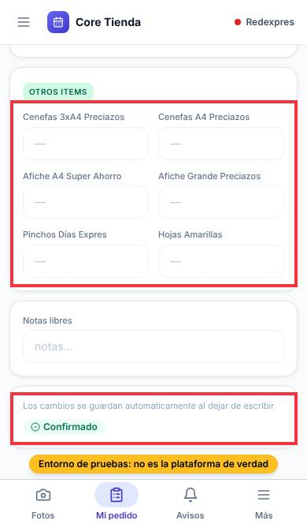
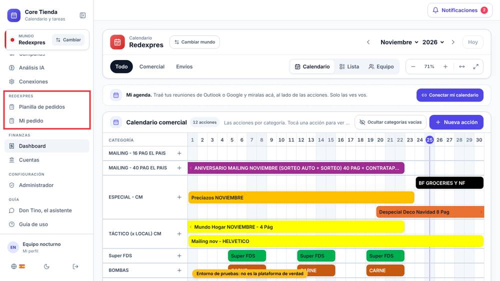
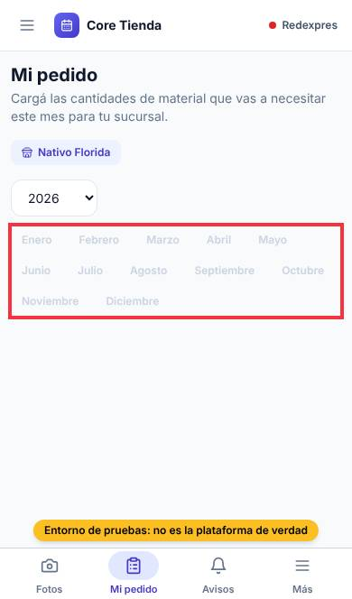
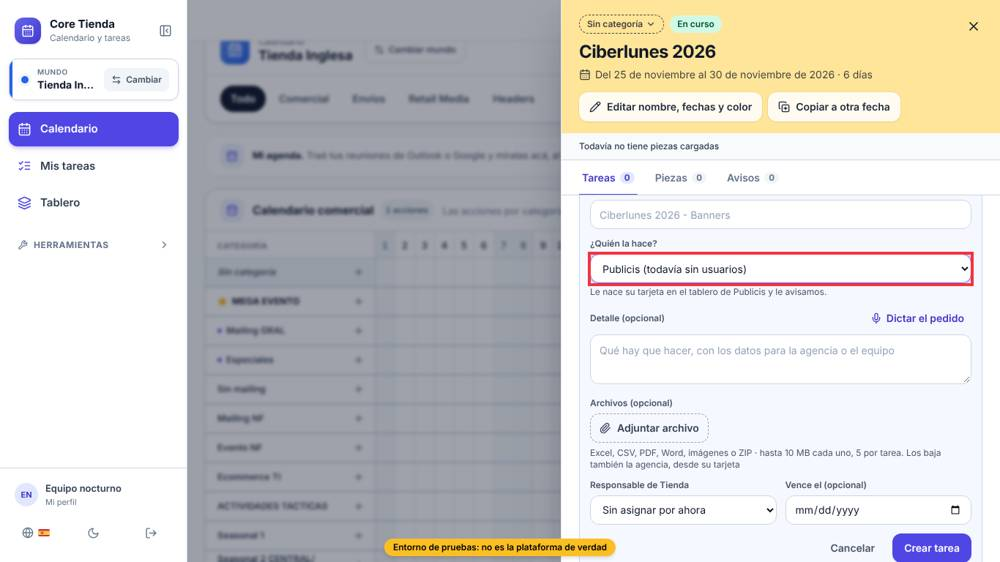
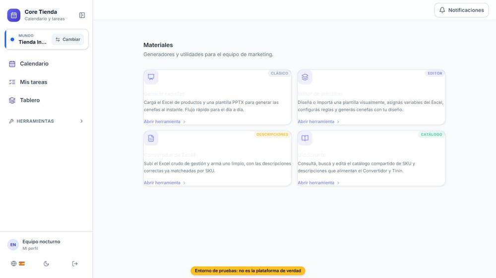
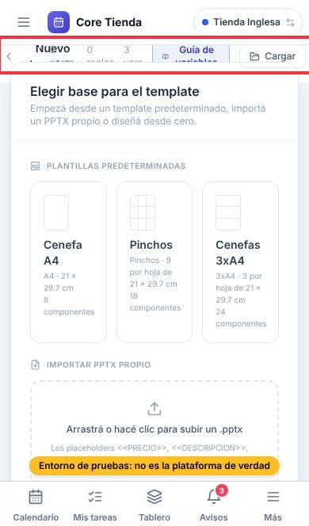
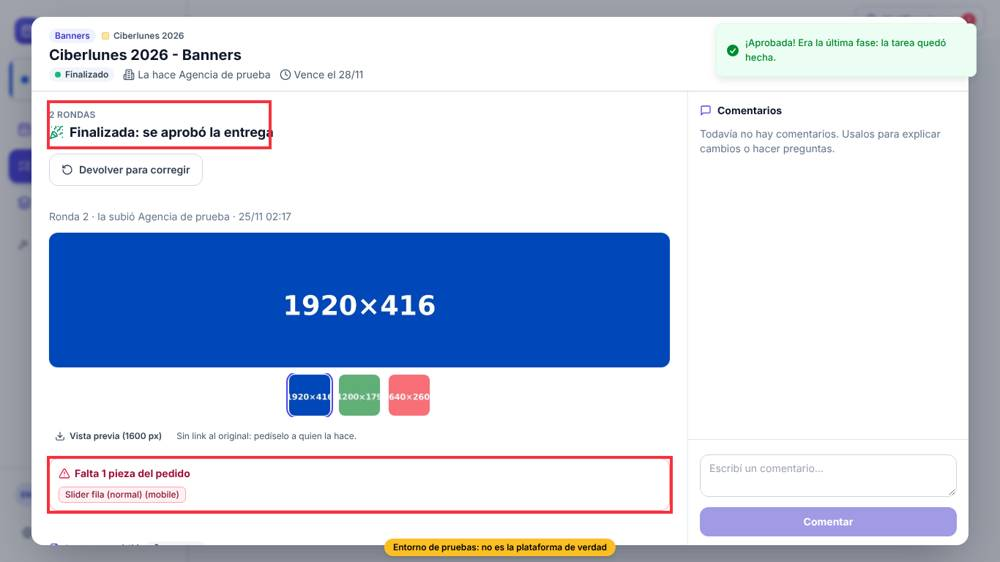

# Cuaderno del Equipo nocturno de Core Tienda

Todo lo que una persona notaría usando Core Tienda, encontrado recorriendo la
plataforma con las cuentas del equipo, la agencia y un local. Lo mantiene el
Equipo nocturno cada noche (ver `.claude/skills/cuaderno-de-hallazgos/SKILL.md`
en `main`). Gravedad: 🔴 bloquea · 🟠 traba · 🟡 desprolijo · ⚪ detalle.

**Resumen:** 34 abiertos (24 confirmados, 10 para confirmar) · 0 en curso · 1 hecho · 0 descartados. Última noche: 25/11/2026 (miércoles, locales y Redexpres): 16 nuevos (🟠 6 · 🟡 9 · ⚪ 1).

> Arranque (24/11/2026): los confirmados salen del primer recorrido de prueba
> del entorno y de leer el código; los «para confirmar» salen del mapa de la
> plataforma (`docs/equipo-nocturno/plataforma/`) y hay que verlos en la
> pantalla antes de trabajarlos.

## En curso

_Nada._ (La rama de anoche ya está en `main`: ver Hechos.)

## Abiertos (de más a menos importante)

> Orden del 25/11: arriba el paquete propuesto para la noche (Redexpres: H-020, H-021, H-009); después por gravedad × gente × frecuencia ÷ esfuerzo; al final los «para confirmar».

### H-020 · Después de confirmar el pedido, queda trancado sin decirlo y sin saber cómo corregir
- **Gravedad:** 🟠 Traba · **Quién:** local · **Dónde:** Mi pedido `/redexpres/mi-pedido`, celular claro
- **Qué ve una persona:** toca «Confirmar pedido» y se confirma de una (sin «¿seguro?»). Después los campos se ven exactamente igual que antes, pero al tocarlos no se puede escribir; abajo sigue diciendo «Los cambios se guardan automáticamente al dejar de escribir». Nada dice que ya no se puede cambiar ni a quién pedirle que lo abra.
- **Por qué importa:** el encargado que se equivocó en un número (o confirmó sin querer con el pulgar) queda trabado y no sabe a quién llamar; parece que la pantalla se colgó.
- **Cómo repetirlo:** equipo en Redexpres crea el mes en la Planilla. Local de prueba (celular) → Mi pedido → escribir cantidades → «Confirmar pedido» → tocar un campo e intentar escribir.
- **Evidencia:**  · los campos están bloqueados pero sin cambio visible.
- **Idea de arreglo:** pedir confirmación antes, y después mostrar los campos como bloqueados con un texto «Ya lo confirmaste. Si tenés que cambiar algo, pedile a <quién> que lo vuelva a abrir».
- **Prueba a ciegas (Martina, 25/11):** abandonó. Tocó el 300 y escribió 30: no cambió, «números grisecitos», nada dice que está bloqueado; Notas libres tampoco deja; en «Más» no hay cómo pedir el cambio → «le mando un WhatsApp a marketing». Pidió un cartel «Ya confirmaste; para cambiarlo pedíselo a marketing». 
- **Visto:** 25/11 (Martina a ciegas)

### H-021 · La Planilla de Redexpres está escondida al fondo de Herramientas, debajo de Medios
- **Gravedad:** 🟠 Traba · **Quién:** equipo de Redexpres · **Dónde:** menú lateral en el mundo Redexpres, notebook claro
- **Qué ve una persona:** en el mundo Redexpres el menú muestra Calendario, Mis tareas, Tablero y Colocación. Para llegar a «Planilla de pedidos» hay que abrir «Herramientas» y bajar pasando Cenefas, Convertidor, Dashboard, Analytics GA4, Campañas, Análisis IA y Conexiones. Además hay dos «Dashboard» (uno en Medios y otro en Finanzas).
- **Por qué importa:** la planilla mensual es lo central de Redexpres y la persona la tiene que buscar cada vez; el doble «Dashboard» confunde.
- **Cómo repetirlo:** equipo → Cambiar → Redexpres → buscar la planilla de pedidos desde el menú.
- **Evidencia:** 
- **Idea de arreglo:** en el mundo Redexpres, «Planilla de pedidos» arriba, junto a Colocación.
- **Prueba a ciegas (Martina, 25/11):** lo logró con dificultad, 11 pasos (~5 dando vueltas): ningún «Pedidos» en el menú, entró a Cenefas creyendo que era el material, el menú corta en «Campañas» y no se nota que sigue; recién al fondo, abajo de Medios, encontró «Planilla de pedidos». La planilla en sí se entendió («1/60 confirmados», fila confirmada distinguible). Detalle: en las celdas vacías de otros locales aparecen cajitas editables y da miedo tocar algo. 
- **Visto:** 25/11 (Martina a ciegas)

### H-009 · Sin mes abierto, el local y la planilla muestran doce meses apagados y nada más
- **Gravedad:** 🟠 Traba · **Quién:** local, equipo de Redexpres · **Dónde:** Mi pedido `/redexpres/mi-pedido` (celular) y Planilla `/redexpres/planilla` (notebook)
- **Qué ve una persona:** el local entra a Mi pedido y ve su sucursal y doce meses en gris clarito (contraste 1,4:1); tocarlos no hace nada y no hay ningún texto que diga que el mes todavía no se abrió ni a quién avisarle. En la Planilla, lo mismo: meses punteados y la pantalla en blanco; tocar un mes punteado crea el mes de una, sin preguntar.
- **Por qué importa:** el encargado cree que la pantalla está rota; el gestor puede abrir un mes equivocado con un toque.
- **Cómo repetirlo:** base sin meses de Redexpres → local de prueba → Mi pedido; equipo en Redexpres → Herramientas → Planilla de pedidos.
- **Evidencia:**   · contraste medido 1,4:1 en los meses.
- **Pendiente de ver:** el Excel con «Confirmar pedido» en vez de «Confirmado» y el «Guardando…» sin fin cuando falla un guardado (no se probaron hoy). Escribir y salir enseguida de Mi pedido **ya no pierde lo escrito** (25/11).
- **Idea de arreglo:** usar el texto de «todavía no hay meses» que ya existe y pedir confirmación al crear un mes tocándolo.
- **Lucía (25/11):** en notebook los meses no abiertos se ven igual de apagados.
- **Visto:** 24/11 (código) · 25/11 (confirmado en pantalla) (Lucía)

### H-001 · Borrar una acción o una tarea borra las imágenes y los ZIP que entregó la agencia
- **Gravedad:** 🔴 Bloquea (rompe la regla «las imágenes de las entregas no se borran nunca») · **Quién:** equipo · **Dónde:** ficha de la acción (Eliminar) y tarea («Borrar con sus entregas»), `/calendario`
- **Qué ve una persona:** el aviso de borrar una acción dice «N tareas»; el de una tarea dice «Borrar con sus entregas». Ninguno dice que se van también las imágenes y ZIP que mandó la agencia, que son el histórico.
- **Por qué importa:** se pierde para siempre el histórico que tiene que ir a SharePoint, con un clic.
- **Cómo repetirlo:** crear acción → tarea para la agencia → la agencia entrega imágenes → borrar la acción → las imágenes ya no existen en la base.
- **Evidencia:** confirmado en el código: `ondelete="CASCADE"` en `backend/app/models/entregas.py` (entregas, versiones, imágenes y ZIP de la versión) y en `backend/app/models/calendario.py` (tareas de la acción).
- **Idea de arreglo:** no dejar borrar una acción o tarea que ya tiene entregas (ofrecer cancelarla o archivarla), del lado del servidor y con su prueba. Sin migración.
- **Visto:** 24/11 (código)

### H-019 · Una foto panorámica de la góndola no se puede mandar, y el error no se entiende
- **Gravedad:** 🟠 Traba · **Quién:** local · **Dónde:** Fotos para subir `/fotos`, celular claro
- **Qué ve una persona:** el encargado saca una foto apaisada de la góndola entera y arriba sale en rojo «La miniatura es demasiado chica (240×52).». No sabe qué es «miniatura» ni qué tiene que hacer distinto; la foto no se manda.
- **Por qué importa:** para mostrar una góndola o una cabecera larga lo natural es la foto panorámica; el local se queda sin poder cumplir el pedido y sin explicación (y marketing lo ve como atrasado).
- **Cómo repetirlo:** equipo en Redexpres → acción → pestaña Fotos → «Pedir foto a 1 local». Local de prueba (celular) → Fotos → subir una imagen de 3000×600 o 1920×416 (más ancha que ~3,75 a 1). Con 1600×1200 anda bien («¡Listo! Tu foto se envió a marketing.»).
- **Evidencia:** 
- **Idea de arreglo:** que la miniatura de una foto muy ancha no quede por debajo del mínimo (o no aplicarle el mínimo), y que cualquier rechazo diga qué hacer en criollo («Sacala de nuevo un poco más de cerca»).
- **Visto:** 25/11

### H-025 · En el celular, el muñequito de Don Tino tapa «Más» en la barra de abajo
- **Gravedad:** 🟠 Traba · **Quién:** equipo · **Dónde:** `/materiales/convertidor`, `/precios`, `/analytics`, `/facturacion`, `/materiales/cenefas`, celular
- **Qué ve una persona:** el botón flotante de Don Tino queda encima de «Más», el último botón de la barra de abajo; en Finanzas el asistente es otro dibujo.
- **Por qué importa:** «Más» es la puerta al resto del menú en el celular; tocarlo abre el chat en vez del menú.
- **Cómo repetirlo:** equipo en el celular → Convertidor de Excel → mirar la barra de abajo.
- **Evidencia:** 
- **Idea de arreglo:** subir el botón flotante por encima de la barra de abajo en el celular.
- **Visto:** 25/11 (Lucía)

### H-010 · El local entra a Don Tino y no a lo suyo
- **Gravedad:** 🟠 Traba · **Quién:** local · **Dónde:** al entrar (`/home`), celular claro
- **Qué ve una persona:** al entrar, «Hola, Local 👋 — Don Tino está listo para ayudarte» y abajo «Asistente con IA real · Powered by Claude Sonnet 5» (en inglés). Nada de su pedido del mes ni de la foto que le pidieron: tiene que saber que eso está en la barra de abajo (Fotos, Mi pedido). La barra de abajo sí está (no se confirma «sin barra»).
- **Por qué importa:** el encargado entra con poco tiempo a hacer una cosa (pedido o foto) y lo primero que ve es un chat.
- **Cómo repetirlo:** entrar con local-de-prueba en el celular.
- **Evidencia:** 
- **Pendiente de ver:** el cambio de contraseña en Mi perfil que siempre falla.
- **Idea de arreglo:** que el local entre a «Fotos para subir» (si tiene alguna pendiente) o a «Mi pedido».
- **Visto:** 24/11 (barrido) · 25/11 (confirmado en pantalla)

### H-018 · Al crear una tarea, la agencia con usuarios no aparece en «¿Quién la hace?»
- **Gravedad:** 🟠 Traba · **Quién:** equipo · **Dónde:** ficha de la acción → «Crear tarea» → «¿Quién la hace?», notebook
- **Qué ve una persona:** la lista ofrece «Publicis (todavía sin usuarios)», «Another Monday (todavía sin usuarios)», «Diseñadores (todavía sin usuarios)» y «Equipo nocturno (vos)». «Agencia de prueba», que sí tiene cuenta, no está; recién aparece al desplegar la tarea ya creada, y cambiarla pide un aviso («Se la sacás a Publicis…»).
- **Por qué importa:** cualquier agencia nueva (o una que no sea de las tres) obliga a crear la tarea para otra y después reasignarla: pasos de más y un aviso que no le corresponde a nadie.
- **Cómo repetirlo:** equipo → acción → Crear tarea → Banners → abrir «¿Quién la hace?».
- **Evidencia:** 
- **Visto:** 24/11 (código) · 25/11 (confirmado en pantalla)

### H-026 · En Campañas, Analytics y Conexiones el menú no marca dónde estás
- **Gravedad:** 🟠 Traba · **Quién:** equipo · **Dónde:** `/campaigns`, `/canales`, `/settings`, notebook
- **Qué ve una persona:** la opción marcada queda fuera de vista en el menú (más abajo, sin bajar); además «Herramientas» aparece abierto en unas pantallas y cerrado en otras.
- **Por qué importa:** la persona no sabe en qué pantalla está ni cómo volver; el menú cambia de forma de una pantalla a otra.
- **Cómo repetirlo:** equipo → /campaigns en 1366×768.
- **Evidencia:** 
- **Visto:** 25/11 (Lucía)

### H-002 · En la portada de Materiales no se leen los nombres de las herramientas
- **Gravedad:** 🟠 Traba · **Quién:** equipo · **Dónde:** Materiales `/materiales`, notebook y celular, claro
- **Qué ve una persona:** cuatro tarjetas con la descripción bien visible pero el título («Generar cenefas», «Editor de plantillas», «Convertidor de Excel», «Diccionario») blanco sobre blanco: casi invisible. Además, a esta portada no se llega desde ningún menú.
- **Por qué importa:** la persona tiene que adivinar qué tarjeta es cuál leyendo la letra chica.
- **Cómo repetirlo:** equipo → ir a `/materiales` en modo claro.
- **Evidencia:**  · contraste medido 1,1:1 (el mínimo es 4,5:1).
- **Visto:** 24/11 · 25/11 (sigue en claro; en oscuro los títulos sí se leen)

### H-027 · Editor de cenefas en el celular: la barra de arriba se encima y se corta
- **Gravedad:** 🟠 Traba · **Quién:** equipo · **Dónde:** Editor de plantillas `/materiales/cenefas/v2`, celular
- **Qué ve una persona:** los botones de arriba («Nuevo», contadores, «Guía de variables», «Cargar») se pisan y quedan cortados.
- **Por qué importa:** no se puede usar el editor desde el celular.
- **Cómo repetirlo:** equipo en el celular → /materiales/cenefas/v2.
- **Evidencia:** 
- **Visto:** 25/11 (Lucía)

### H-024 · Al marcar algo en la imagen, la imagen se va de la vista
- **Gravedad:** 🟡 Desprolijo · **Quién:** equipo · **Dónde:** «Revisar ahora» en la ficha de la tarjeta, notebook 1366×768
- **Qué ve una persona:** toca la imagen para marcar «Precio más grande»; la ventana baja sola hasta el campo de la marca y la mitad izquierda queda en blanco: ya no ve la imagen ni dónde puso la marca mientras escribe.
- **Por qué importa:** revisar es comparar lo que se ve con lo que se escribe; hay que subir y bajar para cada marca.
- **Cómo repetirlo:** equipo → Mis tareas → Para revisar → Revisar ahora → tocar la imagen.
- **Evidencia:** 
- **Idea de arreglo:** que la imagen quede fija a la izquierda mientras se escribe la marca.
- **Visto:** 25/11

### H-023 · Una entrega aprobada sigue mostrando en rojo «Falta 1 pieza del pedido»
- **Gravedad:** 🟡 Desprolijo · **Quién:** equipo, agencia · **Dónde:** ficha de la tarjeta `/entregas?tarea=…`, notebook claro
- **Qué ve una persona:** arriba «Finalizada: se aprobó la entrega» con papel picado; abajo, el recuadro rojo «Falta 1 pieza del pedido». No se sabe si está terminada o no.
- **Por qué importa:** mensajes que se contradicen hacen dudar de lo aprobado (y de si hay que pedir la pieza que falta).
- **Cómo repetirlo:** ciclo completo entregando sin la pieza «Slider fila (mobile)» → Aprobar.
- **Evidencia:** 
- **Idea de arreglo:** una vez aprobada, mostrarlo como dato gris («Se aprobó sin: …»), no como alerta roja.
- **Visto:** 25/11

### H-022 · En la tarea, quién la hace y el responsable se ven cortados
- **Gravedad:** 🟡 Desprolijo · **Quién:** equipo · **Dónde:** ficha de la acción, tarea desplegada, `/calendario`, notebook 1366×768
- **Qué ve una persona:** los selectores dicen «La agencia (Publ», «Agencia de pruel» y «Responsable: Equipo» (cortados), justo lo que hay que confirmar de un vistazo.
- **Por qué importa:** quién hace la pieza es el dato clave de la tarea; cortado se lee mal y se ve poco profesional.
- **Cómo repetirlo:** equipo → acción → crear tarea para una agencia → desplegar la tarea.
- **Evidencia:** 
- **Visto:** 25/11

### H-004 · El nombre del mundo se corta y hay dos botones para cambiarlo
- **Gravedad:** 🟡 Desprolijo · **Quién:** equipo · **Dónde:** menú lateral y encabezado del calendario, notebook 1366×768
- **Qué ve una persona:** en el menú dice «Tienda In…» (cortado) con un botón «Cambiar»; al lado, el encabezado del calendario tiene otro botón «Cambiar mundo».
- **Por qué importa:** el mundo es lo primero que hay que saber (qué estoy mirando) y está cortado; dos botones para lo mismo confunden.
- **Cómo repetirlo:** equipo → Tienda Inglesa → `/calendario` en 1366×768.
- **Evidencia:** 
- **Visto:** 24/11 · 25/11 (Lucía: «Tienda In…» cortado en todas las pantallas del equipo, también en oscuro)

### H-003 · Tres carteles distintos para decir «esto no es para vos»
- **Gravedad:** 🟡 Desprolijo · **Quién:** local, agencia, equipo con permisos limitados · **Dónde:** pantallas sin acceso (por ejemplo `/admin`, `/calendario`, `/entregas`, `/precios` con la cuenta del local)
- **Qué ve una persona:** a veces un candado con título, explicación y botón «Volver al inicio»; a veces un escudo rojo con una línea chica y sin botón («No tenés acceso al calendario»); a veces «Los precios no son de Redexpres» con otro dibujo. Parecen tres aplicaciones distintas.
- **Por qué importa:** se ve poco profesional y, donde no hay botón, la persona queda sin salida.
- **Cómo repetirlo:** entrar con la cuenta del local y abrir `/admin`, `/calendario` y `/precios`.
- **Evidencia:** 
- **Idea de arreglo:** un solo cartel (el del candado, con botón) para todas.
- **Visto:** 24/11 · 25/11 (sigue: en el local, /calendario, /mis-tareas y /entregas con escudo rojo sin botón; /mis-tareas dice «No tenés acceso al calendario.») (Lucía: en el local, Convertidor y /materiales dicen «No tenés acceso a las cenefas»; Diccionario «El diccionario no es de Redexpres» con otro dibujo y sin botón; hojas local-celular-claro-3 y local-notebook-oscuro-3)

### H-017 · Las pantallas viejas parecen otra aplicación (dos estilos visuales)
- **Gravedad:** 🟡 Desprolijo · **Quién:** todos · **Dónde:** pantallas viejas (medios, materiales) vs. nuevas (calendario)
- **Sospecha (código):** botón principal en degradé en las viejas y liso en las nuevas; campos que hacen que el iPhone agrande la página; textos de poco contraste en las viejas.
- **Fuente:** `plataforma/entrada-admin-diseno.md`, sistema visual.
- **Confirmado (Lucía, 25/11):** cuatro estilos de encabezado (con ícono de color variable / sin ícono / centrado / con flecha atrás) y botón en degradé en Conexiones. Las nuevas (calendario, mis tareas, tablero, colocación, fotos, mi pedido) son una familia prolija; medios, finanzas y cenefas v2 parecen otra aplicación. Hojas equipo-notebook-claro-1 a 4.
- **Visto:** 24/11 (código) · 25/11 (Lucía)

### H-029 · En el calendario compiten dos botones principales iguales
- **Gravedad:** 🟡 Desprolijo · **Quién:** equipo · **Dónde:** `/calendario`, notebook
- **Qué ve una persona:** «Conectar mi calendario» y «Nueva acción» tienen el mismo botón violeta lleno; también dice «1 acciones».
- **Por qué importa:** no queda claro cuál es la acción principal de la pantalla más usada.
- **Cómo repetirlo:** equipo → /calendario con una acción en el mes.
- **Evidencia:** hoja equipo-notebook-claro-1 (Lucía: V4-calendario-dos-principales)
- **Visto:** 25/11 (Lucía)

### H-031 · Las pantallas vacías tienen cinco estilos distintos
- **Gravedad:** 🟡 Desprolijo · **Quién:** equipo · **Dónde:** Campañas, Analytics, Conexiones, Finanzas, Colocación…
- **Qué ve una persona:** cada pantalla vacía se ve distinta; la de Colocación es la buena (explica y ofrece el paso). En Campañas el texto está a 1,5:1; los botones desactivados son violeta lavado sin decir qué falta.
- **Por qué importa:** una pantalla vacía tiene que explicar qué va ahí; así parecen rotas.
- **Cómo repetirlo:** equipo → /campaigns, /settings, /facturacion, /colocacion.
- **Evidencia:** hoja equipo-notebook-claro-2 del barrido; contraste 1,5:1 medido
- **Visto:** 25/11 (Lucía)

### H-028 · El Dashboard de medios mezcla inglés y textos con errores
- **Gravedad:** 🟡 Desprolijo · **Quién:** equipo · **Dónde:** `/dashboard`, notebook y celular
- **Qué ve una persona:** «últimos 30D días», «Miércoles 25 De Noviembre», «0.00x», «Auto-sync activo», «Sync datos» al lado de «Sincronizar ahora».
- **Por qué importa:** se ve armado de apuro; no es el vocabulario de la gente.
- **Cómo repetirlo:** equipo → /dashboard.
- **Evidencia:** hoja equipo-notebook-claro-1 del barrido (Lucía: V5-dashboard-en-ingles)
- **Visto:** 25/11 (Lucía)

### H-030 · Finanzas vacía ofrece «Subir factura» cuando primero hay que crear una cuenta
- **Gravedad:** 🟡 Desprolijo · **Quién:** equipo · **Dónde:** `/facturacion`, notebook
- **Qué ve una persona:** el botón grande es «Subir factura»; lo que hay que hacer primero («Crear la primera cuenta») es un link chiquito.
- **Por qué importa:** la persona empieza por el paso equivocado.
- **Cómo repetirlo:** equipo → /facturacion con la base vacía.
- **Evidencia:** hoja equipo-notebook-claro-2 (Lucía: V6-finanzas-vacio)
- **Visto:** 25/11 (Lucía)

### H-032 · Cenefas en el celular: tarjetas angostas con texto cortado
- **Gravedad:** 🟡 Desprolijo · **Quién:** equipo · **Dónde:** `/materiales/cenefas`, celular
- **Qué ve una persona:** las tres tarjetas de tipo de cenefa quedan angostas y el texto se corta.
- **Por qué importa:** no se lee qué es cada tipo.
- **Cómo repetirlo:** equipo en el celular → /materiales/cenefas.
- **Evidencia:** hoja equipo-celular-claro-2 (Lucía: V8-cenefas-tarjetas-celular)
- **Visto:** 25/11 (Lucía)

### H-033 · Conexiones en modo oscuro: un cuadro «+» blanco
- **Gravedad:** 🟡 Desprolijo · **Quién:** equipo · **Dónde:** `/settings`, notebook oscuro
- **Qué ve una persona:** el cuadro vacío con «+» queda blanco y brilla sobre el fondo oscuro.
- **Por qué importa:** rompe el modo oscuro.
- **Cómo repetirlo:** equipo, modo oscuro → /settings.
- **Evidencia:** hoja equipo-notebook-oscuro (Lucía: V7-conexiones-oscuro)
- **Visto:** 25/11 (Lucía)

### H-034 · El local y la agencia ven «Calendario y tareas» bajo el logo sin tener calendario
- **Gravedad:** ⚪ Detalle · **Quién:** local, agencia · **Dónde:** menú lateral; Mi perfil en el celular
- **Qué ve una persona:** debajo de «Core Tienda» dice «Calendario y tareas»; en Mi perfil de la agencia en el celular el mail se corta.
- **Por qué importa:** promete algo que no tienen.
- **Cómo repetirlo:** entrar con la agencia o el local.
- **Evidencia:** hojas agencia-notebook-claro-1, local-notebook-claro-2
- **Visto:** 25/11 (Lucía)

### H-005 · Para confirmar: cualquiera del equipo aprueba una pieza arrastrándola, sin aviso
- **Gravedad:** 🟠 · **Quién:** equipo, agencia · **Dónde:** tablero `/entregas`
- **Sospecha (código):** arrastrar de «Esperando feedback» a «Finalizado» la da por aprobada aunque quien arrastra no sea aprobador, y no se le avisa a nadie (ni a la agencia). Arrastrarla a «En proceso» no le dice a la agencia qué cambiar.
- **Fuente:** `plataforma/calendario-tareas-entregas.md`, tablero y recorrido 8.

### H-006 · Para confirmar: errores que se ven como «no hay nada»
- **Gravedad:** 🟠 · **Quién:** equipo, agencia · **Dónde:** campanita, tablero, archivos de una tarea
- **Sospecha (código):** si falla la carga, la campanita dice «Todavía no tenés notificaciones»; el tablero no avisa si se corta la conexión; los archivos de una tarea no muestran nada.
- **Fuente:** `plataforma/calendario-tareas-entregas.md`.

### H-007 · Para confirmar: el responsable de Tienda queda a ciegas, y Copiar avisa sin decirlo
- **Gravedad:** 🟠 · **Quién:** equipo · **Dónde:** tarea, vista Equipo, «Copiar a otra fecha»
- **Sospecha (código):** el responsable de Tienda no recibe aviso cuando la agencia entrega ni cuando se aprueba, y la vista Equipo no cuenta esa carga. «Copiar a otra fecha» crea tarjetas a la agencia y le avisa en el momento sin decirlo en el cuadro; los archivos del pedido no se copian.
- **Fuente:** `plataforma/calendario-tareas-entregas.md`.

### H-008 · Para confirmar: Generar cenefas muestra «Error desconocido» y sigue consultando sin fin
- **Gravedad:** 🔴 · **Quién:** equipo · **Dónde:** `/materiales/cenefas/v2/generar`
- **Sospecha (código):** el servidor deja cada generación esperando confirmación, pero la pantalla lo muestra como «Error en la generación — Error desconocido» y sigue preguntando; la pieza que confirmaba (`PreviewStep.tsx`) no se usa.
- **Fuente:** `plataforma/materiales-precios-locales.md`.

### H-011 · Para confirmar: en Administración uno se puede dejar afuera a sí mismo
- **Gravedad:** 🟠 · **Quién:** admin · **Dónde:** `/admin`
- **Sospecha (código):** el superadmin puede desactivarse a sí mismo; cambiar el rol en la fila borra sin avisar los permisos ajustados a mano. (Probalo con una cuenta descartable, nunca con Equipo nocturno.)
- **Fuente:** `plataforma/entrada-admin-diseno.md`.

### H-012 · Para confirmar: el bloqueo del login vuelve con un solo error
- **Gravedad:** 🟠 · **Quién:** todos · **Dónde:** `/login`
- **Sospecha (código):** pasados los 15 minutos de bloqueo, un error más vuelve a bloquear; el mail tiene que coincidir exacto (mayúsculas y espacios).
- **Fuente:** `plataforma/entrada-admin-diseno.md`.

### H-013 · Para confirmar: Conexiones ofrece lo que no se puede hacer y miente el error
- **Gravedad:** 🟠 · **Quién:** equipo con rol Usuario · **Dónde:** `/settings`
- **Sospecha (código):** quien solo puede ver tiene «Nueva conexión» y el tacho; cuando el servidor dice que no, la pantalla dice «Contraseña incorrecta».
- **Fuente:** `plataforma/entrada-admin-diseno.md`.

### H-014 · Para confirmar: lo que explica la plataforma está viejo
- **Gravedad:** 🟡 · **Quién:** todos · **Dónde:** Guía de uso `/ayuda`, Don Tino, `/login`
- **Sospecha (código):** la Guía no menciona calendario, tareas ni tablero; Don Tino se presenta como «MKTG Platform» con «19 permisos» (son 32); el login vende medios, precios y cenefas.
- **Fuente:** `plataforma/entrada-admin-diseno.md`.

### H-015 · Para confirmar: links de Cenefas que llevan a donde no se puede entrar
- **Gravedad:** 🟡 · **Quién:** equipo (no superadmin) · **Dónde:** `/materiales/cenefas`
- **Sospecha (código):** «Informe» y «Lo que aprendió» se ven para todos pero son solo de superadmin; a los demás los devuelve sin explicación.
- **Fuente:** `plataforma/materiales-precios-locales.md`.

### H-016 · Para confirmar: Validación de redes deja borrar lo ajeno
- **Gravedad:** 🟡 · **Quién:** equipo · **Dónde:** `/redes-sociales/validacion`
- **Sospecha (código):** el tacho aparece en validaciones de otras personas; si el borrado falla, toda la lista dice «No se pudo cargar el historial».
- **Fuente:** `plataforma/materiales-precios-locales.md`.

## Hechos

### Mis tareas avisa cuando no pudo traer todo
- **Rama:** `nocturno/2026-11-24-mis-tareas-avisa-fallas` («[Nocturno] Mis tareas avisa cuando no pudo traer todo»).
- **Estado:** en `main` por el PR #54 (merge e20b367), 24/11/2026. Mis tareas ya no dice «Estás al día» cuando no pudo traer las tareas o las piezas para revisar. No resolvía ningún H del cuaderno (Mis tareas no estaba en H-006).

## Descartados (no volver a proponer)

_Nada todavía._
