# Cuaderno del Equipo nocturno de Core Tienda

Todo lo que una persona notaría usando Core Tienda, encontrado recorriendo la
plataforma con las cuentas del equipo, la agencia y un local. Lo mantiene el
Equipo nocturno cada noche (ver `.claude/skills/cuaderno-de-hallazgos/SKILL.md`
en `main`). Gravedad: 🔴 bloquea · 🟠 traba · 🟡 desprolijo · ⚪ detalle.

**Resumen:** 76 abiertos (71 confirmados, 5 para confirmar) · 0 en curso · 5 hechos · 0 descartados. Última noche: 25/11/2026, auditoría completa sin cambios de código: 46 nuevos (🟠 12 · 🟡 24 · ⚪ 10), 22 siguen pasando, 4 ya no pasan. Informe: [`auditoria-2026-11-25/INFORME.md`](auditoria-2026-11-25/INFORME.md).

> Arranque (24/11/2026): los confirmados salen del primer recorrido de prueba
> del entorno y de leer el código; los «para confirmar» salen del mapa de la
> plataforma (`docs/equipo-nocturno/plataforma/`) y hay que verlos en la
> pantalla antes de trabajarlos.

## En curso

_Nada: el paquete Redexpres (H-020, H-021, H-009) entró a `main` por el PR #68._

## Abiertos (de más a menos importante)

> Orden del 25/11 (auditoría): primero lo que bloquea; después el flujo equipo ↔ agencia (pedir, revisar, entregar, que se usa todos los días), las trabas de cuentas y herramientas, lo visual de base (ver la dirección de diseño en el informe) y al final los detalles y los «para confirmar».

### H-018 · Al crear una tarea, la agencia con usuarios no aparece en «¿Quién la hace?»
- **Gravedad:** 🔴 Bloquea (una persona nueva no logra pedirle trabajo a su agencia) · **Quién:** equipo · **Dónde:** ficha de la acción → «Crear tarea» → «¿Quién la hace?», notebook
- **Qué ve una persona:** la lista ofrece «Publicis (todavía sin usuarios)», «Another Monday (todavía sin usuarios)», «Diseñadores (todavía sin usuarios)» y «Equipo nocturno (vos)». «Agencia de prueba», que sí tiene cuenta, no está; recién aparece al desplegar la tarea ya creada, y cambiarla pide un aviso («Se la sacás a Publicis…»).
- **Por qué importa:** cualquier agencia nueva (o una que no sea de las tres) obliga a crear la tarea para otra y después reasignarla: pasos de más y un aviso que no le corresponde a nadie.
- **Cómo repetirlo:** equipo → acción → Crear tarea → Banners → abrir «¿Quién la hace?».
- **Evidencia:** 
- **Prueba a ciegas (Martina, auditoría 25/11):** abandonó: «¿Cómo le pido algo a la agencia con la que trabajo todos los días?». Pasa también en Tablero → Nueva tarjeta. 
- **Visto:** 24/11 (código) · 25/11 (confirmado en pantalla) · 25/11 (auditoría: sube a 🔴)

### H-001 · Borrar una acción o una tarea borra las imágenes y los ZIP que entregó la agencia
- **Gravedad:** 🔴 Bloquea (rompe la regla «las imágenes de las entregas no se borran nunca») · **Quién:** equipo · **Dónde:** ficha de la acción (Eliminar) y tarea («Borrar con sus entregas»), `/calendario`
- **Qué ve una persona:** el aviso de borrar una acción dice «N tareas»; el de una tarea dice «Borrar con sus entregas». Ninguno dice que se van también las imágenes y ZIP que mandó la agencia, que son el histórico.
- **Por qué importa:** se pierde para siempre el histórico que tiene que ir a SharePoint, con un clic.
- **Cómo repetirlo:** crear acción → tarea para la agencia → la agencia entrega imágenes → borrar la acción → las imágenes ya no existen en la base.
- **Evidencia:** confirmado en el código: `ondelete="CASCADE"` en `backend/app/models/entregas.py` (entregas, versiones, imágenes y ZIP de la versión) y en `backend/app/models/calendario.py` (tareas de la acción).
- **Idea de arreglo:** no dejar borrar una acción o tarea que ya tiene entregas (ofrecer cancelarla o archivarla), del lado del servidor y con su prueba. Sin migración.
- **Auditoría 25/11:** el aviso dice «Se va con ella 1 tarea. No se puede deshacer.» 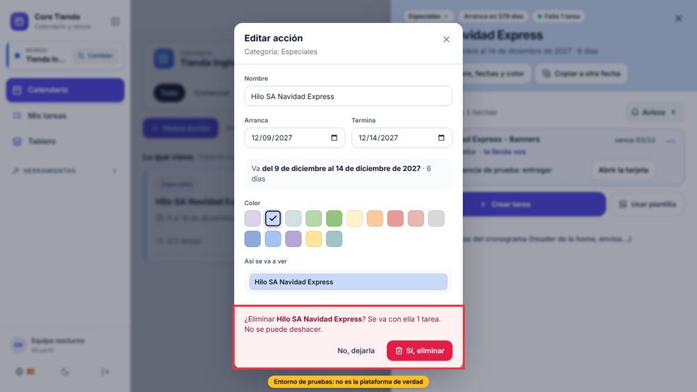
- **Visto:** 24/11 (código) · 25/11 (auditoría)

### H-008 · Generar cenefas (motor v2) termina en «Error desconocido» y la corrida queda colgada
- **Gravedad:** 🔴 Bloquea · **Quién:** equipo · **Dónde:** `/materiales/cenefas/v2/generar`, notebook claro
- **Qué ve una persona:** elige la plantilla del editor, sube el Excel («El CSV está listo para generar», aunque es un Excel), toca «Generar cenefas» y a los 10 s: «Error en la generación — Error desconocido» y solo «Volver al inicio». En el Historial queda «Esperando confirmación», sin descargar ni confirmar.
- **Por qué importa:** no hay forma de terminar la corrida; la plantilla hecha en el editor solo se puede usar acá (H-043).
- **Cómo repetirlo:** Generar cenefas → «Cenefa A4» → subir el Excel de «Descargar plantilla Excel» → Validar → Generar → esperar → `/materiales/cenefas/v2/jobs`.
- **Evidencia:** 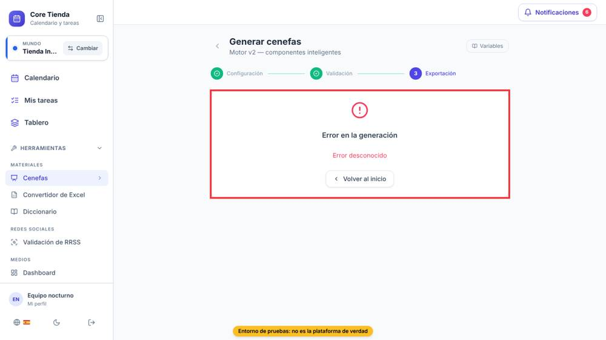
- **Fuente:** `plataforma/materiales-precios-locales.md` (la pieza que confirmaba, `PreviewStep.tsx`, no se usa).
- **Visto:** 24/11 (código) · 25/11 (auditoría: confirmado en pantalla)

### H-035 · Al revisar dice «Ya están todas las piezas del pedido» cuando falta el carrito
- **Gravedad:** 🟠 Traba · **Quién:** equipo · **Dónde:** Revisar la ronda (Mis tareas → Revisar ahora), notebook claro
- **Qué ve una persona:** el pedido es «Header · Carrito» y la agencia mandó solo el header (lo dice en el comentario), pero abajo dice «Ya están todas las piezas del pedido» y el botón grande verde es «Aprobar y terminar».
- **Por qué importa:** quien revisa apurado aprueba y el carrito no llega nunca.
- **Cómo repetirlo:** tarea «Black Friday 2026 - Banners» (Header + Carrito) entregada con una sola imagen 1920×416 → Revisar ahora. Con una tarea creada desde la pantalla, el control previo de la agencia sí avisó lo que faltaba: ver de qué depende.
- **Evidencia:** 
- **Visto:** 25/11 (Martina a ciegas)

### H-036 · «Avanzar» con todo entregado le pide a la agencia «lo que falta», y no falta nada
- **Gravedad:** 🟠 Traba · **Quién:** equipo y agencia · **Dónde:** Revisar la ronda, notebook; agencia en el celular
- **Qué ve una persona:** con todas las piezas en la ronda 2, el link «¿Falta algo? Avanzar» devuelve la tarjeta a la agencia con «Te dieron el OK: entregá lo que falta (ronda 3)». Además los botones cambian de lugar: en la ronda 1 y 3 el verde grande es «Avanzar», en la 2 «Aprobar y terminar».
- **Por qué importa:** una ronda de más y una agencia que no sabe qué mandar.
- **Cómo repetirlo:** la agencia entrega todo en la ronda 2 → equipo «Revisar ahora» → «Avanzar».
- **Evidencia:** 
- **Visto:** 25/11

### H-042 · La agencia no puede sumar la pieza que le faltaba una vez que entregó
- **Gravedad:** 🟠 Traba · **Quién:** agencia · **Dónde:** Mi tablero → tarjeta en «Esperando feedback», celular
- **Qué ve una persona:** mandó el header y quiere mandar el carrito: en la ficha no hay botón para subir y en esa columna no hay «Mover».
- **Por qué importa:** queda esperando que revisen algo incompleto (y por H-035 el equipo ve «ya están todas»). Martina abandonó.
- **Cómo repetirlo:** entregar una sola pieza de un pedido de dos → buscar cómo agregar la segunda.
- **Evidencia:** 
- **Visto:** 25/11 (Martina a ciegas)

### H-037 · Al entregar la corrección, el formulario no recuerda qué había que cambiar
- **Gravedad:** 🟠 Traba · **Quién:** agencia · **Dónde:** ficha → «Entregar ronda 2», celular claro
- **Qué ve una persona:** la marca («El fondo tiene que ser rojo, no verde») queda dos pantallas abajo; el formulario solo dice «Subí la pieza…».
- **Por qué importa:** entrega de memoria; si se olvida un punto, otra ronda.
- **Cómo repetirlo:** tarea devuelta con una marca → agencia (celular) → la tarjeta → Entregar ronda 2.
- **Evidencia:** 
- **Visto:** 25/11

### H-038 · La agencia entra desde el celular y no ve lo que volvió con cambios
- **Gravedad:** 🟠 Traba · **Quién:** agencia · **Dónde:** Mi tablero `/entregas`, celular claro
- **Qué ve una persona:** el tablero abre siempre en «Ingresado»; lo que «Volvió con cambios» está en «En proceso», sin ninguna marca en la pestaña.
- **Por qué importa:** lo más urgente es lo que no ve al entrar.
- **Cómo repetirlo:** el equipo pide cambios → la agencia entra a Mi tablero en el celular.
- **Evidencia:** 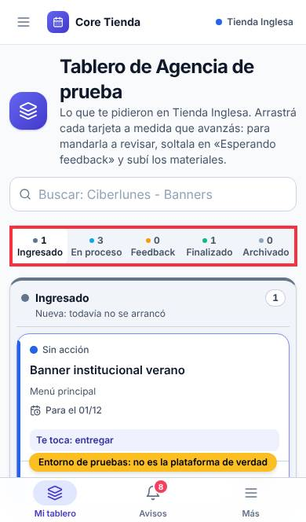
- **Visto:** 25/11

### H-039 · «Atrás» o recargar en medio de una entrega borra todo lo cargado, sin preguntar
- **Gravedad:** 🟠 Traba · **Quién:** agencia (y el equipo al entregar) · **Dónde:** ficha → Entregar, notebook y celular
- **Qué ve una persona:** subió imágenes y escribió el comentario; atrás o F5 → tablero cerrado y todo perdido. Con Escape sí está protegido; al recargar no vuelve a la tarjeta.
- **Por qué importa:** en el celular «atrás» es el gesto natural para cerrar.
- **Cómo repetirlo:** agencia → tarjeta → Entregar → subir imagen y comentario → atrás o F5.
- **Evidencia:** 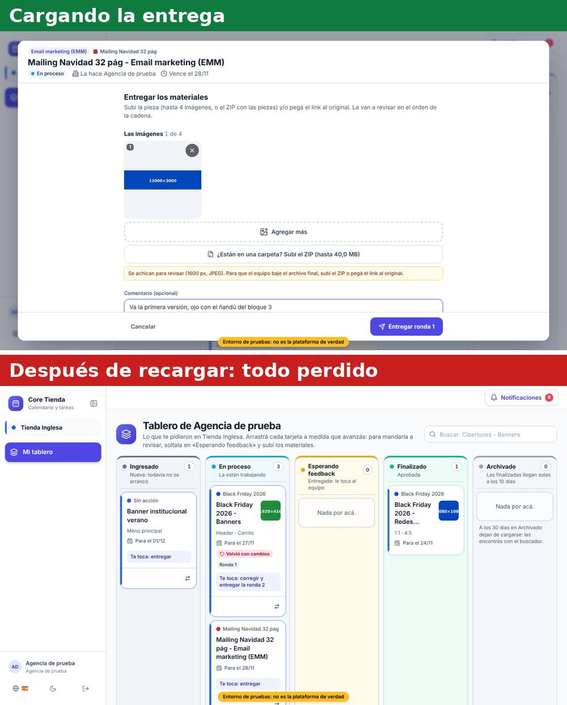
- **Visto:** 25/11 (Ramiro)

### H-040 · El link del mail lleva al login y, después de entrar, no abre la tarea
- **Gravedad:** 🟠 Traba · **Quién:** agencia y equipo · **Dónde:** `/login` desde `/entregas?tarea=…`
- **Qué ve una persona:** toca el link del aviso, entra y cae en el tablero general, sin la tarjeta abierta. Igual cuando la sesión vence trabajando.
- **Por qué importa:** cada aviso por mail termina en buscar la tarjeta a mano.
- **Cómo repetirlo:** sin sesión, abrir `/entregas?tarea=s1304c6e7a0be` → entrar como agencia.
- **Evidencia:** 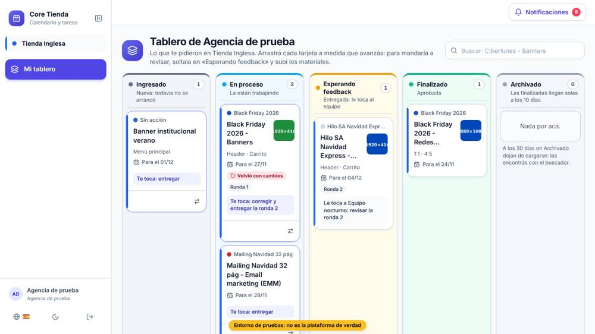
- **Visto:** 25/11 (Ramiro)

### H-010 · El local entra a Don Tino y no a lo suyo
- **Gravedad:** 🟠 Traba · **Quién:** local · **Dónde:** al entrar (`/home`), celular claro
- **Qué ve una persona:** al entrar, «Hola, Local 👋 — Don Tino está listo para ayudarte» y abajo «Asistente con IA real · Powered by Claude Sonnet 5» (en inglés). Nada de su pedido del mes ni de la foto que le pidieron: tiene que saber que eso está en la barra de abajo (Fotos, Mi pedido). La barra de abajo sí está (no se confirma «sin barra»).
- **Por qué importa:** el encargado entra con poco tiempo a hacer una cosa (pedido o foto) y lo primero que ve es un chat.
- **Cómo repetirlo:** entrar con local-de-prueba en el celular.
- **Evidencia:** 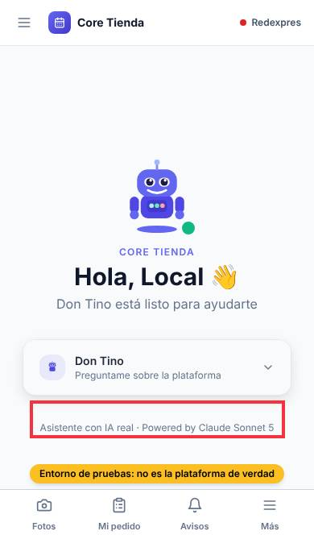
- **Pendiente de ver:** el cambio de contraseña en Mi perfil que siempre falla.
- **Idea de arreglo:** que el local entre a «Fotos para subir» (si tiene alguna pendiente) o a «Mi pedido».
- **Auditoría 25/11:** Martina: «yo vengo a pedir cenefas»; si el local le pregunta a Don Tino «¿qué tengo que hacer hoy?», le dice que pida permiso del calendario. 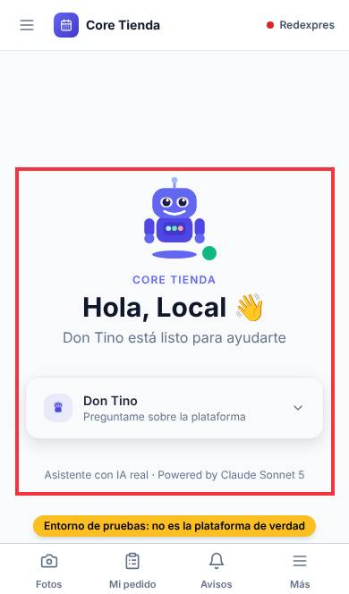
- **Visto:** 24/11 (barrido) · 25/11 (confirmado en pantalla) · 25/11 (auditoría)

### H-041 · A una persona nueva del equipo con rol «Usuario» no le aparece el calendario
- **Gravedad:** 🟠 Traba · **Quién:** jefatura y la persona nueva · **Dónde:** `/admin` → Nuevo usuario, notebook
- **Qué ve una persona:** el rol «Usuario» trae cenefas, analytics, precios y asistentes, pero no «Ver el calendario»; la tarjeta dice «Arranca sin permisos» y «15 permiso» a la vez.
- **Por qué importa:** la persona entra sin Calendario, Mis tareas ni Tablero.
- **Cómo repetirlo:** /admin → Nuevo usuario → Del equipo → Crear → rol Usuario → lápiz → Calendario.
- **Evidencia:** 
- **Visto:** 25/11

### H-025 · El muñequito de Don Tino tapa botones: «Más» en el celular y «Enviar» en La Triada
- **Gravedad:** 🟠 Traba · **Quién:** equipo · **Dónde:** `/materiales/convertidor`, `/precios`, `/analytics`, `/facturacion`, `/materiales/cenefas`, celular
- **Qué ve una persona:** el botón flotante de Don Tino queda encima de «Más», el último botón de la barra de abajo; en Finanzas el asistente es otro dibujo.
- **Por qué importa:** «Más» es la puerta al resto del menú en el celular; tocarlo abre el chat en vez del menú.
- **Cómo repetirlo:** equipo en el celular → Convertidor de Excel → mirar la barra de abajo.
- **Evidencia:** 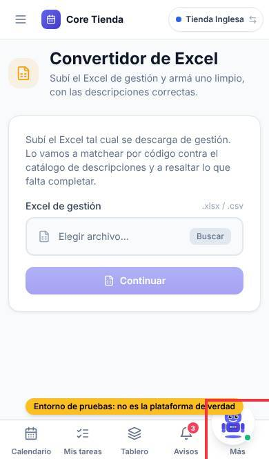
- **Idea de arreglo:** subir el botón flotante por encima de la barra de abajo en el celular.
- **Auditoría 25/11:** en la notebook tapa el botón de enviar del chat de La Triada (`/analytics`). 
- **Visto:** 25/11 (Lucía) · 25/11 (auditoría)

### H-043 · Una plantilla armada en el editor no aparece al hacer cenefas
- **Gravedad:** 🟠 Traba · **Quién:** equipo · **Dónde:** Editor `/materiales/cenefas/v2` y Cenefas → Pruebas, notebook
- **Qué ve una persona:** «Template creado», pero en Cenefas → Elegir plantillas: «Todavía no hay plantillas guardadas». Solo aparece en el motor v2, que falla (H-008).
- **Por qué importa:** tiene que volver a subirla como PPTX.
- **Cómo repetirlo:** editor → Cenefa A4 → Guardar → /materiales/cenefas → Pruebas → Elegir plantillas.
- **Evidencia:** 
- **Visto:** 25/11

### H-044 · En la Planilla de pedidos no hay cómo buscar un local entre 60
- **Gravedad:** 🟠 Traba · **Quién:** equipo de Redexpres · **Dónde:** `/redexpres/planilla`, notebook
- **Qué ve una persona:** 60 filas sin orden ni buscador; el estado al final a la derecha con 59 botones violeta «Confirmar pedido»; nombres largos cortados.
- **Por qué importa:** cada consulta de un local es bajar mirando o Ctrl+F.
- **Cómo repetirlo:** Redexpres → Planilla → Diciembre → buscar «Costa Verde».
- **Evidencia:** 
- **Visto:** 25/11

### H-013 · Conexiones dice «Contraseña incorrecta» aunque la clave está bien
- **Gravedad:** 🟠 Traba · **Quién:** equipo con rol Usuario · **Dónde:** `/settings` → Nueva conexión, notebook
- **Qué ve una persona:** le ofrecen «Nueva conexión» (y el tacho); escribe su contraseña correcta y sale «Contraseña incorrecta». Lo que pasa es que no tiene permiso.
- **Por qué importa:** cree que se equivocó de clave y sigue probando.
- **Cómo repetirlo:** cuenta rol Usuario → /settings → Nueva conexión → datos cualquiera → su clave real → Guardar.
- **Evidencia:** 
- **Visto:** 24/11 (código) · 25/11 (auditoría: confirmado en pantalla)

### H-046 · En Finanzas, «Confirmar» la factura queda gris y no dice qué falta
- **Gravedad:** 🟠 Traba · **Quién:** equipo · **Dónde:** `/facturacion` → Subir factura, notebook
- **Qué ve una persona:** completa todo y «Confirmar» sigue gris; ningún campo marcado obligatorio; se habilita recién al escribir «Concepto», abajo de todo.
- **Por qué importa:** cree que la pantalla no anda.
- **Cómo repetirlo:** Subir factura → PDF → completar todo menos Concepto.
- **Evidencia:** 
- **Visto:** 25/11

### H-045 · Buscar precios muestra un error técnico en inglés y no dice «no encontré nada»
- **Gravedad:** 🟠 Traba · **Quién:** equipo · **Dónde:** `/precios`, notebook
- **Qué ve una persona:** «Búsqueda lista — Encontramos 0 producto(s)» y después «HTTPSConnectionPool(host=…) Max retries exceeded… ProxyError» en naranja. (Sin internet falla igual; importa cómo se muestra.)
- **Por qué importa:** no sabe si no hay resultados o si se rompió.
- **Cómo repetirlo:** /precios → «arroz saman 1kg» → Enter.
- **Evidencia:** 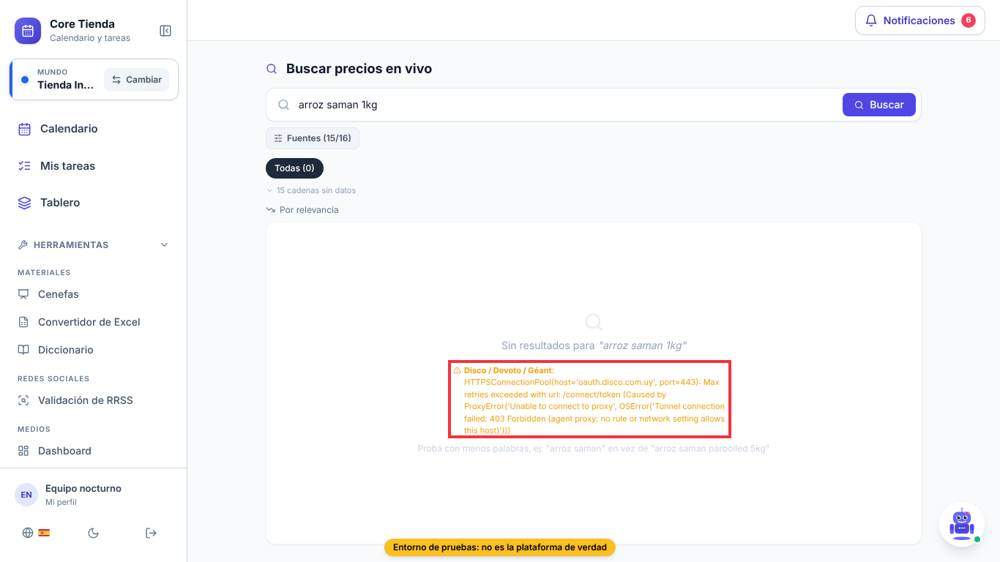
- **Visto:** 25/11

### H-002 · En la portada de Materiales no se leen los nombres de las herramientas
- **Gravedad:** 🟠 Traba · **Quién:** equipo · **Dónde:** Materiales `/materiales`, notebook y celular, claro
- **Qué ve una persona:** cuatro tarjetas con la descripción bien visible pero el título («Generar cenefas», «Editor de plantillas», «Convertidor de Excel», «Diccionario») blanco sobre blanco: casi invisible. Además, a esta portada no se llega desde ningún menú.
- **Por qué importa:** la persona tiene que adivinar qué tarjeta es cuál leyendo la letra chica.
- **Cómo repetirlo:** equipo → ir a `/materiales` en modo claro.
- **Evidencia:**  · contraste medido 1,1:1 (el mínimo es 4,5:1).
- **Auditoría 25/11:** además, el texto de las tarjetas toca el borde (sin margen). 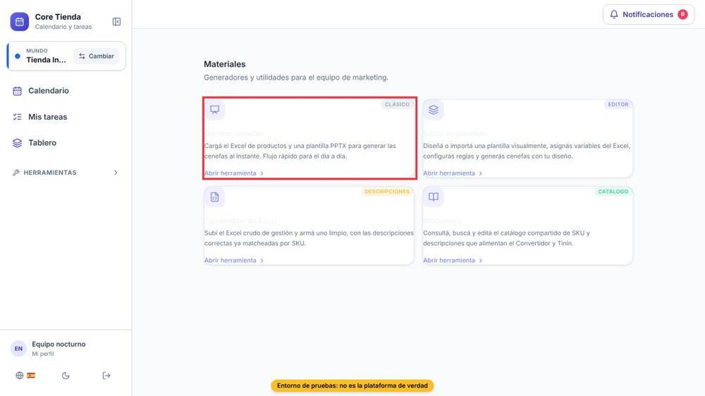
- **Visto:** 24/11 · 25/11 (sigue en claro; en oscuro los títulos sí se leen) · 25/11 (auditoría)

### H-026 · En Campañas, Analytics y Conexiones el menú no marca dónde estás
- **Gravedad:** 🟠 Traba · **Quién:** equipo · **Dónde:** `/campaigns`, `/canales`, `/settings`, notebook
- **Qué ve una persona:** la opción marcada queda fuera de vista en el menú (más abajo, sin bajar); además «Herramientas» aparece abierto en unas pantallas y cerrado en otras.
- **Por qué importa:** la persona no sabe en qué pantalla está ni cómo volver; el menú cambia de forma de una pantalla a otra.
- **Cómo repetirlo:** equipo → /campaigns en 1366×768.
- **Evidencia:** 
- **Visto:** 25/11 (Lucía) · 25/11 (auditoría)

### H-019 · Una foto panorámica de la góndola no se puede mandar, y el error no se entiende
- **Gravedad:** 🟠 Traba · **Quién:** local · **Dónde:** Fotos para subir `/fotos`, celular claro
- **Qué ve una persona:** el encargado saca una foto apaisada de la góndola entera y arriba sale en rojo «La miniatura es demasiado chica (240×52).». No sabe qué es «miniatura» ni qué tiene que hacer distinto; la foto no se manda.
- **Por qué importa:** para mostrar una góndola o una cabecera larga lo natural es la foto panorámica; el local se queda sin poder cumplir el pedido y sin explicación (y marketing lo ve como atrasado).
- **Cómo repetirlo:** equipo en Redexpres → acción → pestaña Fotos → «Pedir foto a 1 local». Local de prueba (celular) → Fotos → subir una imagen de 3000×600 o 1920×416 (más ancha que ~3,75 a 1). Con 1600×1200 anda bien («¡Listo! Tu foto se envió a marketing.»).
- **Evidencia:** 
- **Idea de arreglo:** que la miniatura de una foto muy ancha no quede por debajo del mínimo (o no aplicarle el mínimo), y que cualquier rechazo diga qué hacer en criollo («Sacala de nuevo un poco más de cerca»).
- **Visto:** 25/11

### H-027 · Editor de cenefas en el celular: la barra de arriba se encima y se corta
- **Gravedad:** 🟠 Traba · **Quién:** equipo · **Dónde:** Editor de plantillas `/materiales/cenefas/v2`, celular
- **Qué ve una persona:** los botones de arriba («Nuevo», contadores, «Guía de variables», «Cargar») se pisan y quedan cortados.
- **Por qué importa:** no se puede usar el editor desde el celular.
- **Cómo repetirlo:** equipo en el celular → /materiales/cenefas/v2.
- **Evidencia:** 
- **Visto:** 25/11 (Lucía)

### H-047 · «Otro» y «Otra cosa», uno al lado del otro, al pedir una tarea
- **Gravedad:** 🟡 Desprolijo · **Quién:** equipo · **Dónde:** ficha → Crear tarea; Tablero → Nueva tarjeta, notebook
- **Qué ve una persona:** después de Tótem, «Otro» y «Otra cosa» (marcada de entrada). Nadie sabe la diferencia.
- **Por qué importa:** hace dudar en el primer paso de pedir algo.
- **Cómo repetirlo:** equipo → acción → Crear tarea.
- **Evidencia:** 
- **Visto:** 25/11 (Sofía, Martina y Lucía)

### H-022 · En la tarea, quién la hace y el responsable se ven cortados
- **Gravedad:** 🟡 Desprolijo · **Quién:** equipo · **Dónde:** ficha de la acción, tarea desplegada, `/calendario`, notebook 1366×768
- **Qué ve una persona:** los selectores dicen «La agencia (Publ», «Agencia de pruel» y «Responsable: Equipo» (cortados), justo lo que hay que confirmar de un vistazo.
- **Por qué importa:** quién hace la pieza es el dato clave de la tarea; cortado se lee mal y se ve poco profesional.
- **Cómo repetirlo:** equipo → acción → crear tarea para una agencia → desplegar la tarea.
- **Evidencia:** 
- **Auditoría 25/11:** también en las tarjetas del tablero, pestaña «Otras»: «Agencia de prue…», «Imprenta Gráfic…» (C/100).
- **Visto:** 25/11 · 25/11 (auditoría)

### H-070 · Confirmaciones en la ventanita gris del navegador
- **Gravedad:** 🟡 Desprolijo · **Quién:** equipo, local, jefatura · **Dónde:** cambiar la agencia de una tarea; Confirmar pedido; borrar una cuenta
- **Qué ve una persona:** «localhost dice: Se la sacás a Publicis…», «¿Confirmás el pedido…?», «¿Eliminar a…?» en la caja gris del sistema (en el celular, la de Safari). En el resto, la confirmación va adentro de la pantalla.
- **Por qué importa:** parece un error del navegador; como H-018 obliga a reasignar, sale seguido.
- **Cómo repetirlo:** acción → tarea de Publicis → «Quién la hace» → otra agencia.
- **Evidencia:** la ventanita no sale en las capturas; texto leído en pantalla (Sofía).
- **Visto:** 25/11

### H-059 · El logo de Tienda (la margarita) no aparece: hay tres íconos distintos
- **Gravedad:** 🟡 Desprolijo · **Quién:** todos · **Dónde:** login, Mundos, menú, celular
- **Qué ve una persona:** gráfico de barras en el login, robot en el login del celular, cuadrado con calendario en el menú y en Mundos. La margarita solo está en la pestaña.
- **Por qué importa:** la marca de la empresa no se ve en su propia plataforma.
- **Cómo repetirlo:** /login (notebook y celular), /mundos, cualquier menú.
- **Evidencia:** 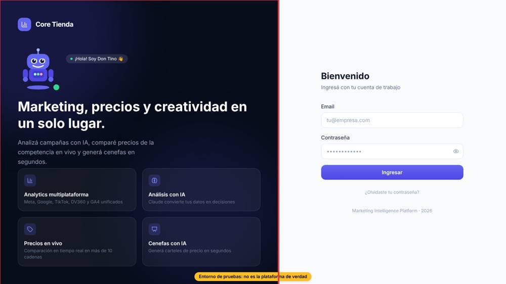 
- **Visto:** 25/11

### H-017 · Las pantallas viejas parecen otra aplicación (dos estilos visuales)
- **Gravedad:** 🟡 Desprolijo · **Quién:** todos · **Dónde:** pantallas viejas (medios, materiales) vs. nuevas (calendario)
- **Sospecha (código):** botón principal en degradé en las viejas y liso en las nuevas; campos que hacen que el iPhone agrande la página; textos de poco contraste en las viejas.
- **Fuente:** `plataforma/entrada-admin-diseno.md`, sistema visual.
- **Confirmado (Lucía, 25/11):** cuatro estilos de encabezado (con ícono de color variable / sin ícono / centrado / con flecha atrás) y botón en degradé en Conexiones. Las nuevas (calendario, mis tareas, tablero, colocación, fotos, mi pedido) son una familia prolija; medios, finanzas y cenefas v2 parecen otra aplicación. Hojas equipo-notebook-claro-1 a 4.
- **Auditoría 25/11:** ver la dirección de diseño y el pantalla por pantalla en `auditoria-2026-11-25/INFORME.md` (sección 3).
- **Visto:** 24/11 (código) · 25/11 (Lucía) · 25/11 (auditoría)

### H-029 · En el calendario compiten dos botones principales iguales
- **Gravedad:** 🟡 Desprolijo · **Quién:** equipo · **Dónde:** `/calendario`, notebook
- **Qué ve una persona:** «Conectar mi calendario» y «Nueva acción» tienen el mismo botón violeta lleno; también dice «1 acciones».
- **Por qué importa:** no queda claro cuál es la acción principal de la pantalla más usada.
- **Cómo repetirlo:** equipo → /calendario con una acción en el mes.
- **Evidencia:** hoja equipo-notebook-claro-1 (Lucía: V4-calendario-dos-principales)
- **Visto:** 25/11 (Lucía) · 25/11 (auditoría)

### H-052 · Tablero del equipo en el celular: el título en 8 renglones y ninguna tarjeta a la vista
- **Gravedad:** 🟡 Desprolijo · **Quién:** equipo · **Dónde:** `/entregas`, celular claro y oscuro
- **Qué ve una persona:** el texto queda apretado entre el ícono y «Nueva tarjeta»; después buscador, cuatro botones de agencia y cinco pestañas; la primera tarjeta queda tapada por la barra.
- **Por qué importa:** hay que bajar dos veces para ver una pieza.
- **Cómo repetirlo:** equipo en el celular → Tablero.
- **Evidencia:** 
- **Visto:** 25/11 (Sofía y Lucía)

### H-051 · Calendario en el celular: una semana a la vista y filtros que se cortan
- **Gravedad:** 🟡 Desprolijo · **Quién:** equipo · **Dónde:** `/calendario` y `/campaigns`, celular
- **Qué ve una persona:** primero selector, «Mi agenda» y «Nueva acción»; del mes, dos renglones; al bajar, 7 días y la columna de categorías ocupa la mitad. «Retail Med…» cortado sin señal de que se desliza; en Campañas «Sin datos para» cortado. La vista Lista, que se lee bien, hay que buscarla.
- **Por qué importa:** «mirar el mes entre dos reuniones» no se puede.
- **Cómo repetirlo:** equipo en el celular → Calendario; → Campañas.
- **Evidencia:** barrido `equipo/celular-claro/calendario.jpg` y `campaigns.jpg`; ver INFORME.
- **Visto:** 25/11 (Sofía y Lucía)

### H-056 · En el celular, en Mis tareas tocar la tarea no la abre y no hay «Hoy»
- **Gravedad:** 🟡 Desprolijo · **Quién:** equipo · **Dónde:** `/mis-tareas`, celular
- **Qué ve una persona:** tocar el título no hace nada; se abre tocando el chip de la acción. Hay «Vencidas» y «Para esta semana», no «Hoy». La ficha dice «1 días».
- **Por qué importa:** «¿qué tengo hoy?» no tiene respuesta directa.
- **Cómo repetirlo:** equipo en el celular → Mis tareas → tocar una tarea vencida.
- **Evidencia:** capturas 054/055 de Martina.
- **Visto:** 25/11 (Martina a ciegas)

### H-004 · El nombre del mundo se corta y hay dos botones para cambiarlo
- **Gravedad:** 🟡 Desprolijo · **Quién:** equipo · **Dónde:** menú lateral y encabezado del calendario, notebook 1366×768
- **Qué ve una persona:** en el menú dice «Tienda In…» (cortado) con un botón «Cambiar»; al lado, el encabezado del calendario tiene otro botón «Cambiar mundo».
- **Por qué importa:** el mundo es lo primero que hay que saber (qué estoy mirando) y está cortado; dos botones para lo mismo confunden.
- **Cómo repetirlo:** equipo → Tienda Inglesa → `/calendario` en 1366×768.
- **Evidencia:** 
- **Visto:** 24/11 · 25/11 (Lucía: «Tienda In…» cortado en todas las pantallas del equipo, también en oscuro) · 25/11 (auditoría)

### H-003 · Tres carteles distintos para decir «esto no es para vos»
- **Gravedad:** 🟡 Desprolijo · **Quién:** local, agencia, equipo con permisos limitados · **Dónde:** pantallas sin acceso (por ejemplo `/admin`, `/calendario`, `/entregas`, `/precios` con la cuenta del local)
- **Qué ve una persona:** a veces un candado con título, explicación y botón «Volver al inicio»; a veces un escudo rojo con una línea chica y sin botón («No tenés acceso al calendario»); a veces «Los precios no son de Redexpres» con otro dibujo. Parecen tres aplicaciones distintas.
- **Por qué importa:** se ve poco profesional y, donde no hay botón, la persona queda sin salida.
- **Cómo repetirlo:** entrar con la cuenta del local y abrir `/admin`, `/calendario` y `/precios`.
- **Evidencia:** 
- **Idea de arreglo:** un solo cartel (el del candado, con botón) para todas.
- **Auditoría 25/11:** sigue; además el local en /entregas deja un error en la consola (pide el tablero y recibe «no») y una dirección que no existe muestra otro cartel más, en inglés (H-058).
- **Visto:** 24/11 · 25/11 (sigue: en el local, /calendario, /mis-tareas y /entregas con escudo rojo sin botón; /mis-tareas dice «No tenés acceso al calendario.») (Lucía: en el local, Convertidor y /materiales dicen «No tenés acceso a las cenefas»; Diccionario «El diccionario no es de Redexpres» con otro dibujo y sin botón; hojas local-celular-claro-3 y local-notebook-oscuro-3) · 25/11 (auditoría)

### H-058 · Una dirección que no existe muestra el 404 de fábrica, en inglés y sin salida
- **Gravedad:** 🟡 Desprolijo · **Quién:** todos · **Dónde:** cualquier ruta inventada, notebook
- **Qué ve una persona:** pantalla blanca «404 | This page could not be found.», sin menú ni botón.
- **Por qué importa:** le pasa a quien abre un link viejo o mal copiado.
- **Cómo repetirlo:** `/calendario/xyz`.
- **Evidencia:** 
- **Visto:** 25/11 (Ramiro)

### H-031 · Las pantallas vacías tienen cinco estilos distintos
- **Gravedad:** 🟡 Desprolijo · **Quién:** equipo · **Dónde:** Campañas, Analytics, Conexiones, Finanzas, Colocación…
- **Qué ve una persona:** cada pantalla vacía se ve distinta; la de Colocación es la buena (explica y ofrece el paso). En Campañas el texto está a 1,5:1; los botones desactivados son violeta lavado sin decir qué falta.
- **Por qué importa:** una pantalla vacía tiene que explicar qué va ahí; así parecen rotas.
- **Cómo repetirlo:** equipo → /campaigns, /settings, /facturacion, /colocacion.
- **Evidencia:** hoja equipo-notebook-claro-2 del barrido; contraste 1,5:1 medido
- **Visto:** 25/11 (Lucía) · 25/11 (auditoría)

### H-069 · Letra gris clarito o de 10 px que no se lee
- **Gravedad:** 🟡 Desprolijo · **Quién:** equipo, agencia, local · **Dónde:** Generar cenefas (pasos 2 y 3), Informe («DESDE/HASTA»), La Triada («Sin conexión»), Cuentas («ACTIVA»), Perfil («SUPER ADMIN»), Mi pedido («OFERTAS», «BOMBAS»)
- **Qué ve una persona:** etiquetas en gris muy claro (≈2,5:1) o de 10 px en mayúscula.
- **Por qué importa:** hay que acercarse para leer; no se distingue «apagado» de «no se lee».
- **Cómo repetirlo:** abrir esas pantallas en claro.
- **Evidencia:** barrido `equipo/notebook-claro/materiales__cenefas__v2__generar.jpg`, `analytics.jpg`, `facturacion__cuentas.jpg`; medida aprox. 2,5–2,6:1.
- **Visto:** 25/11 (Lucía)

### H-068 · El calendario de Redexpres encandila: amarillo flúo y títulos en mayúscula cortados
- **Gravedad:** 🟡 Desprolijo · **Quién:** equipo · **Dónde:** `/calendario` en Redexpres, notebook
- **Qué ve una persona:** barras llenas amarillo puro, naranja, magenta y negro; «ANIVERSARIO MAILING NOVIEMBRE (SORTEO AUTO + SORTEO) 40 PAG + CONTRATAP…».
- **Por qué importa:** cansa la vista y nada se destaca.
- **Cómo repetirlo:** Cambiar mundo → Redexpres → Calendario, noviembre 2026.
- **Evidencia:** 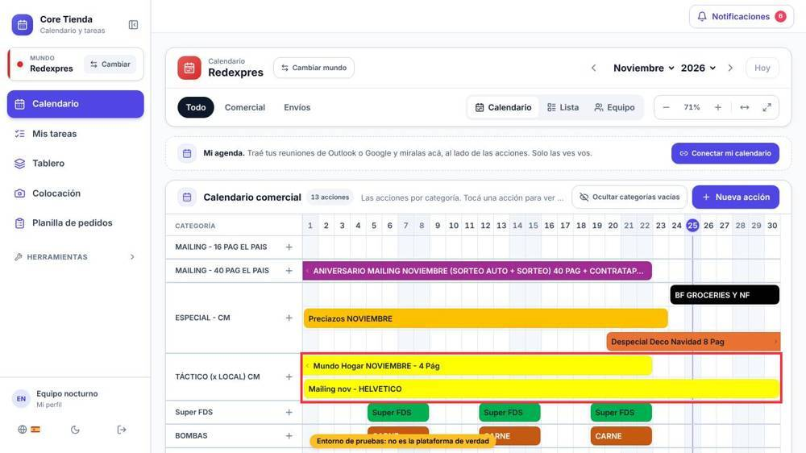
- **Idea de arreglo:** barra blanca con rayita de color (duda para Ivan: los colores los eligen ellos).
- **Visto:** 25/11 (Lucía)

### H-014 · Lo que explica la plataforma está viejo y habla de tokens
- **Gravedad:** 🟡 Desprolijo · **Quién:** todos · **Dónde:** Guía de uso `/ayuda`, Don Tino (`/home`), `/login`
- **Qué ve una persona:** la Guía habla de Dashboard, Campañas, La Triada, Cenefas, Precios y no menciona calendario, tareas, tablero, mundos ni agencias; el login vende «Analytics multiplataforma, Análisis con IA, Precios en vivo, Cenefas con IA»; Don Tino muestra «1.380 tokens» bajo cada respuesta, «Powered by Claude Sonnet 5» y sugiere preguntas de Google Ads y ROAS.
- **Por qué importa:** quien busca ayuda encuentra otra plataforma.
- **Cómo repetirlo:** /ayuda; /login; /home → abrir Don Tino → preguntar.
- **Evidencia:** 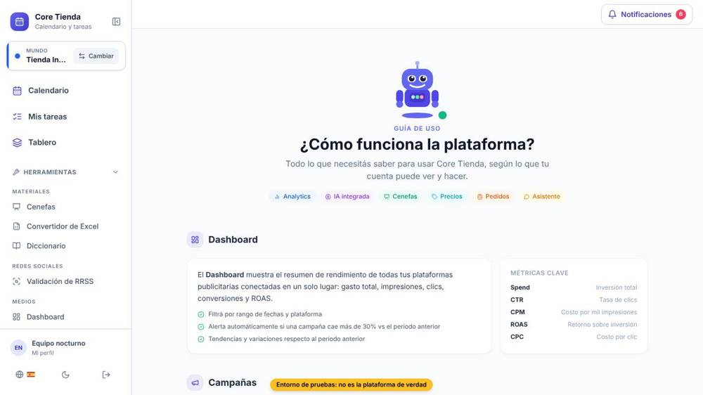 
- **Visto:** 24/11 (código) · 25/11 (auditoría: confirmado en pantalla)

### H-055 · El comentario de la agencia está en la ficha, pero el panel «Comentarios» dice que no hay
- **Gravedad:** 🟡 Desprolijo · **Quién:** equipo y agencia · **Dónde:** ficha de la tarjeta, notebook
- **Qué ve una persona:** «Va header web y carrito…» debajo de la imagen y, a la derecha, «Todavía no hay comentarios».
- **Por qué importa:** dos lugares para comentar y uno dice que no hay nada.
- **Cómo repetirlo:** la agencia entrega con comentario → el equipo abre la tarjeta.
- **Evidencia:** captura C/080 de la noche (Sofía).
- **Visto:** 25/11

### H-054 · «Cambiar el pedido» abre otro formulario, con otras palabras y las medidas vacías
- **Gravedad:** 🟡 Desprolijo · **Quién:** equipo · **Dónde:** ficha de la tarjeta → «Cambiar el pedido, las fases o quiénes aprueban», notebook
- **Qué ve una persona:** «Tipo de pieza: … Banner web…», «Medidas» vacías y «Desde/Hasta» vacías aunque la tarea vence el 04/12.
- **Por qué importa:** parece otro pedido; no se sabe qué vale.
- **Cómo repetirlo:** tarea Banners → abrir la tarjeta → «Cambiar el pedido…».
- **Evidencia:** captura C/037 de la noche (Sofía).
- **Visto:** 25/11

### H-053 · En la vista Equipo, cambiar de mes no cambia nada
- **Gravedad:** 🟡 Desprolijo · **Quién:** equipo · **Dónde:** `/calendario` vista Equipo, notebook
- **Qué ve una persona:** arriba «Febrero 2027», abajo sigue «Esta semana» con las mismas tareas.
- **Por qué importa:** quien mira la carga de otro mes cree que la está viendo.
- **Cómo repetirlo:** Calendario → Equipo → flecha de mes.
- **Evidencia:** capturas C/007 y C/008 de la noche (Sofía).
- **Visto:** 25/11

### H-007 · «Copiar a otra fecha» no copia el archivo del pedido y no lo avisa
- **Gravedad:** 🟡 Desprolijo · **Quién:** equipo, agencia · **Dónde:** ficha de la acción → «Copiar a otra fecha», notebook
- **Qué ve una persona:** «Qué se copia» dice «1 tarea · en Pendiente y con el vencimiento corrido» y no menciona el archivo; la tarea nueva ya no muestra «1 archivo». El aviso verde dice recién al final «Le llegó el aviso de sus tareas a 1 persona».
- **Por qué importa:** la agencia recibe un pedido sin el brief.
- **Cómo repetirlo:** acción con una tarea para la agencia y un adjunto → Copiar a otra fecha → Copiar.
- **Evidencia:** capturas C/050, C/051 y C/043 de la auditoría (Sofía).
- **Ya no pasa:** la vista Equipo ya cuenta la tarea de la agencia para su responsable de Tienda (PR #75). Sin confirmar: que el responsable no reciba aviso al entregar/aprobar.
- **Visto:** 24/11 (código) · 25/11 (auditoría: confirmado en pantalla)

### H-048 · A la agencia, una tarea que no es suya le dice «la borró otra persona»
- **Gravedad:** 🟡 Desprolijo · **Quién:** agencia · **Dónde:** `/entregas?tarea=<de otra agencia>`, notebook
- **Qué ve una persona:** ventana vacía «Esta tarea ya no existe: la borró otra persona.» y «Probar de nuevo», que no sirve.
- **Por qué importa:** cree que le borraron un trabajo (pasa con avisos viejos de tareas reasignadas).
- **Cómo repetirlo:** agencia → `/entregas?tarea=sc40e45525c05` (la de Publicis).
- **Evidencia:** 
- **Visto:** 25/11 (Sofía y Ramiro)

### H-050 · Revisión del lote de cenefas: «Ver capacidad (XXX)», el precio encimado y genera sin la vigencia obligatoria
- **Gravedad:** 🟡 Desprolijo · **Quién:** equipo · **Dónde:** Cenefas → Pruebas → revisión, notebook
- **Qué ve una persona:** botón con texto de relleno «(XXX)»; «Precio Final» encima del «899»; aviso con el título cortado; «Generar las 1»; deja generar con «Vigencia *» vacía.
- **Por qué importa:** se ve sin terminar y sale una cenefa sin vigencia.
- **Cómo repetirlo:** Cenefas → Pruebas → Excel de ejemplo → `Base cenefa A4 1.pptx` → sin vigencia → Generar.
- **Evidencia:** 
- **Visto:** 25/11

### H-063 · Convertidor y Editor de plantillas hablan en jerga
- **Gravedad:** 🟡 Desprolijo · **Quién:** equipo · **Dónde:** `/materiales/convertidor`, `/materiales/cenefas/v2`, notebook
- **Qué ve una persona:** «matchear», «Mapeo de columnas», `ofertaUno`, «Template», «placeholders», «canvas», «0 comp. · 0 reglas · 3 vars»; MECÁNICA dice «Precio F» (cortado); la hoja A4 del editor es un cuadrito de 150 px.
- **Por qué importa:** no es el idioma de promo y marca.
- **Cómo repetirlo:** Convertidor con un Excel de gestión; editor → Cenefa A4.
- **Evidencia:** capturas C/050, C/053, C/022, C/023 de la noche (Sofía).
- **Visto:** 25/11

### H-015 · El link «Informe» de Cenefas no hace nada para quien no es superadmin
- **Gravedad:** 🟡 Desprolijo · **Quién:** equipo (no superadmin) · **Dónde:** `/materiales/cenefas`, arriba a la derecha
- **Qué ve una persona:** toca «Informe» (o «Lo que aprendió») y se queda en la misma pantalla, sin mensaje.
- **Por qué importa:** parece roto.
- **Cómo repetirlo:** cuenta rol Usuario → /materiales/cenefas → Informe.
- **Evidencia:** captura C/109 de la auditoría (Sofía).
- **Visto:** 24/11 (código) · 25/11 (auditoría: confirmado en pantalla)

### H-049 · A una cuenta desactivada le dice «contraseña incorrecta»; y desactivar es un toque sin aviso
- **Gravedad:** 🟡 Desprolijo · **Quién:** quien es dado de baja; admin · **Dónde:** `/login`; `/admin` (tilde verde de la fila)
- **Qué ve una persona:** el tilde desactiva al instante sin preguntar; quien quedó afuera ve «Email o contraseña incorrectos…» y cree que se olvidó la clave. El mismo tilde está en la fila propia (H-011).
- **Por qué importa:** una baja sin querer, y una persona que no sabe que la dieron de baja.
- **Cómo repetirlo:** /admin → tilde de una cuenta → entrar con esa cuenta y su clave correcta.
- **Evidencia:** captura C/110 y C/112 de la noche (Sofía); ver INFORME de la auditoría.
- **Visto:** 25/11

### H-061 · Administración y su Auditoría hablan en código
- **Gravedad:** 🟡 Desprolijo · **Quién:** jefatura · **Dónde:** `/admin`, notebook y celular
- **Qué ve una persona:** `platform.users.view`, «15 permiso», «50 registro», ADMIN en la lista y SUPER ADMIN en el perfil, 4-5 íconos sin texto por fila, campos sin título; Auditoría con `admin.user.delete`, «user #4» y «—» en quién cambió la contraseña.
- **Por qué importa:** quien administra tiene que adivinar.
- **Cómo repetirlo:** /admin; /admin → Auditoría.
- **Evidencia:** 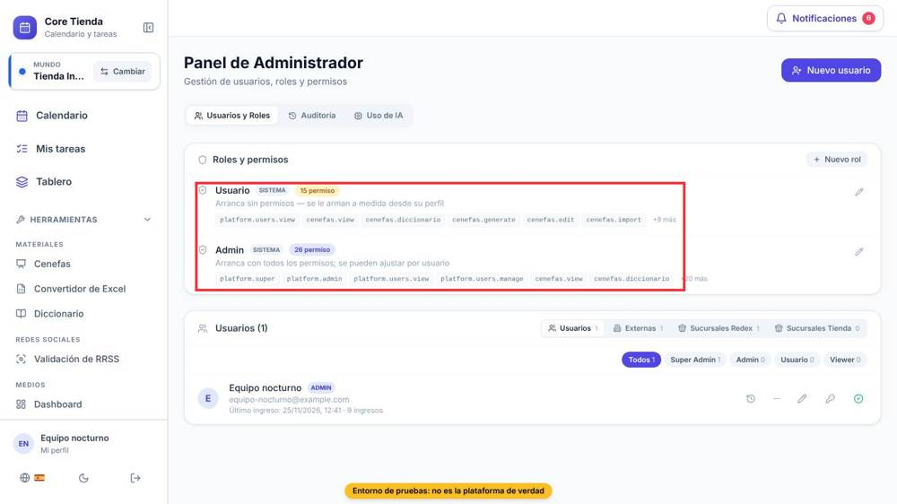
- **Visto:** 25/11

### H-065 · Un link de nueva contraseña vencido dice «Token inválido o expirado» y no da salida
- **Gravedad:** 🟡 Desprolijo · **Quién:** todos · **Dónde:** `/reset-password?token=…`
- **Qué ve una persona:** el error aparece dos veces recién al guardar, con la palabra «Token», y sin botón para pedir otro link.
- **Por qué importa:** no sabe qué hacer para entrar.
- **Cómo repetirlo:** /reset-password?token=cualquiercosa → claves iguales → Guardar.
- **Evidencia:** captura C/010 de la noche (Sofía).
- **Visto:** 25/11

### H-057 · Mi pedido: tres casilleros se llaman «cenefa»
- **Gravedad:** 🟡 Desprolijo · **Quién:** local · **Dónde:** `/redexpres/mi-pedido`, celular
- **Qué ve una persona:** «Cenefa Oferta x3», «Cenefas 3xA4 Preciazos», «Cenefas A4 Preciazos»; ¿«x3» es que vienen de a tres?
- **Por qué importa:** el encargado pide «40 cenefas» y no sabe dónde ponerlo.
- **Cómo repetirlo:** local → Mi pedido → Diciembre.
- **Evidencia:** captura 044 de Martina.
- **Visto:** 25/11 (Martina a ciegas)

### H-023 · Una entrega aprobada sigue mostrando en rojo «Falta 1 pieza del pedido»
- **Gravedad:** 🟡 Desprolijo · **Quién:** equipo, agencia · **Dónde:** ficha de la tarjeta `/entregas?tarea=…`, notebook claro
- **Qué ve una persona:** arriba «Finalizada: se aprobó la entrega» con papel picado; abajo, el recuadro rojo «Falta 1 pieza del pedido». No se sabe si está terminada o no.
- **Por qué importa:** mensajes que se contradicen hacen dudar de lo aprobado (y de si hay que pedir la pieza que falta).
- **Cómo repetirlo:** ciclo completo entregando sin la pieza «Slider fila (mobile)» → Aprobar.
- **Evidencia:** 
- **Idea de arreglo:** una vez aprobada, mostrarlo como dato gris («Se aprobó sin: …»), no como alerta roja.
- **Visto:** 25/11

### H-067 · Finanzas muestra el total como «$-1.250»
- **Gravedad:** 🟡 Desprolijo · **Quién:** equipo, jefatura · **Dónde:** `/facturacion`, notebook y celular
- **Qué ve una persona:** después de una factura de salida de 1250, el total general dice «$-1.250».
- **Por qué importa:** no se entiende si es gasto o saldo negativo.
- **Cómo repetirlo:** cargar una factura de tipo Salida → mirar General.
- **Evidencia:** capturas C/127 y C/183 de la noche (Sofía).
- **Visto:** 25/11

### H-030 · Finanzas vacía ofrece «Subir factura» cuando primero hay que crear una cuenta
- **Gravedad:** 🟡 Desprolijo · **Quién:** equipo · **Dónde:** `/facturacion`, notebook
- **Qué ve una persona:** el botón grande es «Subir factura»; lo que hay que hacer primero («Crear la primera cuenta») es un link chiquito.
- **Por qué importa:** la persona empieza por el paso equivocado.
- **Cómo repetirlo:** equipo → /facturacion con la base vacía.
- **Evidencia:** hoja equipo-notebook-claro-2 (Lucía: V6-finanzas-vacio)
- **Visto:** 25/11 (Lucía) · 25/11 (auditoría)

### H-066 · Las ventanas de Finanzas y Administración dejan una franja blanca arriba
- **Gravedad:** 🟡 Desprolijo · **Quién:** equipo · **Dónde:** Subir factura; Editar usuario, notebook
- **Qué ve una persona:** todo se oscurece menos una franja blanca de 24 px arriba.
- **Por qué importa:** parece un error de pantalla.
- **Cómo repetirlo:** /facturacion → Subir factura.
- **Evidencia:**  (franja arriba)
- **Visto:** 25/11

### H-028 · El Dashboard de medios mezcla inglés y textos con errores
- **Gravedad:** 🟡 Desprolijo · **Quién:** equipo · **Dónde:** `/dashboard`, notebook y celular
- **Qué ve una persona:** «últimos 30D días», «Miércoles 25 De Noviembre», «0.00x», «Auto-sync activo», «Sync datos» al lado de «Sincronizar ahora».
- **Por qué importa:** se ve armado de apuro; no es el vocabulario de la gente.
- **Cómo repetirlo:** equipo → /dashboard.
- **Evidencia:** hoja equipo-notebook-claro-1 del barrido (Lucía: V5-dashboard-en-ingles)
- **Visto:** 25/11 (Lucía) · 25/11 (auditoría)

### H-060 · Análisis IA dice que tiene los datos de tus campañas sin ninguna conexión
- **Gravedad:** 🟡 Desprolijo · **Quién:** equipo · **Dónde:** `/analytics` (La Triada), notebook
- **Qué ve una persona:** «Tengo cargados los datos de tus campañas» sin plataformas conectadas, y «hacé click en el botón de abajo» sin tal botón.
- **Por qué importa:** promete un análisis sobre datos que no hay.
- **Cómo repetirlo:** /analytics sin conexiones.
- **Evidencia:** 
- **Visto:** 25/11

### H-064 · El Informe de producción dice un rango de fechas y suma otra cosa
- **Gravedad:** 🟡 Desprolijo · **Quién:** jefatura · **Dónde:** `/materiales/cenefas/v2/informe` y `/jobs`
- **Qué ve una persona:** «entre el 2026-11-25 y el 2026-11-25» y el número grande sale de una carga declarada en agosto; columna «ISSUES».
- **Por qué importa:** el número que se reporta no corresponde al período.
- **Cómo repetirlo:** abrir el Informe y el Historial.
- **Evidencia:** captura C/042 de la noche (Sofía).
- **Visto:** 25/11

### H-062 · En inglés la plataforma sale mezclada y «Cenefas» se traduce «Banners»
- **Gravedad:** 🟡 Desprolijo · **Quién:** quien cambie el idioma · **Dónde:** globo del menú → English
- **Qué ve una persona:** menú «Calendar», el resto en castellano; «Cenefas» → «Banners», que es otra pieza.
- **Por qué importa:** confunde dos piezas distintas.
- **Cómo repetirlo:** globo → English → /admin y /calendario.
- **Evidencia:** capturas C/119 y C/120 de la noche (Sofía).
- **Visto:** 25/11

### H-032 · Cenefas en el celular: tarjetas angostas con texto cortado
- **Gravedad:** 🟡 Desprolijo · **Quién:** equipo · **Dónde:** `/materiales/cenefas`, celular
- **Qué ve una persona:** las tres tarjetas de tipo de cenefa quedan angostas y el texto se corta.
- **Por qué importa:** no se lee qué es cada tipo.
- **Cómo repetirlo:** equipo en el celular → /materiales/cenefas.
- **Evidencia:** hoja equipo-celular-claro-2 (Lucía: V8-cenefas-tarjetas-celular)
- **Visto:** 25/11 (Lucía) · 25/11 (auditoría)

### H-033 · Conexiones en modo oscuro: un cuadro «+» blanco
- **Gravedad:** 🟡 Desprolijo · **Quién:** equipo · **Dónde:** `/settings`, notebook oscuro
- **Qué ve una persona:** el cuadro vacío con «+» queda blanco y brilla sobre el fondo oscuro.
- **Por qué importa:** rompe el modo oscuro.
- **Cómo repetirlo:** equipo, modo oscuro → /settings.
- **Evidencia:** hoja equipo-notebook-oscuro (Lucía: V7-conexiones-oscuro)
- **Visto:** 25/11 (Lucía) · 25/11 (auditoría)

### H-034 · El local y la agencia ven «Calendario y tareas» bajo el logo sin tener calendario
- **Gravedad:** ⚪ Detalle · **Quién:** local, agencia · **Dónde:** menú lateral; Mi perfil en el celular
- **Qué ve una persona:** debajo de «Core Tienda» dice «Calendario y tareas»; en Mi perfil de la agencia en el celular el mail se corta.
- **Por qué importa:** promete algo que no tienen.
- **Cómo repetirlo:** entrar con la agencia o el local.
- **Evidencia:** hojas agencia-notebook-claro-1, local-notebook-claro-2
- **Visto:** 25/11 (Lucía) · 25/11 (auditoría)

### H-079 · Buscador de la agencia en el celular: dos cruces y «Arrastrá» donde se usa «Mover»
- **Gravedad:** ⚪ Detalle · **Quién:** agencia · **Dónde:** Mi tablero, celular
- **Qué ve una persona:** con texto escrito, dos «x» juntas; el texto de arriba dice «Arrastrá cada tarjeta».
- **Por qué importa:** detalles que confunden en el celular.
- **Cómo repetirlo:** agencia celular → escribir en el buscador.
- **Evidencia:** capturas 001 y 010 de Martina.
- **Visto:** 25/11 (Martina a ciegas)

### H-078 · «Tablero»/«Tableros» y «Notificaciones»/«Avisos»
- **Gravedad:** ⚪ Detalle · **Quién:** equipo · **Dónde:** menú, `/entregas`, barra de arriba y de abajo
- **Qué ve una persona:** el menú dice una cosa y la pantalla otra.
- **Por qué importa:** vocabulario que no se repite igual.
- **Cómo repetirlo:** comparar menú y título; notebook y celular.
- **Evidencia:** 
- **Visto:** 25/11 (Lucía)

### H-071 · Las miniaturas de la entrega recortan la pieza
- **Gravedad:** ⚪ Detalle · **Quién:** agencia y equipo · **Dónde:** formulario de entrega y ficha
- **Qué ve una persona:** cuadradas y verticales cortadas («080×108»), apaisadas como franja.
- **Por qué importa:** antes de mandar no ve la pieza entera.
- **Cómo repetirlo:** entregar una imagen vertical.
- **Evidencia:** capturas C/071 y C/080 de la noche.
- **Visto:** 25/11

### H-072 · Los avisos verdes tapan la ✕ de la ficha
- **Gravedad:** ⚪ Detalle · **Quién:** equipo · **Dónde:** ficha de la acción, notebook
- **Qué ve una persona:** dos avisos encimados arriba a la derecha sobre la ✕ y el título.
- **Por qué importa:** hay que esperar para cerrar.
- **Cómo repetirlo:** crear una tarea.
- **Evidencia:** captura C/035 de la noche.
- **Visto:** 25/11

### H-073 · La app no sigue el modo oscuro del celular
- **Gravedad:** ⚪ Detalle · **Quién:** agencia y local · **Dónde:** todo, celular en oscuro
- **Qué ve una persona:** con el teléfono en oscuro, se ve en claro; solo se prende con la luna del menú.
- **Por qué importa:** encandila de noche.
- **Cómo repetirlo:** celular en oscuro → entrar.
- **Evidencia:** captura C/121 de la noche.
- **Visto:** 25/11

### H-074 · «Nueva tarjeta» no entra en la pantalla de una notebook
- **Gravedad:** ⚪ Detalle · **Quién:** equipo · **Dónde:** `/entregas` → Nueva tarjeta, 1366×768
- **Qué ve una persona:** para llegar a «Crear tarjeta» hay que bajar y se va el título.
- **Por qué importa:** pasos de más.
- **Cómo repetirlo:** Tablero → Nueva tarjeta.
- **Evidencia:** captura C/105 de la noche.
- **Visto:** 25/11

### H-075 · Buscar precios: los números de fuentes no coinciden
- **Gravedad:** ⚪ Detalle · **Quién:** equipo · **Dónde:** `/precios`
- **Qué ve una persona:** «Fuentes (15/16)», 18 pastillas y «15 cadenas»; en el celular el ejemplo se corta.
- **Por qué importa:** resta confianza.
- **Cómo repetirlo:** /precios.
- **Evidencia:** 
- **Visto:** 25/11

### H-076 · Textos sueltos con errores
- **Gravedad:** ⚪ Detalle · **Quién:** equipo · **Dónde:** varias
- **Qué ve una persona:** «produccion», «Lei 7 filas», «Listo: 2 placas revisadas» cuando no se leyó ninguna, la ventana de error del login que sigue abierta en «Olvidé mi contraseña».
- **Por qué importa:** se ve armado de apuro.
- **Cómo repetirlo:** Cenefas → Pruebas; RRSS con error de IA; login con clave mala → Olvidé.
- **Evidencia:** capturas C/020, C/066, C/005 de la noche.
- **Visto:** 25/11

### H-077 · Al entregar un archivo que no es imagen, el aviso no dice cuál ni qué hacer
- **Gravedad:** ⚪ Detalle · **Quién:** agencia · **Dónde:** formulario de entrega
- **Qué ve una persona:** «No se pudo leer la imagen», sin el nombre ni los formatos que sirven.
- **Por qué importa:** con 4 elegidas no sabe cuál falló.
- **Cómo repetirlo:** elegir un texto renombrado a .png.
- **Evidencia:** captura 012 de Ramiro.
- **Visto:** 25/11 (Ramiro)

### H-080 · Solo por la API: mensajes de peso falsos y datos imposibles aceptados
- **Gravedad:** ⚪ Detalle · **Quién:** — (no se llega desde la pantalla) · **Dónde:** API
- **Qué pasa:** «pesa 2 MB: el máximo es 2 MB» para una de 5 MB; meses 13 y 0 dan 200; mensaje vacío al chat gasta una respuesta; campos viejos sin tope de largo.
- **Por qué importa:** robustez; hoy no lo ve nadie.
- **Cómo repetirlo:** ver hallazgos RA-06 y RA-08 de Ramiro (25/11).
- **Evidencia:** respuestas de la API (Ramiro).
- **Visto:** 25/11 (Ramiro)

### H-005 · Para confirmar: cualquiera del equipo aprueba una pieza arrastrándola, sin aviso
- **Gravedad:** 🟠 · **Quién:** equipo, agencia · **Dónde:** tablero `/entregas`
- **Sospecha (código):** arrastrar de «Esperando feedback» a «Finalizado» la da por aprobada aunque quien arrastra no sea aprobador, y no se le avisa a nadie (ni a la agencia). Arrastrarla a «En proceso» no le dice a la agencia qué cambiar.
- **Fuente:** `plataforma/calendario-tareas-entregas.md`, tablero y recorrido 8.
- **Auditoría 25/11:** arrastrar una tarjeta de la agencia de Ingresado a Finalizado no hizo nada y nadie dijo por qué; no había una en «Esperando feedback» para probar.

### H-006 · Para confirmar: errores que se ven como «no hay nada»
- **Gravedad:** 🟠 · **Quién:** equipo, agencia · **Dónde:** campanita, tablero, archivos de una tarea
- **Sospecha (código):** si falla la carga, la campanita dice «Todavía no tenés notificaciones»; el tablero no avisa si se corta la conexión; los archivos de una tarea no muestran nada.
- **Fuente:** `plataforma/calendario-tareas-entregas.md`.

### H-011 · Para confirmar: en Administración uno se puede dejar afuera a sí mismo
- **Gravedad:** 🟠 · **Quién:** admin · **Dónde:** `/admin`
- **Sospecha (código):** el superadmin puede desactivarse a sí mismo; cambiar el rol en la fila borra sin avisar los permisos ajustados a mano. (Probalo con una cuenta descartable, nunca con Equipo nocturno.)
- **Fuente:** `plataforma/entrada-admin-diseno.md`.
- **Auditoría 25/11:** el ícono de desactivar está en la fila propia del admin (no se tocó). Desactivar a otro es un toque sin preguntar: H-049.

### H-012 · Para confirmar: el bloqueo del login vuelve con un solo error
- **Gravedad:** 🟠 · **Quién:** todos · **Dónde:** `/login`
- **Sospecha (código):** pasados los 15 minutos de bloqueo, un error más vuelve a bloquear; el mail tiene que coincidir exacto (mayúsculas y espacios).
- **Fuente:** `plataforma/entrada-admin-diseno.md`.

### H-016 · Para confirmar: Validación de redes deja borrar lo ajeno
- **Gravedad:** 🟡 · **Quién:** equipo · **Dónde:** `/redes-sociales/validacion`
- **Sospecha (código):** el tacho aparece en validaciones de otras personas; si el borrado falla, toda la lista dice «No se pudo cargar el historial».
- **Fuente:** `plataforma/materiales-precios-locales.md`.

## Hechos

### H-020 · Después de confirmar el pedido, queda trancado sin decirlo y sin saber cómo corregir
- **Gravedad:** 🟠 Traba · **Quién:** local · **Dónde:** Mi pedido `/redexpres/mi-pedido`, celular claro
- **Qué ve una persona:** toca «Confirmar pedido» y se confirma de una (sin «¿seguro?»). Después los campos se ven exactamente igual que antes, pero al tocarlos no se puede escribir; abajo sigue diciendo «Los cambios se guardan automáticamente al dejar de escribir». Nada dice que ya no se puede cambiar ni a quién pedirle que lo abra.
- **Por qué importa:** el encargado que se equivocó en un número (o confirmó sin querer con el pulgar) queda trabado y no sabe a quién llamar; parece que la pantalla se colgó.
- **Cómo repetirlo:** equipo en Redexpres crea el mes en la Planilla. Local de prueba (celular) → Mi pedido → escribir cantidades → «Confirmar pedido» → tocar un campo e intentar escribir.
- **Evidencia:**  · los campos están bloqueados pero sin cambio visible.
- **Idea de arreglo:** pedir confirmación antes, y después mostrar los campos como bloqueados con un texto «Ya lo confirmaste. Si tenés que cambiar algo, pedile a <quién> que lo vuelva a abrir».
- **Prueba a ciegas (Martina, 25/11):** abandonó. Tocó el 300 y escribió 30: no cambió, «números grisecitos», nada dice que está bloqueado; Notas libres tampoco deja; en «Más» no hay cómo pedir el cambio → «le mando un WhatsApp a marketing». Pidió un cartel «Ya confirmaste; para cambiarlo pedíselo a marketing». 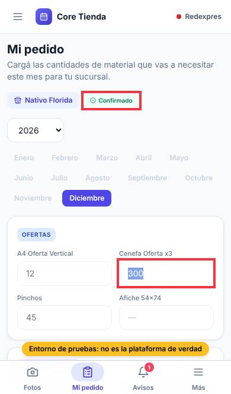
- **Visto:** 25/11 (Martina a ciegas)
- **Estado:** ya no pasa (25/11, auditoría): en `main` por el PR #68 (c34443e). Confirmar pregunta antes y después muestra «Ya confirmaste el pedido… pedíselo a marketing» con candado.

### H-021 · La Planilla de Redexpres está escondida al fondo de Herramientas, debajo de Medios
- **Gravedad:** 🟠 Traba · **Quién:** equipo de Redexpres · **Dónde:** menú lateral en el mundo Redexpres, notebook claro
- **Qué ve una persona:** en el mundo Redexpres el menú muestra Calendario, Mis tareas, Tablero y Colocación. Para llegar a «Planilla de pedidos» hay que abrir «Herramientas» y bajar pasando Cenefas, Convertidor, Dashboard, Analytics GA4, Campañas, Análisis IA y Conexiones. Además hay dos «Dashboard» (uno en Medios y otro en Finanzas).
- **Por qué importa:** la planilla mensual es lo central de Redexpres y la persona la tiene que buscar cada vez; el doble «Dashboard» confunde.
- **Cómo repetirlo:** equipo → Cambiar → Redexpres → buscar la planilla de pedidos desde el menú.
- **Evidencia:** 
- **Idea de arreglo:** en el mundo Redexpres, «Planilla de pedidos» arriba, junto a Colocación.
- **Prueba a ciegas (Martina, 25/11):** lo logró con dificultad, 11 pasos (~5 dando vueltas): ningún «Pedidos» en el menú, entró a Cenefas creyendo que era el material, el menú corta en «Campañas» y no se nota que sigue; recién al fondo, abajo de Medios, encontró «Planilla de pedidos». La planilla en sí se entendió («1/60 confirmados», fila confirmada distinguible). Detalle: en las celdas vacías de otros locales aparecen cajitas editables y da miedo tocar algo. 
- **Visto:** 25/11 (Martina a ciegas)
- **Estado:** ya no pasa (25/11, auditoría): en `main` por el PR #68; en Redexpres «Colocación» y «Planilla de pedidos» están arriba del menú.

### H-009 · Sin mes abierto, el local y la planilla muestran doce meses apagados y nada más
- **Gravedad:** 🟠 Traba · **Quién:** local, equipo de Redexpres · **Dónde:** Mi pedido `/redexpres/mi-pedido` (celular) y Planilla `/redexpres/planilla` (notebook)
- **Qué ve una persona:** el local entra a Mi pedido y ve su sucursal y doce meses en gris clarito (contraste 1,4:1); tocarlos no hace nada y no hay ningún texto que diga que el mes todavía no se abrió ni a quién avisarle. En la Planilla, lo mismo: meses punteados y la pantalla en blanco; tocar un mes punteado crea el mes de una, sin preguntar.
- **Por qué importa:** el encargado cree que la pantalla está rota; el gestor puede abrir un mes equivocado con un toque.
- **Cómo repetirlo:** base sin meses de Redexpres → local de prueba → Mi pedido; equipo en Redexpres → Herramientas → Planilla de pedidos.
- **Evidencia:**  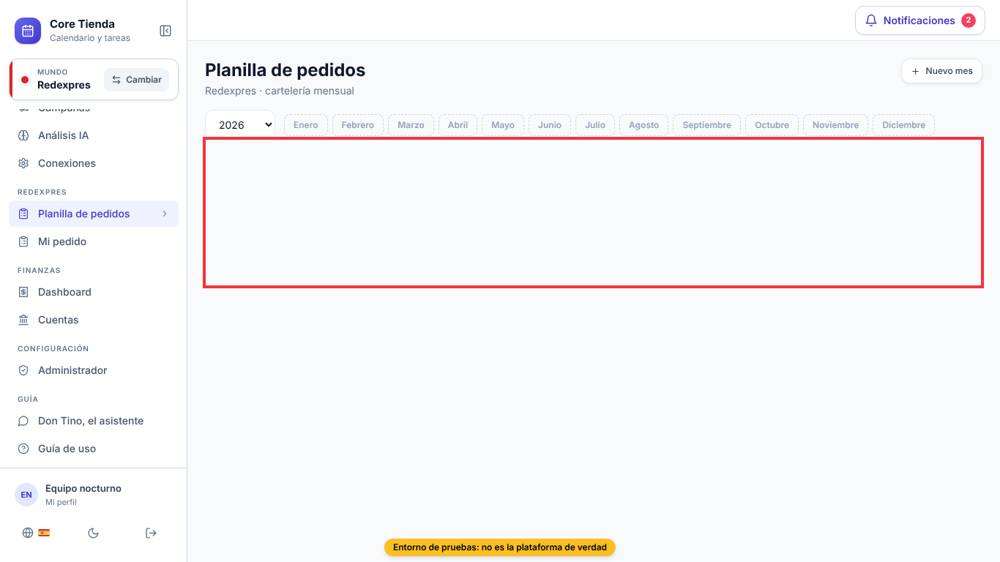 · contraste medido 1,4:1 en los meses.
- **Pendiente de ver:** el Excel con «Confirmar pedido» en vez de «Confirmado» y el «Guardando…» sin fin cuando falla un guardado (no se probaron hoy). Escribir y salir enseguida de Mi pedido **ya no pierde lo escrito** (25/11).
- **Idea de arreglo:** usar el texto de «todavía no hay meses» que ya existe y pedir confirmación al crear un mes tocándolo.
- **Lucía (25/11):** en notebook los meses no abiertos se ven igual de apagados.
- **Visto:** 24/11 (código) · 25/11 (confirmado en pantalla) (Lucía)
- **Estado:** en `main` por el PR #68 (25/11). En la auditoría no se pudo ver el caso sin meses abiertos (la base ya tenía meses): mirarlo en el próximo recorrido.

### H-024 · Al marcar algo en la imagen, la imagen se va de la vista
- **Gravedad:** 🟡 Desprolijo · **Quién:** equipo · **Dónde:** «Revisar ahora» en la ficha de la tarjeta, notebook 1366×768
- **Qué ve una persona:** toca la imagen para marcar «Precio más grande»; la ventana baja sola hasta el campo de la marca y la mitad izquierda queda en blanco: ya no ve la imagen ni dónde puso la marca mientras escribe.
- **Por qué importa:** revisar es comparar lo que se ve con lo que se escribe; hay que subir y bajar para cada marca.
- **Cómo repetirlo:** equipo → Mis tareas → Para revisar → Revisar ahora → tocar la imagen.
- **Evidencia:** 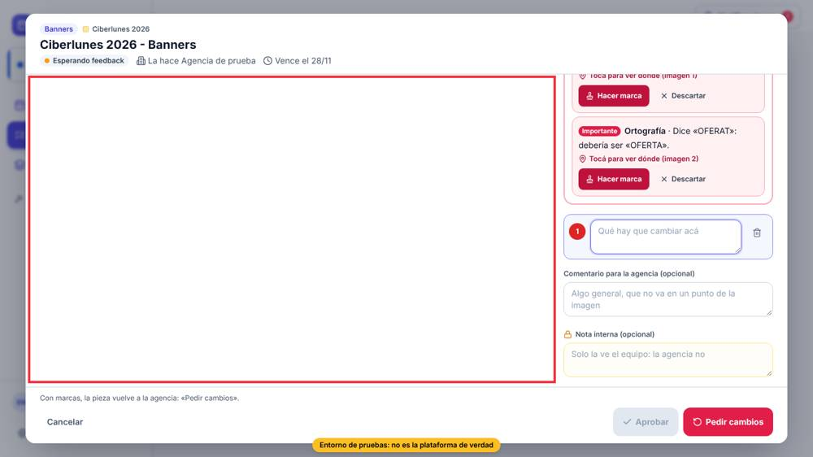
- **Idea de arreglo:** que la imagen quede fija a la izquierda mientras se escribe la marca.
- **Visto:** 25/11
- **Estado:** ya no pasa (25/11, auditoría): al marcar, la imagen queda a la vista y baja la columna de la derecha (probablemente PR #74 «imágenes sin saltos»).

### Mis tareas avisa cuando no pudo traer todo
- **Rama:** `nocturno/2026-11-24-mis-tareas-avisa-fallas` («[Nocturno] Mis tareas avisa cuando no pudo traer todo»).
- **Estado:** en `main` por el PR #54 (merge e20b367), 24/11/2026. Mis tareas ya no dice «Estás al día» cuando no pudo traer las tareas o las piezas para revisar. No resolvía ningún H del cuaderno (Mis tareas no estaba en H-006).

## Descartados (no volver a proponer)

_Nada todavía._
