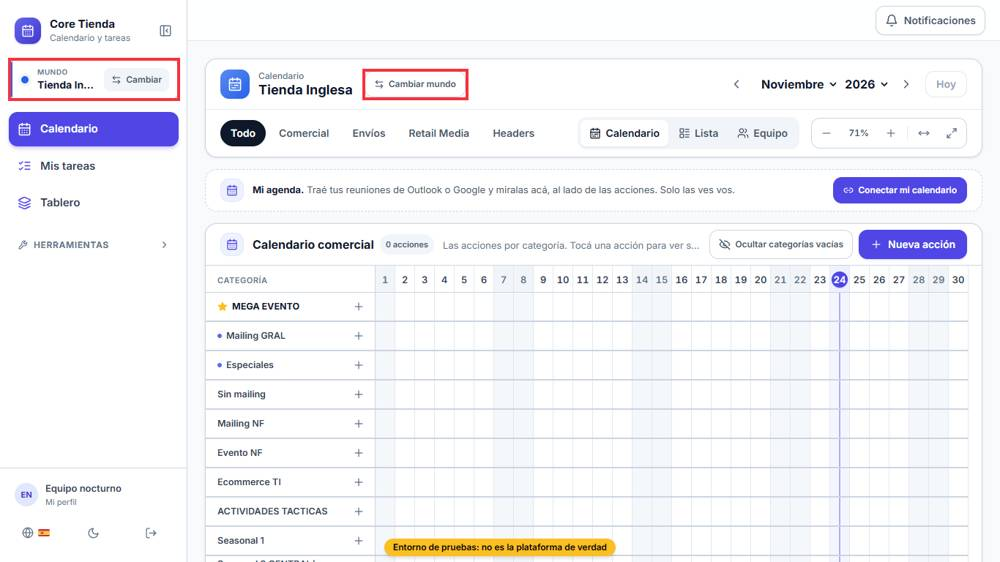

# Cuaderno del Equipo nocturno de Core Tienda

Todo lo que una persona notaría usando Core Tienda, encontrado recorriendo la
plataforma con las cuentas del equipo, la agencia y un local. Lo mantiene el
Equipo nocturno cada noche (ver `.claude/skills/cuaderno-de-hallazgos/SKILL.md`
en `main`). Gravedad: 🔴 bloquea · 🟠 traba · 🟡 desprolijo · ⚪ detalle.

**Resumen:** 18 abiertos (4 confirmados, 14 para confirmar) · 0 en curso · 0 hechos · 0 descartados.

> Arranque (24/11/2026): los confirmados salen del primer recorrido de prueba
> del entorno y de leer el código; los «para confirmar» salen del mapa de la
> plataforma (`docs/equipo-nocturno/plataforma/`) y hay que verlos en la
> pantalla antes de trabajarlos.

## En curso

_Nada todavía._

## Abiertos (de más a menos importante)

### H-001 · Borrar una acción o una tarea borra las imágenes y los ZIP que entregó la agencia
- **Gravedad:** 🔴 Bloquea (rompe la regla «las imágenes de las entregas no se borran nunca») · **Quién:** equipo · **Dónde:** ficha de la acción (Eliminar) y tarea («Borrar con sus entregas»), `/calendario`
- **Qué ve una persona:** el aviso de borrar una acción dice «N tareas»; el de una tarea dice «Borrar con sus entregas». Ninguno dice que se van también las imágenes y ZIP que mandó la agencia, que son el histórico.
- **Por qué importa:** se pierde para siempre el histórico que tiene que ir a SharePoint, con un clic.
- **Cómo repetirlo:** crear acción → tarea para la agencia → la agencia entrega imágenes → borrar la acción → las imágenes ya no existen en la base.
- **Evidencia:** confirmado en el código: `ondelete="CASCADE"` en `backend/app/models/entregas.py` (entregas, versiones, imágenes y ZIP de la versión) y en `backend/app/models/calendario.py` (tareas de la acción).
- **Idea de arreglo:** no dejar borrar una acción o tarea que ya tiene entregas (ofrecer cancelarla o archivarla), del lado del servidor y con su prueba. Sin migración.
- **Visto:** 24/11 (código)

### H-002 · En la portada de Materiales no se leen los nombres de las herramientas
- **Gravedad:** 🟠 Traba · **Quién:** equipo · **Dónde:** Materiales `/materiales`, notebook y celular, claro
- **Qué ve una persona:** cuatro tarjetas con la descripción bien visible pero el título («Generar cenefas», «Editor de plantillas», «Convertidor de Excel», «Diccionario») blanco sobre blanco: casi invisible. Además, a esta portada no se llega desde ningún menú.
- **Por qué importa:** la persona tiene que adivinar qué tarjeta es cuál leyendo la letra chica.
- **Cómo repetirlo:** equipo → ir a `/materiales` en modo claro.
- **Evidencia:**  · contraste medido 1,1:1 (el mínimo es 4,5:1).
- **Visto:** 24/11

### H-003 · Tres carteles distintos para decir «esto no es para vos»
- **Gravedad:** 🟡 Desprolijo · **Quién:** local, agencia, equipo con permisos limitados · **Dónde:** pantallas sin acceso (por ejemplo `/admin`, `/calendario`, `/entregas`, `/precios` con la cuenta del local)
- **Qué ve una persona:** a veces un candado con título, explicación y botón «Volver al inicio»; a veces un escudo rojo con una línea chica y sin botón («No tenés acceso al calendario»); a veces «Los precios no son de Redexpres» con otro dibujo. Parecen tres aplicaciones distintas.
- **Por qué importa:** se ve poco profesional y, donde no hay botón, la persona queda sin salida.
- **Cómo repetirlo:** entrar con la cuenta del local y abrir `/admin`, `/calendario` y `/precios`.
- **Evidencia:** 
- **Idea de arreglo:** un solo cartel (el del candado, con botón) para todas.
- **Visto:** 24/11

### H-004 · El nombre del mundo se corta y hay dos botones para cambiarlo
- **Gravedad:** 🟡 Desprolijo · **Quién:** equipo · **Dónde:** menú lateral y encabezado del calendario, notebook 1366×768
- **Qué ve una persona:** en el menú dice «Tienda In…» (cortado) con un botón «Cambiar»; al lado, el encabezado del calendario tiene otro botón «Cambiar mundo».
- **Por qué importa:** el mundo es lo primero que hay que saber (qué estoy mirando) y está cortado; dos botones para lo mismo confunden.
- **Cómo repetirlo:** equipo → Tienda Inglesa → `/calendario` en 1366×768.
- **Evidencia:** 
- **Visto:** 24/11

### H-005 · Para confirmar: cualquiera del equipo aprueba una pieza arrastrándola, sin aviso
- **Gravedad:** 🟠 · **Quién:** equipo, agencia · **Dónde:** tablero `/entregas`
- **Sospecha (código):** arrastrar de «Esperando feedback» a «Finalizado» la da por aprobada aunque quien arrastra no sea aprobador, y no se le avisa a nadie (ni a la agencia). Arrastrarla a «En proceso» no le dice a la agencia qué cambiar.
- **Fuente:** `plataforma/calendario-tareas-entregas.md`, tablero y recorrido 8.

### H-006 · Para confirmar: errores que se ven como «no hay nada»
- **Gravedad:** 🟠 · **Quién:** equipo, agencia · **Dónde:** campanita, tablero, archivos de una tarea
- **Sospecha (código):** si falla la carga, la campanita dice «Todavía no tenés notificaciones»; el tablero no avisa si se corta la conexión; los archivos de una tarea no muestran nada.
- **Fuente:** `plataforma/calendario-tareas-entregas.md`.

### H-007 · Para confirmar: el responsable de Tienda queda a ciegas, y Copiar avisa sin decirlo
- **Gravedad:** 🟠 · **Quién:** equipo · **Dónde:** tarea, vista Equipo, «Copiar a otra fecha»
- **Sospecha (código):** el responsable de Tienda no recibe aviso cuando la agencia entrega ni cuando se aprueba, y la vista Equipo no cuenta esa carga. «Copiar a otra fecha» crea tarjetas a la agencia y le avisa en el momento sin decirlo en el cuadro; los archivos del pedido no se copian.
- **Fuente:** `plataforma/calendario-tareas-entregas.md`.

### H-008 · Para confirmar: Generar cenefas muestra «Error desconocido» y sigue consultando sin fin
- **Gravedad:** 🔴 · **Quién:** equipo · **Dónde:** `/materiales/cenefas/v2/generar`
- **Sospecha (código):** el servidor deja cada generación esperando confirmación, pero la pantalla lo muestra como «Error en la generación — Error desconocido» y sigue preguntando; la pieza que confirmaba (`PreviewStep.tsx`) no se usa.
- **Fuente:** `plataforma/materiales-precios-locales.md`.

### H-009 · Para confirmar: Redexpres se queda en «Guardando…» y no avisa lo que falta
- **Gravedad:** 🟠 · **Quién:** local, equipo de Redexpres · **Dónde:** `/redexpres/mi-pedido`, `/redexpres/planilla`
- **Sospecha (código):** si un guardado falla, queda en «Guardando…» para siempre; sin meses creados, el local ve una pantalla vacía sin mensaje; en el Excel los confirmados dicen «Confirmar pedido»; el servidor deja editar pedidos ya confirmados.
- **Fuente:** `plataforma/materiales-precios-locales.md`.

### H-010 · Para confirmar: el local entra a Don Tino y no a lo suyo
- **Gravedad:** 🟠 · **Quién:** local · **Dónde:** al entrar (`/home`), Mi perfil, celular
- **Sospecha (código + barrido):** el local cae en el chat de Don Tino (con sugerencias de Google Ads) en vez de «Mi pedido» o «Fotos para subir»; en Mi perfil le aparece un cambio de contraseña que siempre falla; sin barra de abajo no ve sus avisos en el celular. El barrido confirma que entra a `/home`.
- **Fuente:** `plataforma/entrada-admin-diseno.md` y `plataforma/materiales-precios-locales.md`.

### H-011 · Para confirmar: en Administración uno se puede dejar afuera a sí mismo
- **Gravedad:** 🟠 · **Quién:** admin · **Dónde:** `/admin`
- **Sospecha (código):** el superadmin puede desactivarse a sí mismo; cambiar el rol en la fila borra sin avisar los permisos ajustados a mano. (Probalo con una cuenta descartable, nunca con Equipo nocturno.)
- **Fuente:** `plataforma/entrada-admin-diseno.md`.

### H-012 · Para confirmar: el bloqueo del login vuelve con un solo error
- **Gravedad:** 🟠 · **Quién:** todos · **Dónde:** `/login`
- **Sospecha (código):** pasados los 15 minutos de bloqueo, un error más vuelve a bloquear; el mail tiene que coincidir exacto (mayúsculas y espacios).
- **Fuente:** `plataforma/entrada-admin-diseno.md`.

### H-013 · Para confirmar: Conexiones ofrece lo que no se puede hacer y miente el error
- **Gravedad:** 🟠 · **Quién:** equipo con rol Usuario · **Dónde:** `/settings`
- **Sospecha (código):** quien solo puede ver tiene «Nueva conexión» y el tacho; cuando el servidor dice que no, la pantalla dice «Contraseña incorrecta».
- **Fuente:** `plataforma/entrada-admin-diseno.md`.

### H-014 · Para confirmar: lo que explica la plataforma está viejo
- **Gravedad:** 🟡 · **Quién:** todos · **Dónde:** Guía de uso `/ayuda`, Don Tino, `/login`
- **Sospecha (código):** la Guía no menciona calendario, tareas ni tablero; Don Tino se presenta como «MKTG Platform» con «19 permisos» (son 32); el login vende medios, precios y cenefas.
- **Fuente:** `plataforma/entrada-admin-diseno.md`.

### H-015 · Para confirmar: links de Cenefas que llevan a donde no se puede entrar
- **Gravedad:** 🟡 · **Quién:** equipo (no superadmin) · **Dónde:** `/materiales/cenefas`
- **Sospecha (código):** «Informe» y «Lo que aprendió» se ven para todos pero son solo de superadmin; a los demás los devuelve sin explicación.
- **Fuente:** `plataforma/materiales-precios-locales.md`.

### H-016 · Para confirmar: Validación de redes deja borrar lo ajeno
- **Gravedad:** 🟡 · **Quién:** equipo · **Dónde:** `/redes-sociales/validacion`
- **Sospecha (código):** el tacho aparece en validaciones de otras personas; si el borrado falla, toda la lista dice «No se pudo cargar el historial».
- **Fuente:** `plataforma/materiales-precios-locales.md`.

### H-017 · Para confirmar: conviven dos estilos visuales
- **Gravedad:** 🟡 · **Quién:** todos · **Dónde:** pantallas viejas (medios, materiales) vs. nuevas (calendario)
- **Sospecha (código):** botón principal en degradé en las viejas y liso en las nuevas; campos que hacen que el iPhone agrande la página; textos de poco contraste en las viejas.
- **Fuente:** `plataforma/entrada-admin-diseno.md`, sistema visual.

### H-018 · Para confirmar: no se le puede pedir una pieza a una agencia que no sea de las tres
- **Gravedad:** 🟠 · **Quién:** equipo (y el Equipo nocturno con «Agencia de prueba») · **Dónde:** «Crear tarea» → «¿Quién la hace?»
- **Sospecha (código):** solo aparecen Publicis, Another Monday y «Diseñadores»; otra agencia solo se elige por plantilla o reasignando después. Mientras tanto, para el ciclo de la noche: crear para Publicis y cambiar a «Agencia de prueba» desde la tarea.
- **Fuente:** `plataforma/calendario-tareas-entregas.md`.

## Hechos

_Nada todavía._

## Descartados (no volver a proponer)

_Nada todavía._
