# Cuaderno del Equipo nocturno de Core Tienda

Todo lo que una persona notaría usando Core Tienda, encontrado recorriendo la
plataforma con las cuentas del equipo, la agencia y un local. Lo mantiene el
Equipo nocturno cada noche (ver `.claude/skills/cuaderno-de-hallazgos/SKILL.md`
en `main`). Gravedad: 🔴 bloquea · 🟠 traba · 🟡 desprolijo · ⚪ detalle.

**Resumen:** 106 abiertos (101 confirmados, 1 pedido de Ivan, 4 para confirmar) · 16 en curso (los arregla Claude, pedido de Ivan del 26/11) · 10 hechos · 1 descartado. Última noche: 26/11/2026 (jueves, recorrido de Sofía: ciclo completo con la agencia en el celular, Cenefas Rompe Precios y barrido con datos): 6 nuevos con Martina y Lucía (H-111 🟠, H-115 🟠, H-113 🟡, H-114 🟡, H-116 🟡, H-112 ⚪), siguen H-018, H-090, H-083, H-094, H-097 y otros 8; H-098 no se repitió. Antes, el mismo día: corrida especial «cada proceso, de punta a punta» (57 procesos, 4 agentes + barrido; sin cambios de código): 27 nuevos abiertos (🟠 8 · 🟡 16 · ⚪ 3) + H-110 ya resuelto en `main` por #90, 54 siguen pasando (H-012 y H-005 confirmados, H-023 sube a 🟠, H-018 se agrava), ya no pasan H-037, H-038, H-042 y H-081 (#86), la parte «Más» de H-025 y la de la Guía de H-014. `main` con el CI en rojo desde #90/#91 (H-083). Mapa de la noche: `procesos-2026-11-26/`.

> Arranque (24/11/2026): los confirmados salen del primer recorrido de prueba
> del entorno y de leer el código; los «para confirmar» salen del mapa de la
> plataforma (`docs/equipo-nocturno/plataforma/`) y hay que verlos en la
> pantalla antes de trabajarlos.

## En curso

Ivan (26/11/2026) pidió estos juntos y los arregla Claude, fuera de la noche. Siguen descriptos abajo, en Abiertos, hasta que entren a `main`. **La noche no los toma:** elegí de lo que sigue en Abiertos.

- **Arreglos** (rama `fix/hallazgos-del-escuadron`): H-018 y H-090 (pedirle trabajo a cualquier agencia), H-025 y H-010 (Don Tino), H-008 (cenefas v2), H-001 (borrar una acción), H-039 y H-040 (entregar y entrar por el link), H-023, H-035 y H-036 (revisar y aprobar).
- **Clientes VIP** (PR #93): H-083 (CI en rojo, ya arreglado ahí), H-087 y H-088.
- **Tarjetas por pieza** (rama `feat/tarjetas-por-pieza`): pedido de Ivan del 26/11 — sin «entrega 1, entrega 2», el pedido armado pieza por pieza, revisar por pieza, la IA mira solo lo que llegó y un solo estilo. Incluye H-094 y H-089.

### H-111 · La campanita sigue diciendo «Te toca revisarla» de entregas que ya aprobaste
- **Gravedad:** 🟠 Traba (sube con la prueba a ciegas) · **Quién:** equipo y agencia · **Dónde:** Notificaciones (campanita), notebook y celular
- **Qué ve una persona:** después de revisar, pedir cambios y aprobar, la campanita del equipo sigue en rojo con «2»: «Agencia de prueba entregó la versión 2… Te toca revisarla» y «…versión 1… Te toca revisarla», como si fueran pendientes. A la agencia le pasa igual: «3» avisos, entre ellos «Te toca entregar la versión 2», cuando la tarjeta ya está Finalizada. Hay que marcarlos a mano uno por uno o con «Marcar todas como leídas».
- **Por qué importa:** la campanita es lo primero que mira el equipo para saber qué le toca hoy (E4): con avisos viejos que dicen «te toca», el número en rojo deja de servir y se termina ignorando, también cuando llega algo nuevo de verdad.
- **Cómo repetirlo:** hacer el ciclo completo (pedido → entrega v1 → pedir cambios → v2 → aprobar) abriendo la tarjeta desde Mis tareas, sin tocar la campanita; al final abrir Notificaciones en las dos cuentas.
- **Evidencia:** 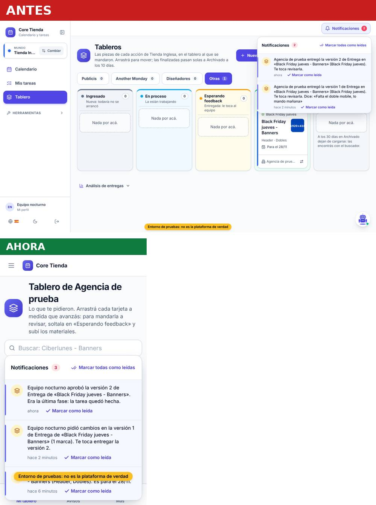 (izquierda equipo, derecha agencia en el celular)
- **Prueba a ciegas (Martina, 26/11 noche):** consigna «fijate qué te toca hoy y en qué quedó lo de la agencia»: Mis tareas dice «No tenés nada pendiente» y la campanita, «Te toca revisarla»: «¿me toca o no?». Tocó el aviso y la entrega ya estaba Finalizada. 8 pasos. 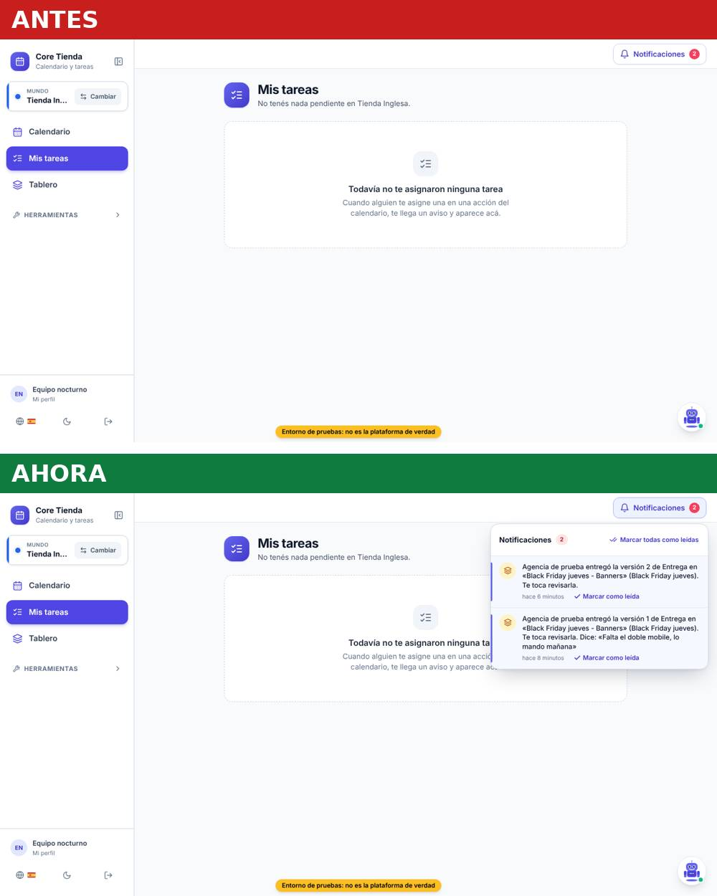
- **Idea de arreglo:** dar por leídos los avisos de una tarjeta cuando la persona la abre o hace lo que el aviso pedía.
- **Visto:** 26/11 noche (Sofía) · 26/11 noche (Martina a ciegas: sube a 🟠)
- **Estado:** En curso desde 26/11 en `nocturno/2026-11-26-campanita-al-dia` (Ramiro VERDE). H-113 queda abierto (choca con «Tarjetas por pieza»).

## Abiertos (de más a menos importante)

> Ivan (25/11): «esta plataforma la van a usar varias agencias a la vez, así que tiene que adaptarse a su forma de trabajar, no al revés». H-081 (ida y vuelta con versiones) ya está en `main` (#86); H-082 (sugerencias) entra después del flujo de la agencia.
>
> Orden del 26/11 (corrida de procesos): 1) que se le pueda pedir trabajo a cualquier agencia (H-018 + H-090) y lo que bloquea (CI en rojo, borrar entregas, cenefas v2); 2) revisar y entregar sin sorpresas; 3) Sugerencias (Ivan); 4) local y Redexpres; 5) Clientes VIP; 6) trabas de herramientas; 7) lo visual y los detalles; 8) lo que falta confirmar.
>
> Orden del 26/11 noche (lo que no está en curso ni en el PR #93): 1) la campanita y la ficha dicen lo mismo que pasó (H-111, H-113); 2) Cenefas sin dudas al cargar (H-115, H-112); 3) local y Redexpres (H-085, H-099, H-086, H-084); 4) palabras de las versiones (H-097) y miniaturas (H-114) después de «Tarjetas por pieza»; 5) lo visual (H-116, H-069, H-003…).

### H-018 · La agencia con la que trabajás no aparece en «¿Quién la hace?», y una «Nueva tarjeta» no se le puede pasar
- **Gravedad:** 🔴 Bloquea (una persona nueva no logra pedirle trabajo a su agencia) · **Quién:** equipo · **Dónde:** ficha de la acción → «Crear tarea» → «¿Quién la hace?», notebook
- **Qué ve una persona:** la lista ofrece «Publicis (todavía sin usuarios)», «Another Monday (todavía sin usuarios)», «Diseñadores (todavía sin usuarios)» y «Equipo nocturno (vos)». «Agencia de prueba», que sí tiene cuenta, no está; recién aparece al desplegar la tarea ya creada, y cambiarla pide un aviso («Se la sacás a Publicis…»).
- **Por qué importa:** cualquier agencia nueva (o una que no sea de las tres) obliga a crear la tarea para otra y después reasignarla: pasos de más y un aviso que no le corresponde a nadie.
- **Cómo repetirlo:** equipo → acción → Crear tarea → Banners → abrir «¿Quién la hace?».
- **Evidencia:** 
- **Prueba a ciegas (Martina, auditoría 25/11):** abandonó: «¿Cómo le pido algo a la agencia con la que trabajo todos los días?». Pasa también en Tablero → Nueva tarjeta. 
- **Procesos 26/11:** sigue en «Crear tarea» y en «Nueva tarjeta», en notebook y celular, y tampoco aparece una agencia recién dada de alta en /admin («Agencia Sofía»). **Se agrava:** una tarjeta creada con «Nueva tarjeta» (sin acción) no tiene en ningún lado cómo cambiarle la agencia (la ficha solo deja nombre, responsable y fecha; «Mover» solo cambia de columna): la agencia de verdad nunca recibe el pedido; hubo que pasarla por la API. En las tareas de una acción el atajo sigue siendo crear para Publicis y reasignar desde ⋯ (ventanita gris H-070, nombre cortado H-022). Ver también H-090 (en el tablero esas agencias caen en «Otras»). 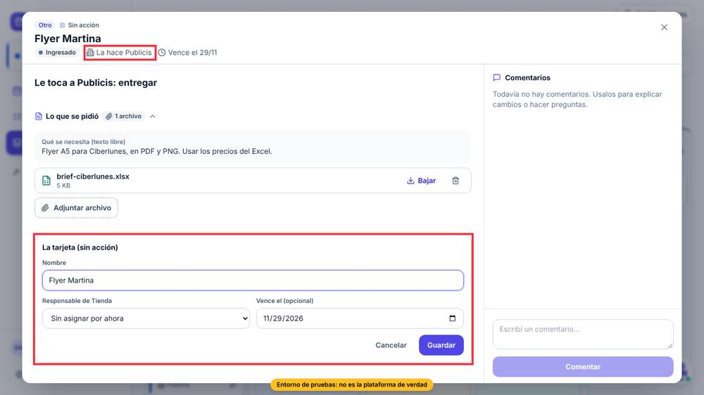 · procesos P12, P13, P17, P51
- **Visto:** 24/11 (código) · 25/11 (confirmado en pantalla) · 25/11 (auditoría: sube a 🔴) · 26/11 (procesos: sigue y se agrava) · 26/11 noche (Sofía: sigue en «Crear tarea»; reasignar desde ⋯ pide la ventanita gris)

### H-090 · En el tablero del equipo, la agencia con la que trabajás no aparece por su nombre: está en «Otras»
- **Gravedad:** 🟠 Traba · **Quién:** equipo · **Dónde:** Tablero `/entregas`, pestañas de agencia, notebook y celular
- **Qué ve una persona:** pestañas «Publicis 2 · Another Monday 0 · Diseñadores 0 · Otras 2». Las tarjetas de «Agencia de prueba» (la única con usuarios) caen en «Otras»; una pedida a Publicis y reasignada también terminó ahí. Cada vez que vuelve al tablero arranca en «Publicis», aunque todo lo suyo esté en «Otras».
- **Por qué importa:** Ivan: «la van a usar varias agencias a la vez». Cada agencia nueva queda escondida bajo «Otras» y hay que acordarse de tocarla en cada visita. Es la misma raíz que H-018 (las tres agencias fijas).
- **Cómo repetirlo:** equipo → Tablero → mirar las pestañas; ir a otra pantalla y volver.
- **Evidencia:** 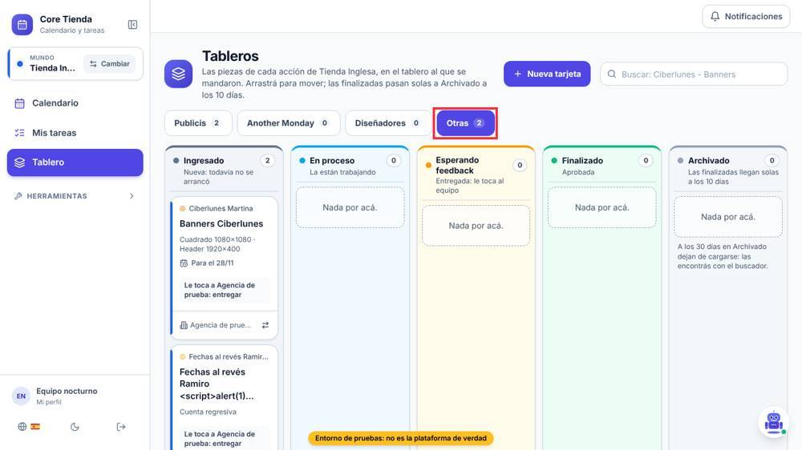
- **Idea de arreglo:** una pestaña por agencia que tenga tarjetas, y recordar la última elegida. Va en paquete con H-018.
- **Visto:** 26/11 (Lucía y Sofía) · procesos P27, P57 · 26/11 noche (Sofía: la tarjeta de Agencia de prueba aprobada sigue en «Otras»; el tablero vuelve a abrir en «Publicis 0») 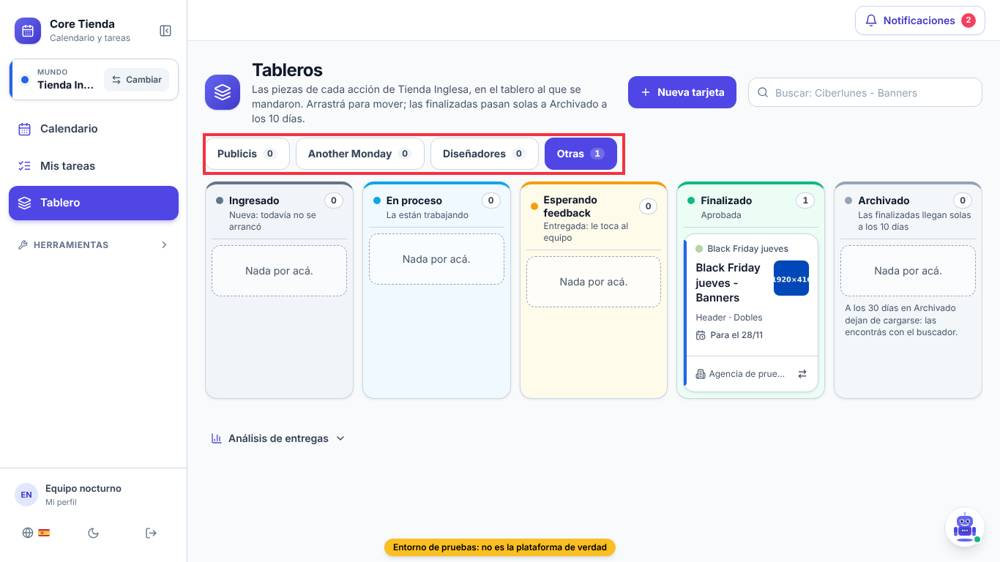

### H-083 · Las pruebas automáticas de `main` están en rojo desde el merge de #90 y #91
- **Gravedad:** 🟠 Traba (no la ve nadie de promo y marca, pero todo PR nuevo nace en rojo) · **Quién:** el equipo que construye (Ivan y el Escuadrón) · **Dónde:** CI de GitHub, paso `npm run test:externos`
- **Qué pasa:** la prueba «cada herramienta de un mundo tiene su permiso» falla para `/clientes-vip`: la ruta no está en la lista de requisitos de acceso del front (`frontend/lib/acceso.ts`). La API (403) y la pantalla («No tenés permiso para ver Clientes VIP») sí bloquean, así que no hay agujero. Como el script encadena con `&&`, tampoco corren test:usuarios, test:redexpres, test:adjuntos, test:guia ni test:clientes-vip (aparte, pasan todas).
- **Por qué importa:** con `main` en rojo no se distingue un PR que rompe algo de uno sano; Ivan ve rojo en cada propuesta.
- **Cómo repetirlo:** `cd frontend && npm run test:externos` → «FALLA … /clientes-vip · 1 prueba(s) fallaron». En GitHub, corrida del merge de #91.
- **Evidencia:** salida del comando (Ramiro, 26/11) y el CI de `main` (dato del coordinador).
- **Idea de arreglo:** sumar `/clientes-vip` con `clientes_vip.view` a los requisitos del front. Chico.
- **Visto:** 26/11 (Ramiro y coordinador) · procesos P49, P55 · 26/11 noche (sigue: el CI del merge de #92 en `main` falla en `test:externos` por `/clientes-vip`; el arreglo está en PR #93, sin mergear)

### H-001 · Borrar una acción o una tarea borra las imágenes y los ZIP que entregó la agencia
- **Gravedad:** 🔴 Bloquea (rompe la regla «las imágenes de las entregas no se borran nunca») · **Quién:** equipo · **Dónde:** ficha de la acción (Eliminar) y tarea («Borrar con sus entregas»), `/calendario`
- **Qué ve una persona:** el aviso de borrar una acción dice «N tareas»; el de una tarea dice «Borrar con sus entregas». Ninguno dice que se van también las imágenes y ZIP que mandó la agencia, que son el histórico.
- **Por qué importa:** se pierde para siempre el histórico que tiene que ir a SharePoint, con un clic.
- **Cómo repetirlo:** crear acción → tarea para la agencia → la agencia entrega imágenes → borrar la acción → las imágenes ya no existen en la base.
- **Evidencia:** confirmado en el código: `ondelete="CASCADE"` en `backend/app/models/entregas.py` (entregas, versiones, imágenes y ZIP de la versión) y en `backend/app/models/calendario.py` (tareas de la acción).
- **Idea de arreglo:** no dejar borrar una acción o tarea que ya tiene entregas (ofrecer cancelarla o archivarla), del lado del servidor y con su prueba. Sin migración.
- **Auditoría 25/11:** el aviso dice «Se va con ella 1 tarea. No se puede deshacer.» 
- **Procesos 26/11:** borrar una acción sigue diciendo solo «Se va con ella 1 tarea. No se puede deshacer.» (captura 081 de Sofía). Sigue esperando respuesta de Ivan sobre cuándo hacerlo · proceso P09
- **Visto:** 24/11 (código) · 25/11 (auditoría) · 26/11 (el aviso sigue igual)

### H-008 · Generar cenefas (motor v2) termina en «Error desconocido» y la corrida queda colgada
- **Gravedad:** 🔴 Bloquea · **Quién:** equipo · **Dónde:** `/materiales/cenefas/v2/generar`, notebook claro
- **Qué ve una persona:** elige la plantilla del editor, sube el Excel («El CSV está listo para generar», aunque es un Excel), toca «Generar cenefas» y a los 10 s: «Error en la generación — Error desconocido» y solo «Volver al inicio». En el Historial queda «Esperando confirmación», sin descargar ni confirmar.
- **Por qué importa:** no hay forma de terminar la corrida; la plantilla hecha en el editor solo se puede usar acá (H-043).
- **Cómo repetirlo:** Generar cenefas → «Cenefa A4» → subir el Excel de «Descargar plantilla Excel» → Validar → Generar → esperar → `/materiales/cenefas/v2/jobs`.
- **Evidencia:** 
- **Fuente:** `plataforma/materiales-precios-locales.md` (la pieza que confirmaba, `PreviewStep.tsx`, no se usa).
- **Procesos 26/11:** editor → «Guardar y Generar» → Excel de ejemplo → Validar (bien) → Generar → «Error en la generación — Error desconocido». El camino normal de Cenefas sí genera (P33). Captura 032 de Sofía · proceso P34
- **Visto:** 24/11 (código) · 25/11 (auditoría: confirmado en pantalla) · 26/11 (sigue)

### H-023 · «Aprobar y terminar» aprueba con piezas faltantes sin preguntar, y la aprobada sigue diciendo en rojo «Falta 1 pieza»
- **Gravedad:** 🟠 Traba (sube 26/11) · **Quién:** equipo, agencia · **Dónde:** ficha de la tarjeta `/entregas?tarea=…`, notebook claro
- **Qué ve una persona:** arriba «Finalizada: se aprobó la entrega» con papel picado; abajo, el recuadro rojo «Falta 1 pieza del pedido». No se sabe si está terminada o no.
- **Por qué importa:** mensajes que se contradicen hacen dudar de lo aprobado (y de si hay que pedir la pieza que falta).
- **Cómo repetirlo:** ciclo completo entregando sin la pieza «Slider fila (mobile)» → Aprobar.
- **Evidencia:** 
- **Idea de arreglo:** una vez aprobada, mostrarlo como dato gris («Se aprobó sin: …»), no como alerta roja.
- **Procesos 26/11:** con «Falta 1 pieza del pedido: Cuenta regresiva» en rojo en la revisión, un toque en «¿Ya está todo? Aprobar y terminar» aprueba sin preguntar (también con doble clic: una sola decisión); en el celular, aprobada con 4 piezas faltantes sigue diciendo «Faltan 4 piezas del pedido». La pieza que falta no llega nunca. Capturas 039, 040 y 090 de Ramiro; 172 de Sofía · proceso P24
- **Visto:** 25/11 · 26/11 (Sofía en el celular y Ramiro: sube a 🟠)

### H-036 · «Avanzar» con todo entregado le pide a la agencia «lo que falta», y no falta nada
- **Gravedad:** 🟠 Traba · **Quién:** equipo y agencia · **Dónde:** Revisar la ronda, notebook; agencia en el celular
- **Qué ve una persona:** con todas las piezas en la ronda 2, el link «¿Falta algo? Avanzar» devuelve la tarjeta a la agencia con «Te dieron el OK: entregá lo que falta (ronda 3)». Además los botones cambian de lugar: en la ronda 1 y 3 el verde grande es «Avanzar», en la 2 «Aprobar y terminar».
- **Por qué importa:** una ronda de más y una agencia que no sabe qué mandar.
- **Cómo repetirlo:** la agencia entrega todo en la ronda 2 → equipo «Revisar ahora» → «Avanzar».
- **Evidencia:** 
- **Procesos 26/11:** «Avanzar» sobre una v3 con las dos medidas le dice a la agencia «Te dieron el OK: entregá lo que falta (versión 4)» y la tarjeta vuelve a En proceso. 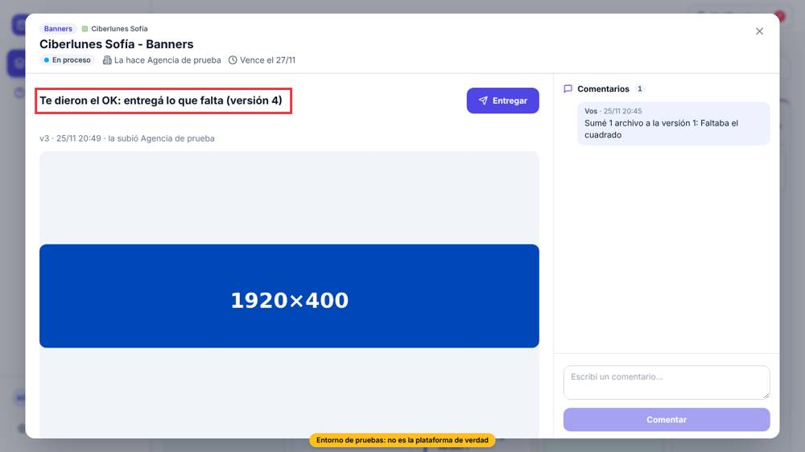 · proceso P21
- **Visto:** 25/11 · 26/11 (sigue)

### H-035 · Al revisar dice «Ya están todas las piezas del pedido» cuando falta el carrito
- **Gravedad:** 🟠 Traba · **Quién:** equipo · **Dónde:** Revisar la ronda (Mis tareas → Revisar ahora), notebook claro
- **Qué ve una persona:** el pedido es «Header · Carrito» y la agencia mandó solo el header (lo dice en el comentario), pero abajo dice «Ya están todas las piezas del pedido» y el botón grande verde es «Aprobar y terminar».
- **Por qué importa:** quien revisa apurado aprueba y el carrito no llega nunca.
- **Cómo repetirlo:** tarea «Black Friday 2026 - Banners» (Header + Carrito) entregada con una sola imagen 1920×416 → Revisar ahora. Con una tarea creada desde la pantalla, el control previo de la agencia sí avisó lo que faltaba: ver de qué depende.
- **Evidencia:** 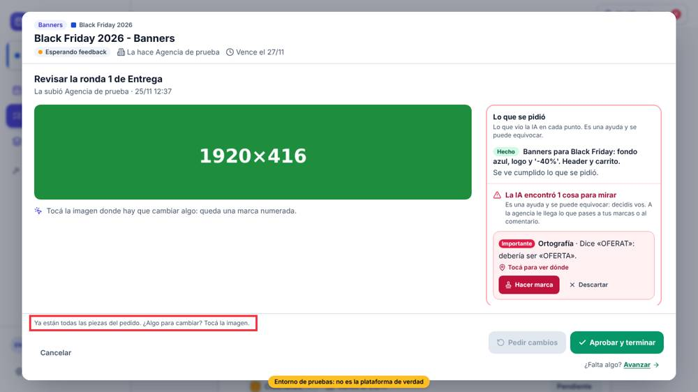
- **Procesos 26/11:** con medidas de la lista la revisión ya avisa «Falta 1 pieza del pedido» (Ramiro, captura 039); con medidas escritas a mano no avisa nada (Sofía: el control previo no dijo que faltaba el 1080×1080). Ver H-094 y H-023 · procesos P19, P21, P26
- **Visto:** 25/11 (Martina a ciegas) · 26/11 (en parte)

### H-089 · «Comparar con la versión 1» pone lado a lado dos piezas distintas
- **Gravedad:** 🟠 Traba · **Quién:** equipo (quien revisa) · **Dónde:** ficha de la tarjeta → Revisar ahora → «Comparar con la versión 1», notebook
- **Qué ve una persona:** «ANTES · VERSIÓN 1» muestra el cuadrado 1080×1080 y «AHORA · VERSIÓN 2» el header 1920×400. No hay forma de elegir qué pieza comparar. Además «Dejar de comparar» queda violeta lleno al lado del «Avanzar» verde (dos botones principales).
- **Por qué importa:** comparar sirve para ver qué cambió en LA MISMA pieza; con pedidos de varias medidas (lo normal en banners) la comparación no sirve y hay que ir y volver entre versiones.
- **Cómo repetirlo:** tarjeta con v1 (1080×1080) y v2 (1080×1080 + 1920×400) → Revisar ahora → Comparar con la versión 1. Con una sola pieza por versión anda bien (Sofía).
- **Evidencia:** 
- **Idea de arreglo:** comparar pieza por pieza, emparejando por medida (o dejar elegir cuál).
- **Visto:** 26/11 (Lucía) · proceso P23

### H-095 · Si la agencia manda una versión mientras revisás, «recargá» te borra la marca que ya escribiste
- **Gravedad:** 🟡 Desprolijo · **Quién:** equipo (quien revisa) · **Dónde:** ficha → Revisar ahora
- **Qué ve una persona:** marca la v1 con un texto; la agencia manda la v2; al tocar «Pedir cambios»: «La agencia mandó una versión nueva mientras revisabas: recargá para ver la última». Al recargar, la marca y su texto se pierden.
- **Por qué importa:** con H-081 la agencia manda versiones sin esperar: va a pasar seguido. Lo bueno: el servidor no deja decidir sobre la versión vieja.
- **Cómo repetirlo:** dos pestañas (equipo y agencia) sobre la misma tarjeta, en ese orden.
- **Evidencia:** captura 055 de Ramiro.
- **Idea de arreglo:** guardar el texto de la marca y ofrecer copiarlo a la versión nueva.
- **Visto:** 26/11 (Ramiro) · procesos P22, P56

### H-039 · «Atrás» o recargar en medio de una entrega borra todo lo cargado, sin preguntar
- **Gravedad:** 🟠 Traba · **Quién:** agencia (y el equipo al entregar) · **Dónde:** ficha → Entregar, notebook y celular
- **Qué ve una persona:** subió imágenes y escribió el comentario; atrás o F5 → tablero cerrado y todo perdido. Con Escape sí está protegido; al recargar no vuelve a la tarjeta.
- **Por qué importa:** en el celular «atrás» es el gesto natural para cerrar.
- **Cómo repetirlo:** agencia → tarjeta → Entregar → subir imagen y comentario → atrás o F5.
- **Evidencia:** 
- **Visto:** 25/11 (Ramiro)

### H-040 · El link del mail lleva al login y, después de entrar, no abre la tarea
- **Gravedad:** 🟠 Traba · **Quién:** agencia y equipo · **Dónde:** `/login` desde `/entregas?tarea=…`
- **Qué ve una persona:** toca el link del aviso, entra y cae en el tablero general, sin la tarjeta abierta. Igual cuando la sesión vence trabajando.
- **Por qué importa:** cada aviso por mail termina en buscar la tarjeta a mano.
- **Cómo repetirlo:** sin sesión, abrir `/entregas?tarea=s1304c6e7a0be` → entrar como agencia.
- **Evidencia:** 
- **Visto:** 25/11 (Ramiro)

### H-097 · Las palabras de las versiones y las fases se enredan: «entregar Entrega 2», «Era la última fase»
- **Gravedad:** 🟡 Desprolijo · **Quién:** agencia y equipo · **Dónde:** tarjeta, ficha y avisos de la campanita
- **Qué ve una persona:** «Le toca a Agencia de prueba: entregar Entrega 2», «corregir y entregar la versión 3 de Entrega 2», botón «Entregar versión 1» en la primera y «Entregar Entrega 2» al reabrir; avisos «Entrega de «Banners Ciberlunes»», «Era la última fase: la tarea quedó hecha». Las rayitas de color de la tarjeta no dicen qué son; en el pie «Agencia de prue…».
- **Por qué importa:** la agencia tiene que traducir; «fase» y «Entrega 2» no son palabras de la gente (la gente dice «ronda» o «cambio»).
- **Cómo repetirlo:** reabrir una tarjeta aprobada y mirar la tarjeta y el aviso de la agencia.
- **Evidencia:** capturas m-agencia2 y 033 de Lucía; 062 de Martina.
- **Visto:** 26/11 (Lucía, Martina y Ramiro) · procesos P19, P25, P29 · 26/11 noche (sigue: «Revisar la versión 1 de Entrega», «¡Aprobada! Era la última fase», avisos «versión 2 de Entrega»)

### H-094 · La revisión con IA dice «encontró 2 cosas» y muestra una; el control previo no avisa la medida que falta
- **Gravedad:** 🟡 Desprolijo · **Quién:** equipo y agencia · **Dónde:** revisión de la versión (equipo) y control previo al entregar (agencia)
- **Qué ve una persona:** «La IA encontró 2 cosas para mirar» con una sola en la lista. En el control previo de la agencia, entregando sin el 1080×1080 (o sin el 1920×400) ni el PDF pedido, solo avisa «OFERAT».
- **Por qué importa:** el número que no coincide resta confianza; y que el control previo no diga «te falta una medida» deja pasar entregas incompletas (H-035, H-023).
- **Cómo repetirlo:** pedido con dos medidas escritas a mano → la agencia entrega una sola → mirar el control previo y después la revisión.
- **Evidencia:** capturas 039, 049 y 052 de Sofía; 027 de Martina.
- **Ojo:** la IA de pruebas es simulada: lo que se juzga es el conteo y el chequeo de medidas (que no depende de la IA), no lo que «ve».
- **Visto:** 26/11 (Sofía y Martina) · procesos P19, P26 · 26/11 noche (sigue: a la agencia le muestra 1 cosa; al equipo «La IA encontró 3 cosas» en v1 y «4 cosas» en v2, con una sola tarjeta a la vista. El control previo **sí** avisó «Pieza que falta: Dobles (mobile) 315×405» antes de mandar: esa parte ya no pasa)

### H-005 · Mover una tarjeta a «Finalizado» la aprueba aunque no haya nada entregado, y no avisa a nadie
- **Gravedad:** 🟠 · **Quién:** equipo, agencia · **Dónde:** tablero `/entregas`
- **Sospecha (código):** arrastrar de «Esperando feedback» a «Finalizado» la da por aprobada aunque quien arrastra no sea aprobador, y no se le avisa a nadie (ni a la agencia). Arrastrarla a «En proceso» no le dice a la agencia qué cambiar.
- **Fuente:** `plataforma/calendario-tareas-entregas.md`, tablero y recorrido 8.
- **Auditoría 25/11:** arrastrar una tarjeta de la agencia de Ingresado a Finalizado no hizo nada y nadie dijo por qué; no había una en «Esperando feedback» para probar.
- **Confirmado del lado del servidor (Ramiro, 26/11):** una tarjeta de Publicis en «Ingresado», sin versiones, movida a «finalizado» queda aprobada y «avisados: 0». No se verificó si la pantalla pide confirmación al soltar (falta probarlo arrastrando) · proceso P27
- **Visto:** 26/11 (Ramiro: confirmado del lado del servidor)

### H-098 · La pestaña abierta de la agencia no se pone al día sola
- **Gravedad:** 🟡 Desprolijo · **Quién:** agencia · **Dónde:** Mi tablero `/entregas`, notebook
- **Qué ve una persona:** una pestaña que quedó abierta sigue diciendo «Ingresado · Entregar versión 1» cuando la tarjeta ya iba por la v2 con cambios pedidos.
- **Por qué importa:** la agencia deja el tablero abierto todo el día y trabaja sobre algo viejo. (La ficha de la acción del equipo sí se pone al día en ~15 s.)
- **Cómo repetirlo:** agencia con el tablero abierto → el equipo pide cambios → mirar la pestaña sin recargar.
- **Evidencia:** captura 051 de Martina.
- **Visto:** 26/11 (Martina a ciegas) · proceso P22 · 26/11 noche (**no se repitió**: con la ficha abierta en la pestaña de la agencia y en la del equipo, cada cambio del otro apareció solo al volver a la pestaña, sin recargar; si Martina tampoco lo ve, pasa a Hechos)

### H-113 · La versión aprobada dice «Aprobada · Agencia de prueba»: no se sabe quién de Tienda la aprobó
- **Gravedad:** 🟡 Desprolijo · **Quién:** equipo (y jefatura) · **Dónde:** ficha de la tarjeta → Versiones, notebook
- **Qué ve una persona:** la línea de la versión dice «v2 · 26/11 02:14 · Aprobada · Agencia de prueba» y abajo «La subió Agencia de prueba». Leído de corrido parece que la aprobó la agencia; en ningún lado dice quién de Tienda aprobó ni cuándo.
- **Por qué importa:** con varias personas en el equipo, nadie sabe quién dio el OK a una pieza que sale publicada. Martina (a ciegas): «yo no aprobé nada, ¿quién la aprobó?».
- **Cómo repetirlo:** ciclo completo hasta aprobar → abrir la tarjeta Finalizada → bajar a Versiones.
- **Evidencia:** 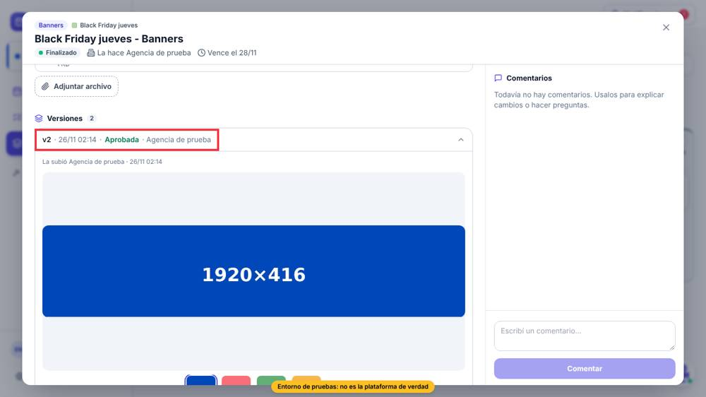
- **Idea de arreglo:** «Aprobada por Equipo nocturno · 26/11 02:15» en la línea de la versión (y en el aviso).
- **Visto:** 26/11 noche (Martina a ciegas)

### H-114 · Las miniaturas de la entrega dicen solo la medida, no qué pieza es
- **Gravedad:** 🟡 Desprolijo · **Quién:** equipo · **Dónde:** ficha de la tarjeta y revisión, notebook
- **Qué ve una persona:** debajo de la imagen grande, cuadritos «1920×416», «640×260», «590×240», «315×405». Para saber cuál es el Header y cuál el Doble mobile hay que bajar a «Lo que se pidió» y cruzar medidas a mano.
- **Por qué importa:** revisar una entrega es comparar con lo pedido (E3); con 4 a 8 piezas, cruzar medidas cansa y se escapa una.
- **Cómo repetirlo:** abrir una tarjeta con la entrega de Banners Header + Dobles.
- **Evidencia:** 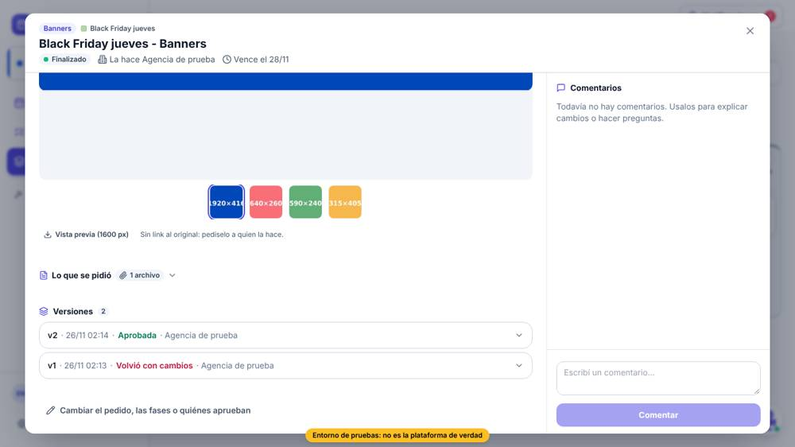 (en las imágenes de prueba la medida está escrita adentro; con piezas de verdad no se ve ni eso)
- **Ojo:** probablemente lo cubre «Tarjetas por pieza» (`feat/tarjetas-por-pieza`, revisar por pieza). Confirmar cuando entre.
- **Visto:** 26/11 noche (Martina a ciegas)

### H-082 · Pedido de Ivan: un lugar de Sugerencias para las agencias, con estado visible
- **Gravedad:** 🟡 (pedido nuevo de Ivan, 25/11) · **Quién:** agencias (y el equipo, que las prioriza) · **Dónde:** nuevo: sección o botón «Sugerencias»
- **Lo que pide Ivan** ([comentario](https://github.com/IvanCasaviejaTI/marketingTienda/issues/82#issuecomment-7169163795)): «una sección o botón de Sugerencias donde puedan dejar comentarios. Cada sugerencia tendría un estado visible (Recibida, En evaluación, Implementada), así ven que su aporte se tiene en cuenta». Sirve para priorizar con información real de quienes la usan.
- **Visto:** 25/11 (pedido de Ivan)

### H-025 · La burbuja de Don Tino tapa botones: «Confirmar pedido» del local, «Validar placas», «Enviar» en La Triada
- **Gravedad:** 🟠 Traba · **Quién:** local y equipo · **Dónde:** `/materiales/convertidor`, `/precios`, `/analytics`, `/facturacion`, `/materiales/cenefas`, celular
- **Qué ve una persona:** el botón flotante de Don Tino queda encima de «Más», el último botón de la barra de abajo; en Finanzas el asistente es otro dibujo.
- **Por qué importa:** «Más» es la puerta al resto del menú en el celular; tocarlo abre el chat en vez del menú.
- **Cómo repetirlo:** equipo en el celular → Convertidor de Excel → mirar la barra de abajo.
- **Evidencia:** 
- **Idea de arreglo:** subir el botón flotante por encima de la barra de abajo en el celular. Ivan (25/11): los asistentes conservan nombre e identidad aunque se vaya el dibujo de robot.
- **Auditoría 25/11:** en la notebook tapa el botón de enviar del chat de La Triada (`/analytics`). 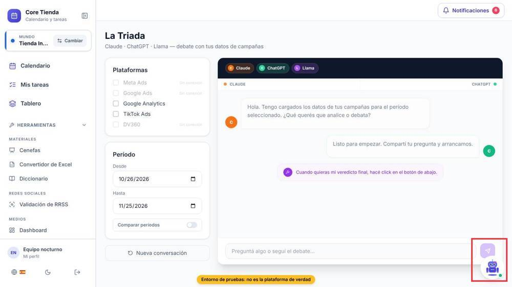
- **Procesos 26/11:** **ya no tapa «Más»** de la barra del celular (arreglado por #87, una sola burbuja). **Sigue tapando:** «Confirmar pedido» y el sello «Confirmado» de **Mi pedido** del local (notebook: se lee «Confirm…»; celular igual), «Sacar foto» en Fotos (celular), «Validar placas (2)» en **Validación de RRSS** (notebook), «Enviar» en La Triada, el último «Confirmar pedido» visible en la **Planilla**, el final de «Pinchos Bombas», la columna «L» del calendario, el contador de columna del tablero, el texto del informe de Clientes VIP y chips de la Guía y Precios (celular). Al local le sugiere Google Ads / ROAS.  · procesos P31, P40, P41, P43, P44, P45, P57
- **Visto:** 25/11 (Lucía) · 25/11 (auditoría) · 26/11 (sigue: «Más» arreglado, tapa en lugares nuevos) · 26/11 noche (Lucía: sigue)

### H-085 · Mi pedido: una cantidad negativa da «Error al guardar» y queda escrita como si estuviera
- **Gravedad:** 🟠 Traba · **Quién:** local · **Dónde:** Mi pedido `/redexpres/mi-pedido`, cualquier casilla, notebook
- **Qué ve una persona:** escribe -5 en «Afiche 54×74», sale de la casilla: aviso rojo «Error al guardar Nativo Florida» y el -5 sigue en la casilla; en la base quedó vacío. Con 99999999 baja a 20 y avisa «Máximo 20 por sucursal» (bien); con 2.5 guarda 2 sin decir nada.
- **Por qué importa:** el local cree que pidió algo que no quedó, y el error no dice qué casilla ni qué hacer (un guion de más se tipea fácil en el celular).
- **Cómo repetirlo:** local → Mi pedido (mes abierto) → escribir -5 en una casilla → salir.
- **Evidencia:** 
- **Idea de arreglo:** no dejar escribir negativos ni decimales (como con el máximo), o volver la casilla a lo guardado y decir cuál falló.
- **Visto:** 26/11 (Ramiro) · procesos P40, P56

### H-086 · Desconfirmar un pedido: solo lo ve el superadmin y es una «✕» de 10 px sin explicación
- **Gravedad:** 🟠 Traba · **Quién:** equipo de Redexpres (gestión) y, de rebote, el local · **Dónde:** Planilla `/redexpres/planilla`, columna Estado, notebook
- **Qué ve una persona:** en la fila confirmada, «Confirmado» y una ✕ gris chiquita, sin texto ni explicación al pasar el mouse; tocarla desconfirma sin preguntar. La ✕ solo se dibuja para superadmin, aunque el servidor deja desconfirmar a cualquiera con permiso de gestionar Redexpres.
- **Por qué importa:** es la única salida para el local que confirmó con un error («pedíselo a marketing», H-020): si quien gestiona Redexpres no es superadmin, no tiene cómo destrabarlo.
- **Cómo repetirlo:** Redexpres → Planilla → mes con un pedido confirmado → correr la tabla a la derecha → mirar la ✕; con una cuenta con redexpres.manage sin superadmin no aparece.
- **Evidencia:** 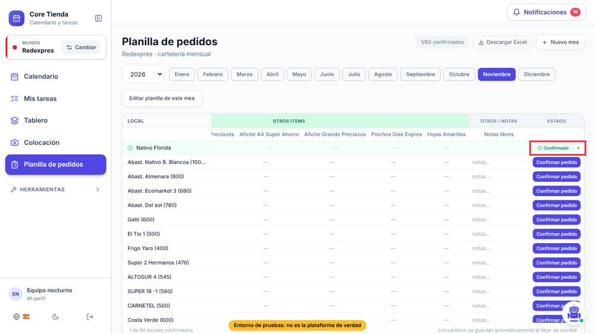
- **Idea de arreglo:** botón «Volver a abrir» con texto, para quien tenga el permiso de gestión, con confirmación dentro de la pantalla.
- **Visto:** 26/11 (Sofía) · proceso P41

### H-084 · Al local le dejan llenar «Cambiar contraseña» y recién al final le dicen que no puede
- **Gravedad:** 🟠 Traba · **Quién:** local · **Dónde:** Mi perfil `/perfil`, notebook y celular
- **Qué ve una persona:** el formulario «Cambiar contraseña» está, se deja llenar entero y al tocar «Actualizar contraseña» sale en rojo «Los usuarios de sucursal no pueden cambiar su propia contraseña — pedile a un administrador que la resetee».
- **Por qué importa:** el encargado pierde tiempo, cree que se equivocó y no sabe a quién pedírselo (la contraseña se vence cada 60 días). Era el «pendiente de ver» de H-010.
- **Cómo repetirlo:** local → Mi perfil → completar los tres campos → Actualizar contraseña.
- **Evidencia:** 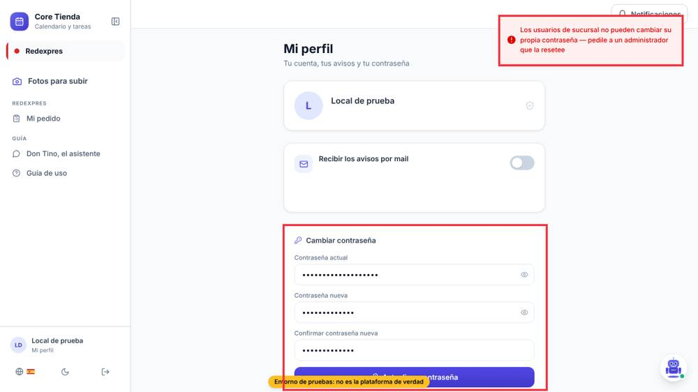 (el mail de prueba tapado)
- **Idea de arreglo:** para el local, en vez del formulario, un texto «Tu contraseña la cambia marketing: pedíselo a …».
- **Visto:** 26/11 (Martina a ciegas) · procesos P03, P53

### H-010 · El local entra a Don Tino y no a lo suyo
- **Gravedad:** 🟠 Traba · **Quién:** local · **Dónde:** al entrar (`/home`), celular claro
- **Qué ve una persona:** al entrar, «Hola, Local 👋 — Don Tino está listo para ayudarte» y abajo «Asistente con IA real · Powered by Claude Sonnet 5» (en inglés). Nada de su pedido del mes ni de la foto que le pidieron: tiene que saber que eso está en la barra de abajo (Fotos, Mi pedido). La barra de abajo sí está (no se confirma «sin barra»).
- **Por qué importa:** el encargado entra con poco tiempo a hacer una cosa (pedido o foto) y lo primero que ve es un chat.
- **Cómo repetirlo:** entrar con local-de-prueba en el celular.
- **Evidencia:** 
- **Pendiente de ver:** el cambio de contraseña en Mi perfil → confirmado el 26/11, ahora es H-084.
- **Idea de arreglo:** que el local entre a «Fotos para subir» (si tiene alguna pendiente) o a «Mi pedido».
- **Auditoría 25/11:** Martina: «yo vengo a pedir cenefas»; si el local le pregunta a Don Tino «¿qué tengo que hacer hoy?», le dice que pida permiso del calendario. 
- **Procesos 26/11:** el local sigue entrando a Don Tino, que le sugiere Google Ads, ROAS y precios de competencia (captura 002 de Martina) · procesos P01, P31
- **Visto:** 24/11 (barrido) · 25/11 (confirmado en pantalla) · 25/11 (auditoría) · 26/11 (Lucía y Martina)

### H-012 · Pasado el bloqueo del login, un solo error vuelve a dejar a la persona 15 minutos afuera
- **Gravedad:** 🟠 Traba · **Quién:** todos (sobre todo el encargado de local) · **Dónde:** `/login`
- **Sospecha (código):** pasados los 15 minutos de bloqueo, un error más vuelve a bloquear; el mail tiene que coincidir exacto (mayúsculas y espacios).
- **Fuente:** `plataforma/entrada-admin-diseno.md`.
- **Confirmado (Ramiro, 26/11):** con una cuenta descartable: 5 claves malas → bloqueada (la buena rebota con mensaje genérico); al vencer el bloqueo, 1 clave mala → otros 15 min y la buena vuelve a rebotar. El mensaje no explica el bloqueo. Por qué importa: el encargado que se equivoca una vez después del primer bloqueo queda otra vez afuera sin saber por qué. Evidencia: prueba con la cuenta descartable (fin del bloqueo simulado en la base, solo esa cuenta) · proceso P01
- **Visto:** 26/11 (Ramiro: confirmado)

### H-099 · Al local no le llega aviso cuando abren el pedido del mes, y los otros meses no responden
- **Gravedad:** 🟡 Desprolijo · **Quién:** local · **Dónde:** Mi pedido `/redexpres/mi-pedido`, notebook
- **Qué ve una persona:** «Marketing todavía no abrió el pedido de Noviembre 2026» (bien), pero ningún mes queda marcado, tocar otro mes no hace nada ni explica, y cuando marketing lo abre no llega nada a la campanita.
- **Por qué importa:** el encargado tiene que entrar a mirar cada tanto para saber si ya puede pedir.
- **Cómo repetirlo:** local con el mes sin abrir → Mi pedido → tocar Octubre; el equipo abre el mes → campanita del local.
- **Evidencia:** captura 007 de Martina.
- **Lucía (26/11 noche):** en el celular los 12 meses son palabras grises sin borde, de 28 px de alto, y no marcan el mes en curso: no parecen tocables. 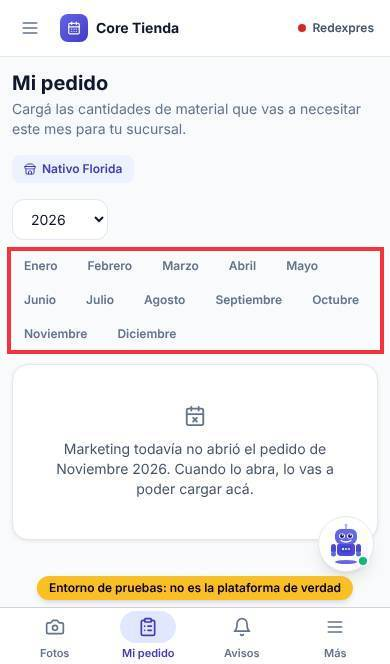
- **Visto:** 26/11 (Martina a ciegas) · proceso P40 · 26/11 noche (Lucía: meses en el celular)

### H-044 · En la Planilla de pedidos no hay cómo buscar un local entre 60
- **Gravedad:** 🟠 Traba · **Quién:** equipo de Redexpres · **Dónde:** `/redexpres/planilla`, notebook
- **Qué ve una persona:** 60 filas sin orden ni buscador; el estado al final a la derecha con 59 botones violeta «Confirmar pedido»; nombres largos cortados.
- **Por qué importa:** cada consulta de un local es bajar mirando o Ctrl+F.
- **Cómo repetirlo:** Redexpres → Planilla → Diciembre → buscar «Costa Verde».
- **Evidencia:** 
- **Procesos 26/11:** sigue sin buscador; además los meses tienen borde punteado (parecen sin terminar) y distinto a Mi pedido, y las columnas se cortan a la derecha sin señal de que se desliza (captura 060 de Lucía) · procesos P39, P41
- **Visto:** 25/11 · 26/11 (sigue)

### H-070 · Confirmaciones en la ventanita gris del navegador
- **Gravedad:** 🟡 Desprolijo · **Quién:** equipo, local, jefatura · **Dónde:** cambiar la agencia de una tarea; Confirmar pedido; borrar una cuenta
- **Qué ve una persona:** «localhost dice: Se la sacás a Publicis…», «¿Confirmás el pedido…?», «¿Eliminar a…?» en la caja gris del sistema (en el celular, la de Safari). En el resto, la confirmación va adentro de la pantalla.
- **Por qué importa:** parece un error del navegador; como H-018 obliga a reasignar, sale seguido.
- **Cómo repetirlo:** acción → tarea de Publicis → «Quién la hace» → otra agencia.
- **Evidencia:** la ventanita no sale en las capturas; texto leído en pantalla (Sofía).
- **Procesos 26/11:** sale también en **«Confirmar pedido» del local** (confirma bien, pero pide el OK en la ventanita gris; la herramienta de Martina la cerraba sola y le pareció que el botón no hacía nada) y al tocar un mes punteado de la Planilla. Al reasignar: «Se la sacás a Publicis…» (Sofía y Ramiro) · procesos P17, P39, P41
- **Visto:** 25/11 · 26/11 (sigue, más lugares) · 26/11 noche (sigue: reasignar la tarea a otra agencia)

### H-019 · Una foto panorámica de la góndola no se puede mandar, y el error no se entiende
- **Gravedad:** 🟠 Traba · **Quién:** local · **Dónde:** Fotos para subir `/fotos`, celular claro
- **Qué ve una persona:** el encargado saca una foto apaisada de la góndola entera y arriba sale en rojo «La miniatura es demasiado chica (240×52).». No sabe qué es «miniatura» ni qué tiene que hacer distinto; la foto no se manda.
- **Por qué importa:** para mostrar una góndola o una cabecera larga lo natural es la foto panorámica; el local se queda sin poder cumplir el pedido y sin explicación (y marketing lo ve como atrasado).
- **Cómo repetirlo:** equipo en Redexpres → acción → pestaña Fotos → «Pedir foto a 1 local». Local de prueba (celular) → Fotos → subir una imagen de 3000×600 o 1920×416 (más ancha que ~3,75 a 1). Con 1600×1200 anda bien («¡Listo! Tu foto se envió a marketing.»).
- **Evidencia:** 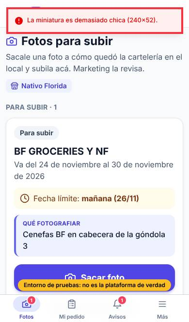
- **Idea de arreglo:** que la miniatura de una foto muy ancha no quede por debajo del mínimo (o no aplicarle el mínimo), y que cualquier rechazo diga qué hacer en criollo («Sacala de nuevo un poco más de cerca»).
- **26/11:** Martina subió una panorámica de 4000×1200 (3,3 a 1) y anduvo, y se ve entera al ampliarla. Falta probar una más ancha que 3,75 a 1 para darlo por resuelto.
- **Visto:** 25/11

### H-087 · Clientes VIP: el gráfico dice «0 M» en todo el eje y el informe del mes es un mensaje de error
- **Gravedad:** 🟠 Traba · **Quién:** equipo con Clientes VIP (jefatura) · **Dónde:** `/clientes-vip`, notebook y celular, claro y oscuro
- **Qué ve una persona:** en «Venta por mes» las cinco rayas del eje dicen «0 M» (las ventas son de miles). En «El informe del mes», firmado «Sofía (análisis) y Valentina (predicción)», el texto es «No tengo acceso al calendario con tus permisos: pedile a un administrador…», y lo ve la superadmin.
- **Por qué importa:** es la pantalla confidencial para decidir; un eje en cero y un informe que es un error le quitan la confianza a todo lo demás.
- **Cómo repetirlo:** equipo → Clientes VIP con un CSV inventado de montos chicos (2 meses).
- **Evidencia:** 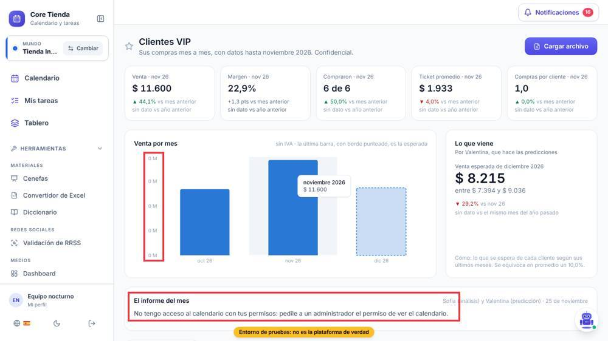
- **Ojo:** el eje «0 M» es de la pantalla. El texto del informe sale de la IA simulada de pruebas (contesta cualquier pedido como Don Tino): no se puede juzgar acá. #91 («el informe de la IA sale entero o no sale») está en `main` y no en el entorno probado: confirmar la próxima noche.
- **Visto:** 26/11 (Lucía, Sofía y Ramiro) · proceso P48

### H-088 · Clientes VIP: un mes imposible en el archivo muestra «undefined» y rebota la carga entera
- **Gravedad:** 🟠 Traba · **Quién:** equipo con permiso de cargar · **Dónde:** `/clientes-vip` → Cargar archivo, notebook
- **Qué ve una persona:** con una fila «30/13/2019», el resumen dice «Meses: enero 2019 a undefined 2019» y ofrece «Cargar los 2 meses»; al cargar, todo rebota con «Mes inválido: '2019-13'», sin decir qué fila.
- **Por qué importa:** el archivo del mes viene de otro sistema; una fila mala frena la carga y nadie sabe cuál corregir. Por código, un año mal tipeado (2062) se aceptaría y pasaría a ser «el último mes», cambiando los segmentos de todos los clientes (no se probó para no pisar datos).
- **Cómo repetirlo:** CSV inventado con las 10 columnas y una fila con mes 13 → Cargar archivo.
- **Evidencia:** 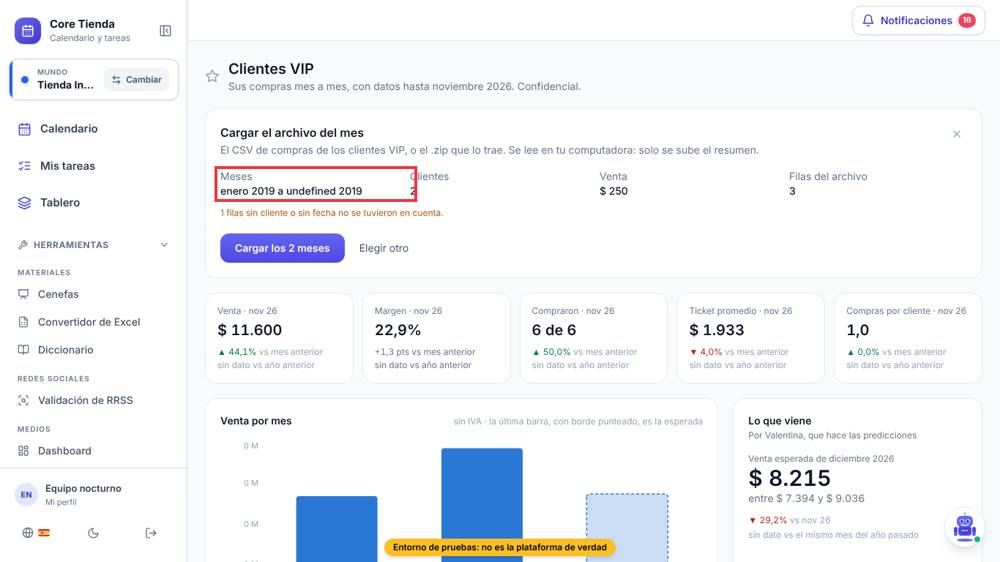
- **Idea de arreglo:** marcar en la vista previa las filas con fecha imposible o futura (con su número) y dejar cargar el resto.
- **Visto:** 26/11 (Ramiro) · proceso P47

### H-100 · Clientes VIP: con poca historia todos salen «Creciendo, riesgo 0», aunque hayan bajado
- **Gravedad:** 🟡 Desprolijo · **Quién:** equipo con Clientes VIP · **Dónde:** `/clientes-vip` → Clientes y ficha del cliente
- **Qué ve una persona:** con 2 meses cargados, los 6 clientes «Creciendo», riesgo 0. El 900002 bajó de $ 2.500 a $ 400 (su gráfico lo muestra) y la ficha dice «Sus últimos 3 meses subieron más de 10% contra los 3 de antes».
- **Por qué importa:** en la primera carga o con clientes nuevos dice lo contrario de lo que se ve (pasa porque «los 3 de antes» no tienen datos).
- **Cómo repetirlo:** cargar 2 meses inventados con un cliente que baja → Clientes → tocarlo.
- **Evidencia:** 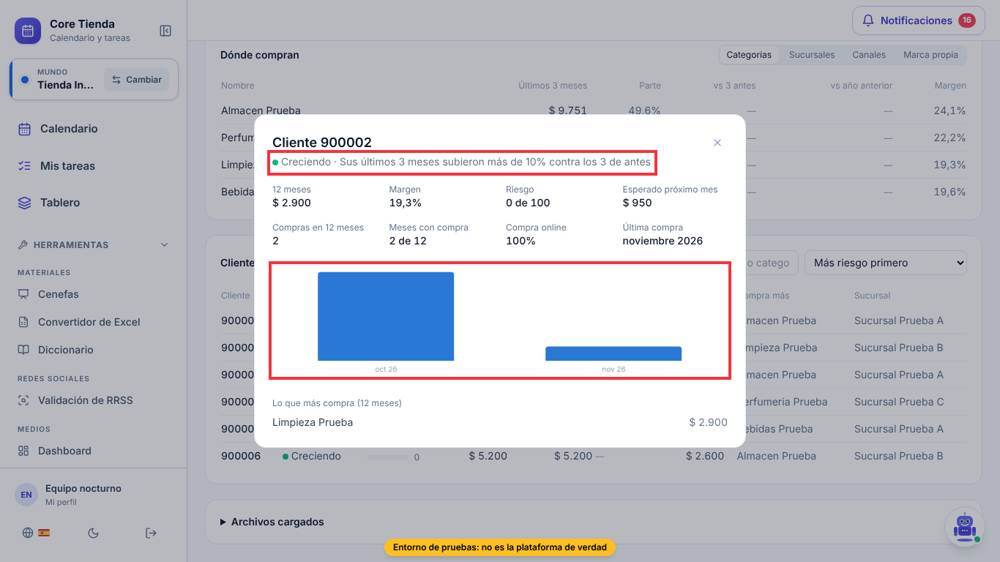
- **Idea de arreglo:** sin historia suficiente, «Nuevo» o «Sin historia» en vez de «Creciendo».
- **Visto:** 26/11 (Sofía) · proceso P48

### H-115 · Cenefas: la Vigencia obligatoria no dice qué escribir ni si hay que tocar «Guardar»
- **Gravedad:** 🟠 Traba · **Quién:** equipo · **Dónde:** Cenefas → Rompe Precios, «Configuración», notebook
- **Qué ve una persona:** «Vigencia *» es un campo vacío con una flechita. Al abrirla: «Sin opciones guardadas — escribí un valor y hacé clic en "Guardar"». No hay ejemplo de formato (¿«del 27 al 29/11»?, ¿fechas?) y no se sabe si el valor se usa sin tocar «Guardar». El título pide «el Excel de productos y la plantilla PPTX», pero lugar para la plantilla recién aparece después de cargar el Excel. Y a pesar del asterisco, se puede seguir sin vigencia (H-112).
- **Por qué importa:** la vigencia sale impresa en cada cenefa del fin de semana: si se escribe mal o queda vacía, hay que reimprimir todo.
- **Cómo repetirlo:** Cenefas → Rompe Precios → tocar la flechita de Vigencia.
- **Evidencia:** 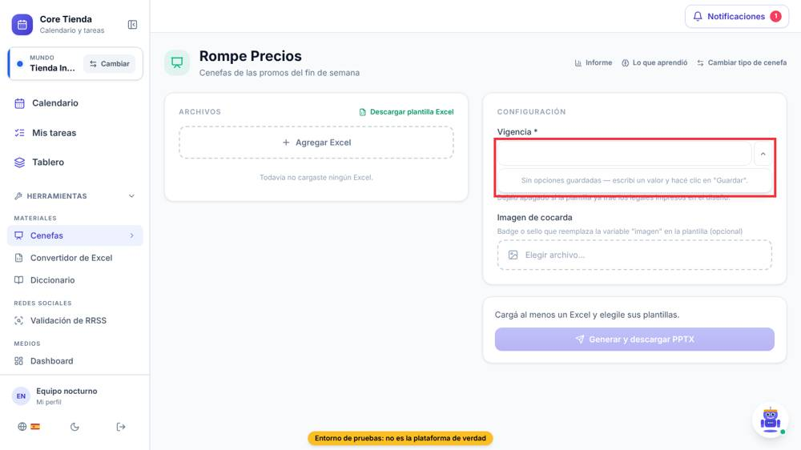
- **Idea de arreglo:** ejemplo en el campo («Ej.: Válido del 27/11 al 29/11»), que lo escrito valga sin «Guardar» (guardar = recordarlo para la próxima), y no dejar seguir sin vigencia. Va en paquete con H-112.
- **Visto:** 26/11 noche (Martina a ciegas)

### H-043 · Una plantilla armada en el editor no aparece al hacer cenefas
- **Gravedad:** 🟠 Traba · **Quién:** equipo · **Dónde:** Editor `/materiales/cenefas/v2` y Cenefas → Pruebas, notebook
- **Qué ve una persona:** «Template creado», pero en Cenefas → Elegir plantillas: «Todavía no hay plantillas guardadas». Solo aparece en el motor v2, que falla (H-008).
- **Por qué importa:** tiene que volver a subirla como PPTX.
- **Cómo repetirlo:** editor → Cenefa A4 → Guardar → /materiales/cenefas → Pruebas → Elegir plantillas.
- **Evidencia:** 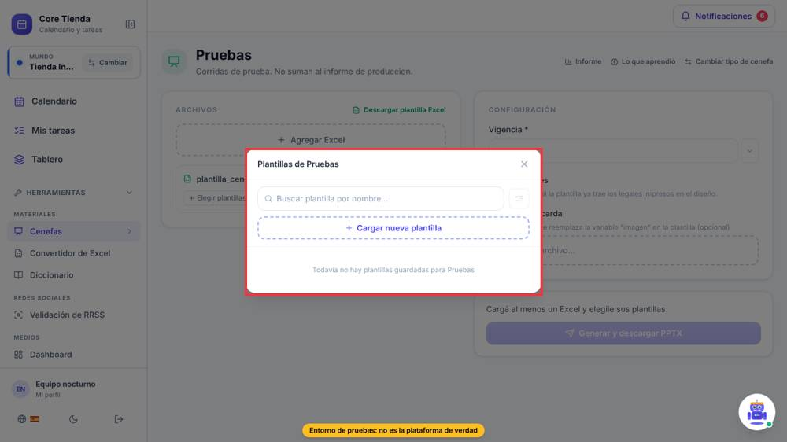
- **Visto:** 25/11

### H-013 · Conexiones dice «Contraseña incorrecta» aunque la clave está bien
- **Gravedad:** 🟠 Traba · **Quién:** equipo con rol Usuario · **Dónde:** `/settings` → Nueva conexión, notebook
- **Qué ve una persona:** le ofrecen «Nueva conexión» (y el tacho); escribe su contraseña correcta y sale «Contraseña incorrecta». Lo que pasa es que no tiene permiso.
- **Por qué importa:** cree que se equivocó de clave y sigue probando.
- **Cómo repetirlo:** cuenta rol Usuario → /settings → Nueva conexión → datos cualquiera → su clave real → Guardar.
- **Evidencia:** 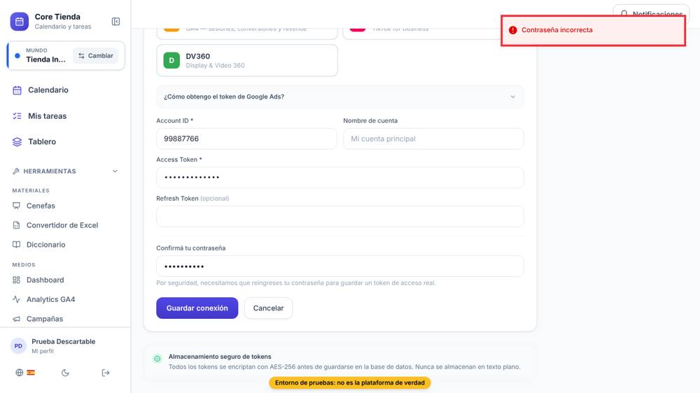
- **Visto:** 24/11 (código) · 25/11 (auditoría: confirmado en pantalla)

### H-046 · En Finanzas, «Confirmar» la factura queda gris y no dice qué falta
- **Gravedad:** 🟠 Traba · **Quién:** equipo · **Dónde:** `/facturacion` → Subir factura, notebook
- **Qué ve una persona:** completa todo y «Confirmar» sigue gris; ningún campo marcado obligatorio; se habilita recién al escribir «Concepto», abajo de todo.
- **Por qué importa:** cree que la pantalla no anda.
- **Cómo repetirlo:** Subir factura → PDF → completar todo menos Concepto.
- **Evidencia:** 
- **Procesos 26/11:** con Cuenta, Monto y Proveedor completos, «Confirmar» gris; se habilita recién con «Nº de factura» y «Concepto», que no dicen ser obligatorios (captura 085 de Sofía) · proceso P46
- **Visto:** 25/11 · 26/11 (sigue)

### H-045 · Buscar precios muestra un error técnico en inglés y no dice «no encontré nada»
- **Gravedad:** 🟠 Traba · **Quién:** equipo · **Dónde:** `/precios`, notebook
- **Qué ve una persona:** «Búsqueda lista — Encontramos 0 producto(s)» y después «HTTPSConnectionPool(host=…) Max retries exceeded… ProxyError» en naranja. (Sin internet falla igual; importa cómo se muestra.)
- **Por qué importa:** no sabe si no hay resultados o si se rompió.
- **Cómo repetirlo:** /precios → «arroz saman 1kg» → Enter.
- **Evidencia:** 
- **Procesos 26/11:** «arroz 1kg» → ventana «Búsqueda lista: Encontramos 0 producto(s)… No pudimos identificar marcas para agrupar» (que sobra) y después el error en inglés (captura 048 de Sofía) · proceso P37
- **Visto:** 25/11 · 26/11 (sigue)

### H-002 · En la portada de Materiales no se leen los nombres de las herramientas
- **Gravedad:** 🟠 Traba · **Quién:** equipo · **Dónde:** Materiales `/materiales`, notebook y celular, claro
- **Qué ve una persona:** cuatro tarjetas con la descripción bien visible pero el título («Generar cenefas», «Editor de plantillas», «Convertidor de Excel», «Diccionario») blanco sobre blanco: casi invisible. Además, a esta portada no se llega desde ningún menú.
- **Por qué importa:** la persona tiene que adivinar qué tarjeta es cuál leyendo la letra chica.
- **Cómo repetirlo:** equipo → ir a `/materiales` en modo claro.
- **Evidencia:**  · contraste medido 1,1:1 (el mínimo es 4,5:1).
- **Auditoría 25/11:** además, el texto de las tarjetas toca el borde (sin margen). 
- **Visto:** 24/11 · 25/11 (sigue en claro; en oscuro los títulos sí se leen) · 25/11 (auditoría) · 26/11 (Lucía: sigue) · 26/11 noche (Lucía: sigue)

### H-026 · En Campañas, Analytics y Conexiones el menú no marca dónde estás
- **Gravedad:** 🟠 Traba · **Quién:** equipo · **Dónde:** `/campaigns`, `/canales`, `/settings`, notebook
- **Qué ve una persona:** la opción marcada queda fuera de vista en el menú (más abajo, sin bajar); además «Herramientas» aparece abierto en unas pantallas y cerrado en otras.
- **Por qué importa:** la persona no sabe en qué pantalla está ni cómo volver; el menú cambia de forma de una pantalla a otra.
- **Cómo repetirlo:** equipo → /campaigns en 1366×768.
- **Evidencia:** 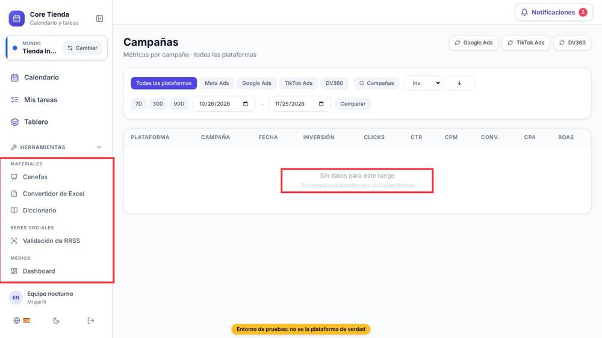
- **Visto:** 25/11 (Lucía) · 25/11 (auditoría) · 26/11 (Lucía: sigue) · 26/11 noche (Lucía: sigue)

### H-027 · Editor de cenefas en el celular: la barra de arriba se encima y se corta
- **Gravedad:** 🟠 Traba · **Quién:** equipo · **Dónde:** Editor de plantillas `/materiales/cenefas/v2`, celular
- **Qué ve una persona:** los botones de arriba («Nuevo», contadores, «Guía de variables», «Cargar») se pisan y quedan cortados.
- **Por qué importa:** no se puede usar el editor desde el celular.
- **Cómo repetirlo:** equipo en el celular → /materiales/cenefas/v2.
- **Evidencia:** 
- **Procesos 26/11:** captura 033 de Sofía · proceso P34
- **Visto:** 25/11 (Lucía) · 26/11 (sigue) · 26/11 noche (Lucía: sigue)

### H-091 · Usar una plantilla en una acción que ya arrancó crea tareas ya vencidas, sin avisar
- **Gravedad:** 🟡 Desprolijo · **Quién:** equipo · **Dónde:** ficha de la acción → Tareas → Usar plantilla, notebook
- **Qué ve una persona:** en una acción del 25/11, «Usar en esta acción» crea 6 tareas y 4 nacen vencidas («venció 26/10», «04/11», «15/11», «22/11»); la acción pasa a «4 tareas vencidas».
- **Por qué importa:** la acción nace en rojo y Mis tareas se llena de vencidas que nunca lo fueron.
- **Cómo repetirlo:** acción que empieza hoy → Usar plantilla → Nueva plantilla → Empezar con un ejemplo → Guardar → Usar en esta acción.
- **Evidencia:** 
- **Idea de arreglo:** avisar antes («4 quedarían vencidas: ¿las ponemos para hoy?»).
- **Visto:** 26/11 (Sofía) · proceso P16

### H-096 · Un archivo rechazado al crear la tarea no la frena: el pedido sale sin el adjunto
- **Gravedad:** 🟡 Desprolijo · **Quién:** equipo · **Dónde:** ficha de la acción → Crear tarea → Adjuntar archivo
- **Qué ve una persona:** adjunta un archivo que el servidor rechaza («dice ser PNG pero adentro es otra cosa») → la tarea se crea igual y el aviso del archivo aparece tapando la ✕ (H-072).
- **Por qué importa:** la agencia recibe el pedido sin el brief y nadie se acuerda de volver a subirlo.
- **Cómo repetirlo:** adjuntar un .svg renombrado a .png → Crear tarea.
- **Evidencia:** captura 013 de Ramiro.
- **Visto:** 26/11 (Ramiro) · procesos P12, P56

### H-092 · El menú «Mover» de una tarjeta en «Ingresado» sale cortado a la izquierda
- **Gravedad:** 🟡 Desprolijo · **Quién:** equipo · **Dónde:** Tablero `/entregas`, primera columna, notebook
- **Qué ve una persona:** al tocar ⇄ se lee «rrancar», «Moverla a mano», «Darla por terminada» sin el principio. En la segunda columna se ve bien.
- **Por qué importa:** justo en la columna donde arranca todo no se entiende qué hace cada opción.
- **Cómo repetirlo:** Tablero → tarjeta en Ingresado → ícono ⇄.
- **Evidencia:** captura 030 de Sofía (bien: 108).
- **Visto:** 26/11 (Sofía) · proceso P27

### H-093 · Una tarjeta movida a mano a «Esperando feedback» dice dos cosas a la vez
- **Gravedad:** 🟡 Desprolijo · **Quién:** equipo · **Dónde:** Tablero → Mover → «Moverla a mano, sin entregar»; ficha de la tarjeta
- **Qué ve una persona:** arriba «Esperando feedback» y en el cuerpo «Le toca a Agencia de prueba: entregar Entrega 2».
- **Por qué importa:** no se sabe a quién le toca.
- **Cómo repetirlo:** Mover → Esperando feedback (a mano) → abrir la tarjeta.
- **Evidencia:** captura 111 de Sofía.
- **Visto:** 26/11 (Sofía) · proceso P27

### H-102 · La Triada: Enter no manda, el nombre de la plataforma no la tilda y el error dice «OPENAI_API_KEY»
- **Gravedad:** 🟡 Desprolijo · **Quién:** equipo · **Dónde:** Análisis IA `/analytics`, notebook
- **Qué ve una persona:** escribe y Enter → nada; toca «Google Analytics» → no se tilda (hay que pegarle al cuadradito); con la casilla: «Error al generar análisis — OPENAI_API_KEY no configurado».
- **Por qué importa:** tres trabas seguidas en la misma pregunta; el error en código no dice qué hacer. (En pruebas no hay clave: lo malo es el texto.)
- **Cómo repetirlo:** /analytics → escribir → Enter; tocar el nombre de una plataforma; mandar.
- **Evidencia:** capturas 074 y 077 de Sofía.
- **Visto:** 26/11 (Sofía) · proceso P45

### H-103 · El Diccionario no deja agregar una descripción: solo se llena desde el Convertidor
- **Gravedad:** 🟡 Desprolijo · **Quién:** equipo · **Dónde:** `/materiales/diccionario`, notebook
- **Qué ve una persona:** vacío dice «se completa al usar el Convertidor» y no hay botón para agregar; corregir es un lápiz de 14 px y hay que tocar el ✓.
- **Por qué importa:** quien quiere dejar listo un producto antes del Excel del mes no puede.
- **Cómo repetirlo:** /materiales/diccionario → buscar cómo agregar un SKU.
- **Evidencia:** capturas 039 y 046 de Sofía.
- **Visto:** 26/11 (Sofía) · proceso P36

### H-104 · Mi perfil: no hay dónde cambiar el nombre
- **Gravedad:** 🟡 Desprolijo · **Quién:** todos · **Dónde:** `/perfil`, notebook
- **Qué ve una persona:** el nombre solo se ve; no hay cómo corregirlo. Idioma y tema están en íconos abajo del menú, no en el perfil. En la agencia la página abre ya bajada (título cortado).
- **Por qué importa:** quien quedó mal escrito al darlo de alta depende de un admin.
- **Cómo repetirlo:** cualquier cuenta → Mi perfil.
- **Evidencia:** capturas 102 de Sofía; 012 y 020 de Martina.
- **Visto:** 26/11 (Sofía y Martina) · proceso P53

### H-047 · «Otro» y «Otra cosa», uno al lado del otro, al pedir una tarea
- **Gravedad:** 🟡 Desprolijo · **Quién:** equipo · **Dónde:** ficha → Crear tarea; Tablero → Nueva tarjeta, notebook
- **Qué ve una persona:** después de Tótem, «Otro» y «Otra cosa» (marcada de entrada). Nadie sabe la diferencia.
- **Por qué importa:** hace dudar en el primer paso de pedir algo.
- **Cómo repetirlo:** equipo → acción → Crear tarea.
- **Evidencia:** 
- **Visto:** 25/11 (Sofía, Martina y Lucía) · 26/11 (sigue) · 26/11 noche (sigue)

### H-022 · En la tarea, quién la hace y el responsable se ven cortados
- **Gravedad:** 🟡 Desprolijo · **Quién:** equipo · **Dónde:** ficha de la acción, tarea desplegada, `/calendario`, notebook 1366×768
- **Qué ve una persona:** los selectores dicen «La agencia (Publ», «Agencia de pruel» y «Responsable: Equipo» (cortados), justo lo que hay que confirmar de un vistazo.
- **Por qué importa:** quién hace la pieza es el dato clave de la tarea; cortado se lee mal y se ve poco profesional.
- **Cómo repetirlo:** equipo → acción → crear tarea para una agencia → desplegar la tarea.
- **Evidencia:** 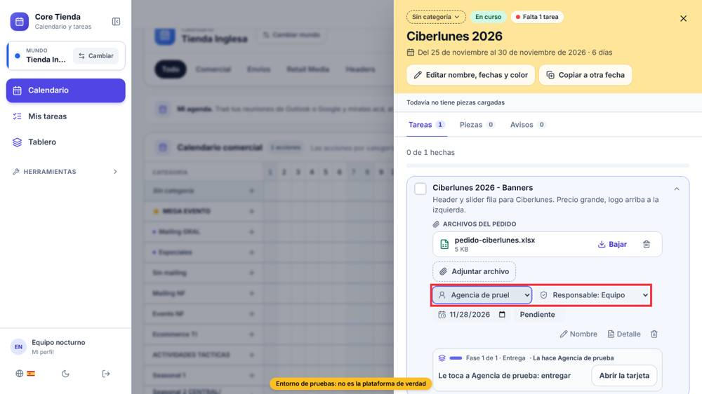
- **Auditoría 25/11:** también en las tarjetas del tablero, pestaña «Otras»: «Agencia de prue…», «Imprenta Gráfic…» (C/100).
- **Procesos 26/11:** «Agencia de prueba (Ager» al reasignar (captura 024 de Sofía) · proceso P17
- **Visto:** 25/11 · 25/11 (auditoría) · 26/11 (sigue)

### H-059 · El logo de Tienda (la margarita) no aparece: hay tres íconos distintos
- **Gravedad:** 🟡 Desprolijo · **Quién:** todos · **Dónde:** login, Mundos, menú, celular
- **Qué ve una persona:** gráfico de barras en el login, robot en el login del celular, cuadrado con calendario en el menú y en Mundos. La margarita solo está en la pestaña.
- **Por qué importa:** la marca de la empresa no se ve en su propia plataforma.
- **Cómo repetirlo:** /login (notebook y celular), /mundos, cualquier menú.
- **Evidencia:**  
- **Visto:** 25/11 · 26/11 (sigue)

### H-017 · Las pantallas viejas parecen otra aplicación (dos estilos visuales)
- **Gravedad:** 🟡 Desprolijo · **Quién:** todos · **Dónde:** pantallas viejas (medios, materiales) vs. nuevas (calendario)
- **Sospecha (código):** botón principal en degradé en las viejas y liso en las nuevas; campos que hacen que el iPhone agrande la página; textos de poco contraste en las viejas.
- **Fuente:** `plataforma/entrada-admin-diseno.md`, sistema visual.
- **Confirmado (Lucía, 25/11):** cuatro estilos de encabezado (con ícono de color variable / sin ícono / centrado / con flecha atrás) y botón en degradé en Conexiones. Las nuevas (calendario, mis tareas, tablero, colocación, fotos, mi pedido) son una familia prolija; medios, finanzas y cenefas v2 parecen otra aplicación. Hojas equipo-notebook-claro-1 a 4.
- **Auditoría 25/11:** ver la dirección de diseño y el pantalla por pantalla en `auditoria-2026-11-25/INFORME.md` (sección 3).
- **Ivan (25/11):** «Hoy se ve muy "hecho con IA". Hay que trabajarlo para que tenga una identidad más propia.» Sigue la dirección del informe, con un cambio: Don Tino y el resto de los asistentes **mantienen su nombre y su identidad** aunque dejen de verse como robots (no se fusionan en «un solo asistente»). Pendiente que conteste: color de las acciones del calendario y azul de una vez.
- **Visto:** 24/11 (código) · 25/11 (Lucía) · 25/11 (auditoría) · 26/11 (Lucía: sigue)

### H-029 · En el calendario compiten dos botones principales iguales
- **Gravedad:** 🟡 Desprolijo · **Quién:** equipo · **Dónde:** `/calendario`, notebook
- **Qué ve una persona:** «Conectar mi calendario» y «Nueva acción» tienen el mismo botón violeta lleno; también dice «1 acciones».
- **Por qué importa:** no queda claro cuál es la acción principal de la pantalla más usada.
- **Cómo repetirlo:** equipo → /calendario con una acción en el mes.
- **Evidencia:** hoja equipo-notebook-claro-1 (Lucía: V4-calendario-dos-principales)
- **Visto:** 25/11 (Lucía) · 25/11 (auditoría) · 26/11 (sigue)

### H-052 · Tablero del equipo en el celular: el título en 8 renglones y ninguna tarjeta a la vista
- **Gravedad:** 🟡 Desprolijo · **Quién:** equipo · **Dónde:** `/entregas`, celular claro y oscuro
- **Qué ve una persona:** el texto queda apretado entre el ícono y «Nueva tarjeta»; después buscador, cuatro botones de agencia y cinco pestañas; la primera tarjeta queda tapada por la barra.
- **Por qué importa:** hay que bajar dos veces para ver una pieza.
- **Cómo repetirlo:** equipo en el celular → Tablero.
- **Evidencia:** 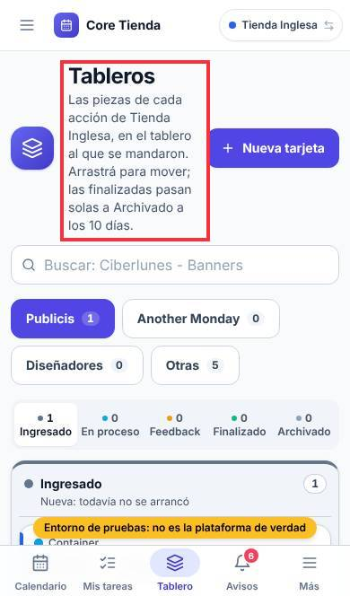
- **Procesos 26/11:** captura 169 de Sofía; 043 de Lucía · proceso P27
- **Visto:** 25/11 (Sofía y Lucía) · 26/11 (sigue) · 26/11 noche (Lucía: sigue)

### H-051 · Calendario en el celular: una semana a la vista y filtros que se cortan
- **Gravedad:** 🟡 Desprolijo · **Quién:** equipo · **Dónde:** `/calendario` y `/campaigns`, celular
- **Qué ve una persona:** primero selector, «Mi agenda» y «Nueva acción»; del mes, dos renglones; al bajar, 7 días y la columna de categorías ocupa la mitad. «Retail Med…» cortado sin señal de que se desliza; en Campañas «Sin datos para» cortado. La vista Lista, que se lee bien, hay que buscarla.
- **Por qué importa:** «mirar el mes entre dos reuniones» no se puede.
- **Cómo repetirlo:** equipo en el celular → Calendario; → Campañas.
- **Evidencia:** barrido `equipo/celular-claro/calendario.jpg` y `campaigns.jpg`; ver INFORME.
- **Visto:** 25/11 (Sofía y Lucía) · 26/11 (sigue)

### H-056 · En el celular, en Mis tareas tocar la tarea no la abre y no hay «Hoy»
- **Gravedad:** 🟡 Desprolijo · **Quién:** equipo · **Dónde:** `/mis-tareas`, celular
- **Qué ve una persona:** tocar el título no hace nada; se abre tocando el chip de la acción. Hay «Vencidas» y «Para esta semana», no «Hoy». La ficha dice «1 días».
- **Por qué importa:** «¿qué tengo hoy?» no tiene respuesta directa.
- **Cómo repetirlo:** equipo en el celular → Mis tareas → tocar una tarea vencida.
- **Evidencia:** capturas 054/055 de Martina.
- **Procesos 26/11:** en la notebook tampoco abre nada tocar el nombre de la tarea (Sofía) · proceso P28
- **Visto:** 25/11 (Martina a ciegas) · 26/11 (también en notebook)

### H-004 · El nombre del mundo se corta y hay dos botones para cambiarlo
- **Gravedad:** 🟡 Desprolijo · **Quién:** equipo · **Dónde:** menú lateral y encabezado del calendario, notebook 1366×768
- **Qué ve una persona:** en el menú dice «Tienda In…» (cortado) con un botón «Cambiar»; al lado, el encabezado del calendario tiene otro botón «Cambiar mundo».
- **Por qué importa:** el mundo es lo primero que hay que saber (qué estoy mirando) y está cortado; dos botones para lo mismo confunden.
- **Cómo repetirlo:** equipo → Tienda Inglesa → `/calendario` en 1366×768.
- **Evidencia:** 
- **Visto:** 24/11 · 25/11 (Lucía: «Tienda In…» cortado en todas las pantallas del equipo, también en oscuro) · 25/11 (auditoría) · 26/11 (sigue) · 26/11 noche (Lucía: sigue)

### H-003 · Tres carteles distintos para decir «esto no es para vos»
- **Gravedad:** 🟡 Desprolijo · **Quién:** local, agencia, equipo con permisos limitados · **Dónde:** pantallas sin acceso (por ejemplo `/admin`, `/calendario`, `/entregas`, `/precios` con la cuenta del local)
- **Qué ve una persona:** a veces un candado con título, explicación y botón «Volver al inicio»; a veces un escudo rojo con una línea chica y sin botón («No tenés acceso al calendario»); a veces «Los precios no son de Redexpres» con otro dibujo. Parecen tres aplicaciones distintas.
- **Por qué importa:** se ve poco profesional y, donde no hay botón, la persona queda sin salida.
- **Cómo repetirlo:** entrar con la cuenta del local y abrir `/admin`, `/calendario` y `/precios`.
- **Evidencia:** 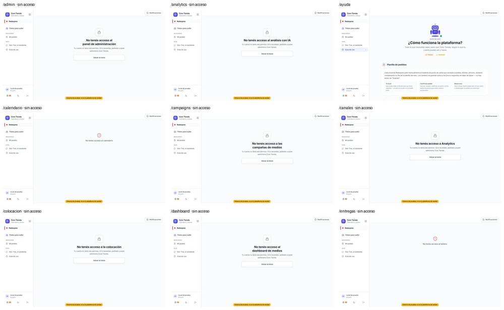
- **Idea de arreglo:** un solo cartel (el del candado, con botón) para todas.
- **Auditoría 25/11:** sigue; además el local en /entregas deja un error en la consola (pide el tablero y recibe «no») y una dirección que no existe muestra otro cartel más, en inglés (H-058).
- **Procesos 26/11:** Clientes VIP suma un cuarto estilo («Clientes VIP no es de Redexpres»); con un usuario sin permiso de calendario, «No tenés acceso al calendario» sigue sin salida (Sofía, Lucía, Ramiro) · procesos P49, P52, P55
- **Visto:** 24/11 · 25/11 (sigue: en el local, /calendario, /mis-tareas y /entregas con escudo rojo sin botón; /mis-tareas dice «No tenés acceso al calendario.») (Lucía: en el local, Convertidor y /materiales dicen «No tenés acceso a las cenefas»; Diccionario «El diccionario no es de Redexpres» con otro dibujo y sin botón; hojas local-celular-claro-3 y local-notebook-oscuro-3) · 25/11 (auditoría) · 26/11 (sigue) · 26/11 noche (barrido: sigue igual en el local) · 26/11 noche (Lucía: además, el Convertidor le dice al local «No tenés acceso a las cenefas»)

### H-058 · Una dirección que no existe muestra el 404 de fábrica, en inglés y sin salida
- **Gravedad:** 🟡 Desprolijo · **Quién:** todos · **Dónde:** cualquier ruta inventada, notebook
- **Qué ve una persona:** pantalla blanca «404 | This page could not be found.», sin menú ni botón.
- **Por qué importa:** le pasa a quien abre un link viejo o mal copiado.
- **Cómo repetirlo:** `/calendario/xyz`.
- **Evidencia:** 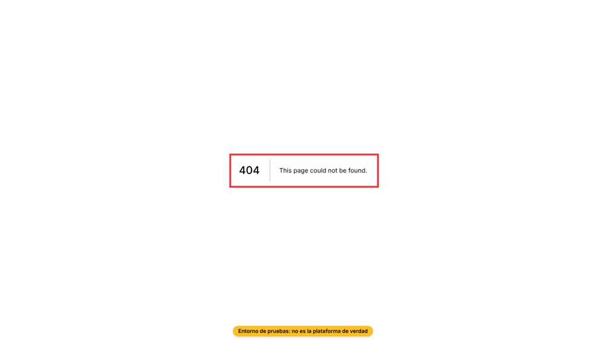
- **Visto:** 25/11 (Ramiro)

### H-031 · Las pantallas vacías tienen cinco estilos distintos
- **Gravedad:** 🟡 Desprolijo · **Quién:** equipo · **Dónde:** Campañas, Analytics, Conexiones, Finanzas, Colocación…
- **Qué ve una persona:** cada pantalla vacía se ve distinta; la de Colocación es la buena (explica y ofrece el paso). En Campañas el texto está a 1,5:1; los botones desactivados son violeta lavado sin decir qué falta.
- **Por qué importa:** una pantalla vacía tiene que explicar qué va ahí; así parecen rotas.
- **Cómo repetirlo:** equipo → /campaigns, /settings, /facturacion, /colocacion.
- **Evidencia:** hoja equipo-notebook-claro-2 del barrido; contraste 1,5:1 medido
- **Visto:** 25/11 (Lucía) · 25/11 (auditoría) · 26/11 (Lucía: sigue)

### H-116 · Dos estilos de botón «apagado»: lila lavado en unas pantallas, gris en otras, sin decir por qué
- **Gravedad:** 🟡 Desprolijo · **Quién:** equipo · **Dónde:** Diccionario («Descargar Excel»), Finanzas → Cuentas («+ Crear»), Convertidor («Continuar»), Precios («Buscar»); notebook y celular
- **Qué ve una persona:** con el diccionario vacío, «Descargar Excel» es un violeta lavado (~2:1) que no se sabe si está apagado o es que no se lee, y no dice qué falta. En otras pantallas lo apagado es gris. Dos maneras distintas de decir «todavía no».
- **Por qué importa:** no se distingue «no se puede» de «no se lee», y no dice qué falta para poder usarlo (vara: pareja en todas partes, contraste alto).
- **Cómo repetirlo:** equipo → Herramientas → Diccionario con la base vacía; Finanzas → Cuentas; Convertidor sin archivo.
- **Evidencia:** 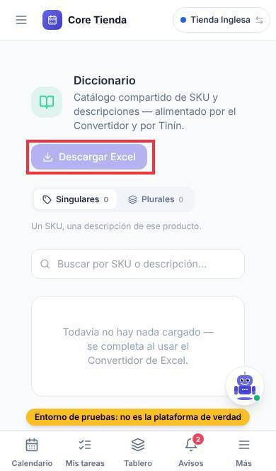 (Lucía, barrido del 26/11 noche)
- **Visto:** 26/11 noche (Lucía)

### H-069 · Letra gris clarito o de 10 px que no se lee
- **Gravedad:** 🟡 Desprolijo · **Quién:** equipo, agencia, local · **Dónde:** Generar cenefas (pasos 2 y 3), Informe («DESDE/HASTA»), La Triada («Sin conexión»), Cuentas («ACTIVA»), Perfil («SUPER ADMIN»), Mi pedido («OFERTAS», «BOMBAS»)
- **Qué ve una persona:** etiquetas en gris muy claro (≈2,5:1) o de 10 px en mayúscula.
- **Por qué importa:** hay que acercarse para leer; no se distingue «apagado» de «no se lee».
- **Cómo repetirlo:** abrir esas pantallas en claro.
- **Evidencia:** barrido `equipo/notebook-claro/materiales__cenefas__v2__generar.jpg`, `analytics.jpg`, `facturacion__cuentas.jpg`; medida aprox. 2,5–2,6:1.
- **Visto:** 25/11 (Lucía) · 26/11 (Lucía: sigue) · 26/11 noche (Lucía: sigue)

### H-068 · El calendario de Redexpres encandila: amarillo flúo y títulos en mayúscula cortados
- **Gravedad:** 🟡 Desprolijo · **Quién:** equipo · **Dónde:** `/calendario` en Redexpres, notebook
- **Qué ve una persona:** barras llenas amarillo puro, naranja, magenta y negro; «ANIVERSARIO MAILING NOVIEMBRE (SORTEO AUTO + SORTEO) 40 PAG + CONTRATAP…».
- **Por qué importa:** cansa la vista y nada se destaca.
- **Cómo repetirlo:** Cambiar mundo → Redexpres → Calendario, noviembre 2026.
- **Evidencia:** 
- **Idea de arreglo:** barra blanca con rayita de color (duda para Ivan: los colores los eligen ellos).
- **Visto:** 25/11 (Lucía)

### H-014 · Lo que explica la plataforma está viejo y habla de tokens
- **Gravedad:** 🟡 Desprolijo · **Quién:** todos · **Dónde:** Guía de uso `/ayuda`, Don Tino (`/home`), `/login`
- **Qué ve una persona:** la Guía habla de Dashboard, Campañas, La Triada, Cenefas, Precios y no menciona calendario, tareas, tablero, mundos ni agencias; el login vende «Analytics multiplataforma, Análisis con IA, Precios en vivo, Cenefas con IA»; Don Tino muestra «1.380 tokens» bajo cada respuesta, «Powered by Claude Sonnet 5» y sugiere preguntas de Google Ads y ROAS.
- **Por qué importa:** quien busca ayuda encuentra otra plataforma.
- **Cómo repetirlo:** /ayuda; /login; /home → abrir Don Tino → preguntar.
- **Evidencia:**  
- **Procesos 26/11:** **la Guía ya habla de calendario, tareas, tableros y agencias** (esa parte ya no pasa). Siguen «1.380 tokens» y «Powered by Claude Sonnet 5» en Don Tino, y al local le sugiere Google Ads/ROAS (Sofía, Lucía, Martina) · procesos P31, P32
- **Visto:** 24/11 (código) · 25/11 (auditoría: confirmado en pantalla) · 26/11 (sigue en parte)

### H-055 · El comentario de la agencia está en la ficha, pero el panel «Comentarios» dice que no hay
- **Gravedad:** 🟡 Desprolijo · **Quién:** equipo y agencia · **Dónde:** ficha de la tarjeta, notebook
- **Qué ve una persona:** «Va header web y carrito…» debajo de la imagen y, a la derecha, «Todavía no hay comentarios».
- **Por qué importa:** dos lugares para comentar y uno dice que no hay nada.
- **Cómo repetirlo:** la agencia entrega con comentario → el equipo abre la tarjeta.
- **Evidencia:** captura C/080 de la noche (Sofía).
- **Procesos 26/11:** después de pedir cambios con comentario, el panel sigue mostrando solo «Sumé 1 archivo…» (captura 062 de Sofía) · proceso P22
- **Visto:** 25/11 · 26/11 (sigue) · 26/11 noche (sigue: con una marca y la nota de la agencia, «Comentarios» dice «Todavía no hay comentarios»)

### H-054 · «Cambiar el pedido» abre otro formulario, con otras palabras y las medidas vacías
- **Gravedad:** 🟡 Desprolijo · **Quién:** equipo · **Dónde:** ficha de la tarjeta → «Cambiar el pedido, las fases o quiénes aprueban», notebook
- **Qué ve una persona:** «Tipo de pieza: … Banner web…», «Medidas» vacías y «Desde/Hasta» vacías aunque la tarea vence el 04/12.
- **Por qué importa:** parece otro pedido; no se sabe qué vale.
- **Cómo repetirlo:** tarea Banners → abrir la tarjeta → «Cambiar el pedido…».
- **Evidencia:** captura C/037 de la noche (Sofía).
- **Visto:** 25/11 · 26/11 (sigue)

### H-053 · En la vista Equipo, cambiar de mes no cambia nada
- **Gravedad:** 🟡 Desprolijo · **Quién:** equipo · **Dónde:** `/calendario` vista Equipo, notebook
- **Qué ve una persona:** arriba «Febrero 2027», abajo sigue «Esta semana» con las mismas tareas.
- **Por qué importa:** quien mira la carga de otro mes cree que la está viendo.
- **Cómo repetirlo:** Calendario → Equipo → flecha de mes.
- **Evidencia:** capturas C/007 y C/008 de la noche (Sofía).
- **Procesos 26/11:** captura 085 de Sofía · proceso P10
- **Visto:** 25/11 · 26/11 (sigue)

### H-007 · «Copiar a otra fecha» no copia el archivo del pedido y no lo avisa
- **Gravedad:** 🟡 Desprolijo · **Quién:** equipo, agencia · **Dónde:** ficha de la acción → «Copiar a otra fecha», notebook
- **Qué ve una persona:** «Qué se copia» dice «1 tarea · en Pendiente y con el vencimiento corrido» y no menciona el archivo; la tarea nueva ya no muestra «1 archivo». El aviso verde dice recién al final «Le llegó el aviso de sus tareas a 1 persona».
- **Por qué importa:** la agencia recibe un pedido sin el brief.
- **Cómo repetirlo:** acción con una tarea para la agencia y un adjunto → Copiar a otra fecha → Copiar.
- **Evidencia:** capturas C/050, C/051 y C/043 de la auditoría (Sofía).
- **Ya no pasa:** la vista Equipo ya cuenta la tarea de la agencia para su responsable de Tienda (PR #75). Sin confirmar: que el responsable no reciba aviso al entregar/aprobar.
- **Procesos 26/11:** la copia no trae el Excel (la original dice «1 archivo»), sin aviso (captura 080 de Sofía) · proceso P08
- **Visto:** 24/11 (código) · 25/11 (auditoría: confirmado en pantalla) · 26/11 (sigue)

### H-048 · A la agencia, una tarea que no es suya le dice «la borró otra persona»
- **Gravedad:** 🟡 Desprolijo · **Quién:** agencia · **Dónde:** `/entregas?tarea=<de otra agencia>`, notebook
- **Qué ve una persona:** ventana vacía «Esta tarea ya no existe: la borró otra persona.» y «Probar de nuevo», que no sirve.
- **Por qué importa:** cree que le borraron un trabajo (pasa con avisos viejos de tareas reasignadas).
- **Cómo repetirlo:** agencia → `/entregas?tarea=sc40e45525c05` (la de Publicis).
- **Evidencia:** 
- **Procesos 26/11:** la agencia que intenta cambiar el estado de su propia tarea por la API recibe «Esta acción ya no existe: la borró otra persona» (Ramiro) · proceso P55
- **Visto:** 25/11 (Sofía y Ramiro) · 26/11 (parecido por la API)

### H-050 · Revisión del lote de cenefas: «Ver capacidad (XXX)», el precio encimado y genera sin la vigencia obligatoria
- **Gravedad:** 🟡 Desprolijo · **Quién:** equipo · **Dónde:** Cenefas → Pruebas → revisión, notebook
- **Qué ve una persona:** botón con texto de relleno «(XXX)»; «Precio Final» encima del «899»; aviso con el título cortado; «Generar las 1»; deja generar con «Vigencia *» vacía.
- **Por qué importa:** se ve sin terminar y sale una cenefa sin vigencia.
- **Cómo repetirlo:** Cenefas → Pruebas → Excel de ejemplo → `Base cenefa A4 1.pptx` → sin vigencia → Generar.
- **Evidencia:** 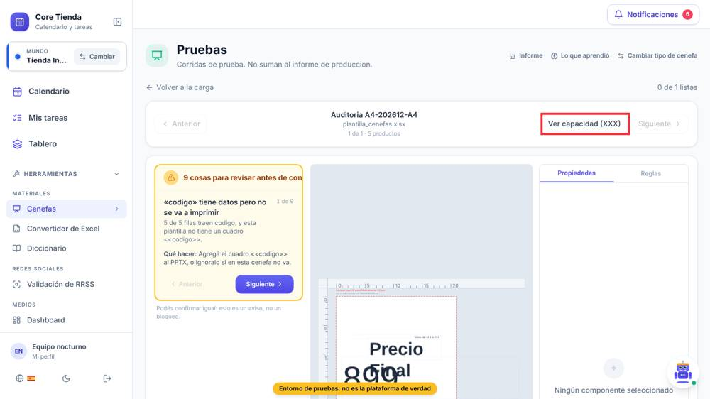
- **Visto:** 25/11 · 26/11 (sigue) · 26/11 noche (sigue: «Ver capacidad (XXX)», «9 cosas para revisar antes de con…» cortado y deja seguir sin vigencia)

### H-063 · Convertidor y Editor de plantillas hablan en jerga
- **Gravedad:** 🟡 Desprolijo · **Quién:** equipo · **Dónde:** `/materiales/convertidor`, `/materiales/cenefas/v2`, notebook
- **Qué ve una persona:** «matchear», «Mapeo de columnas», `ofertaUno`, «Template», «placeholders», «canvas», «0 comp. · 0 reglas · 3 vars»; MECÁNICA dice «Precio F» (cortado); la hoja A4 del editor es un cuadrito de 150 px.
- **Por qué importa:** no es el idioma de promo y marca.
- **Cómo repetirlo:** Convertidor con un Excel de gestión; editor → Cenefa A4.
- **Evidencia:** capturas C/050, C/053, C/022, C/023 de la noche (Sofía).
- **Procesos 26/11:** en la grilla del Convertidor la descripción corregida se lee «Refresco S» (captura 046 de Sofía) · procesos P35, P36
- **Visto:** 25/11 · 26/11 (sigue) · 26/11 noche (sigue: en Rompe Precios, «Badge o sello que reemplaza la variable "imagen"» y «<<codigo>>»)

### H-015 · El link «Informe» de Cenefas no hace nada para quien no es superadmin
- **Gravedad:** 🟡 Desprolijo · **Quién:** equipo (no superadmin) · **Dónde:** `/materiales/cenefas`, arriba a la derecha
- **Qué ve una persona:** toca «Informe» (o «Lo que aprendió») y se queda en la misma pantalla, sin mensaje.
- **Por qué importa:** parece roto.
- **Cómo repetirlo:** cuenta rol Usuario → /materiales/cenefas → Informe.
- **Evidencia:** captura C/109 de la auditoría (Sofía).
- **Visto:** 24/11 (código) · 25/11 (auditoría: confirmado en pantalla)

### H-049 · A una cuenta desactivada le dice «contraseña incorrecta»; y desactivar es un toque sin aviso
- **Gravedad:** 🟡 Desprolijo · **Quién:** quien es dado de baja; admin · **Dónde:** `/login`; `/admin` (tilde verde de la fila)
- **Qué ve una persona:** el tilde desactiva al instante sin preguntar; quien quedó afuera ve «Email o contraseña incorrectos…» y cree que se olvidó la clave. El mismo tilde está en la fila propia (H-011).
- **Por qué importa:** una baja sin querer, y una persona que no sabe que la dieron de baja.
- **Cómo repetirlo:** /admin → tilde de una cuenta → entrar con esa cuenta y su clave correcta.
- **Evidencia:** captura C/110 y C/112 de la noche (Sofía); ver INFORME de la auditoría.
- **Visto:** 25/11

### H-061 · Administración y su Auditoría hablan en código
- **Gravedad:** 🟡 Desprolijo · **Quién:** jefatura · **Dónde:** `/admin`, notebook y celular
- **Qué ve una persona:** `platform.users.view`, «15 permiso», «50 registro», ADMIN en la lista y SUPER ADMIN en el perfil, 4-5 íconos sin texto por fila, campos sin título; Auditoría con `admin.user.delete`, «user #4» y «—» en quién cambió la contraseña.
- **Por qué importa:** quien administra tiene que adivinar.
- **Cómo repetirlo:** /admin; /admin → Auditoría.
- **Evidencia:** 
- **Procesos 26/11:** el rol «Usuario» dice «Arranca sin permisos» y trae 15; la ficha de un usuario dice «Calendario: Todo» aunque no tenga el permiso de verlo (Sofía, Ramiro) · procesos P50, P52
- **Visto:** 25/11 · 26/11 (sigue)

### H-065 · Un link de nueva contraseña vencido dice «Token inválido o expirado» y no da salida
- **Gravedad:** 🟡 Desprolijo · **Quién:** todos · **Dónde:** `/reset-password?token=…`
- **Qué ve una persona:** el error aparece dos veces recién al guardar, con la palabra «Token», y sin botón para pedir otro link.
- **Por qué importa:** no sabe qué hacer para entrar.
- **Cómo repetirlo:** /reset-password?token=cualquiercosa → claves iguales → Guardar.
- **Evidencia:** captura C/010 de la noche (Sofía).
- **Procesos 26/11:** además «Olvidé mi contraseña» dice que la recuperación por mail no está activada (puede ser solo del entorno) · proceso P02
- **Visto:** 25/11 · 26/11 (sigue)

### H-057 · Mi pedido: tres casilleros se llaman «cenefa»
- **Gravedad:** 🟡 Desprolijo · **Quién:** local · **Dónde:** `/redexpres/mi-pedido`, celular
- **Qué ve una persona:** «Cenefa Oferta x3», «Cenefas 3xA4 Preciazos», «Cenefas A4 Preciazos»; ¿«x3» es que vienen de a tres?
- **Por qué importa:** el encargado pide «40 cenefas» y no sabe dónde ponerlo.
- **Cómo repetirlo:** local → Mi pedido → Diciembre.
- **Evidencia:** captura 044 de Martina.
- **Procesos 26/11:** son cinco casilleros que dicen cenefa (Oferta x3, Valle del Sol, Supremo Hogar, 3xA4 Preciazos, A4 Preciazos), y «se guardan automáticamente» está solo abajo de todo, sin «Guardado» al lado de lo que se escribe (captura 070 de Martina) · proceso P40
- **Visto:** 25/11 (Martina a ciegas) · 26/11 (amplía)

### H-067 · Finanzas muestra el total como «$-1.250»
- **Gravedad:** 🟡 Desprolijo · **Quién:** equipo, jefatura · **Dónde:** `/facturacion`, notebook y celular
- **Qué ve una persona:** después de una factura de salida de 1250, el total general dice «$-1.250».
- **Por qué importa:** no se entiende si es gasto o saldo negativo.
- **Cómo repetirlo:** cargar una factura de tipo Salida → mirar General.
- **Evidencia:** capturas C/127 y C/183 de la noche (Sofía).
- **Visto:** 25/11 · 26/11 (sigue)

### H-030 · Finanzas vacía ofrece «Subir factura» cuando primero hay que crear una cuenta
- **Gravedad:** 🟡 Desprolijo · **Quién:** equipo · **Dónde:** `/facturacion`, notebook
- **Qué ve una persona:** el botón grande es «Subir factura»; lo que hay que hacer primero («Crear la primera cuenta») es un link chiquito.
- **Por qué importa:** la persona empieza por el paso equivocado.
- **Cómo repetirlo:** equipo → /facturacion con la base vacía.
- **Evidencia:** hoja equipo-notebook-claro-2 (Lucía: V6-finanzas-vacio)
- **Visto:** 25/11 (Lucía) · 25/11 (auditoría)

### H-066 · Las ventanas de Finanzas y Administración dejan una franja blanca arriba
- **Gravedad:** 🟡 Desprolijo · **Quién:** equipo · **Dónde:** Subir factura; Editar usuario, notebook
- **Qué ve una persona:** todo se oscurece menos una franja blanca de 24 px arriba.
- **Por qué importa:** parece un error de pantalla.
- **Cómo repetirlo:** /facturacion → Subir factura.
- **Evidencia:**  (franja arriba)
- **Visto:** 25/11 · 26/11 (sigue)

### H-028 · El Dashboard de medios mezcla inglés y textos con errores
- **Gravedad:** 🟡 Desprolijo · **Quién:** equipo · **Dónde:** `/dashboard`, notebook y celular
- **Qué ve una persona:** «últimos 30D días», «Miércoles 25 De Noviembre», «0.00x», «Auto-sync activo», «Sync datos» al lado de «Sincronizar ahora».
- **Por qué importa:** se ve armado de apuro; no es el vocabulario de la gente.
- **Cómo repetirlo:** equipo → /dashboard.
- **Evidencia:** hoja equipo-notebook-claro-1 del barrido (Lucía: V5-dashboard-en-ingles)
- **Visto:** 25/11 (Lucía) · 25/11 (auditoría)

### H-060 · Análisis IA dice que tiene los datos de tus campañas sin ninguna conexión
- **Gravedad:** 🟡 Desprolijo · **Quién:** equipo · **Dónde:** `/analytics` (La Triada), notebook
- **Qué ve una persona:** «Tengo cargados los datos de tus campañas» sin plataformas conectadas, y «hacé click en el botón de abajo» sin tal botón.
- **Por qué importa:** promete un análisis sobre datos que no hay.
- **Cómo repetirlo:** /analytics sin conexiones.
- **Evidencia:** 
- **Visto:** 25/11 · 26/11 (sigue)

### H-064 · El Informe de producción dice un rango de fechas y suma otra cosa
- **Gravedad:** 🟡 Desprolijo · **Quién:** jefatura · **Dónde:** `/materiales/cenefas/v2/informe` y `/jobs`
- **Qué ve una persona:** «entre el 2026-11-25 y el 2026-11-25» y el número grande sale de una carga declarada en agosto; columna «ISSUES».
- **Por qué importa:** el número que se reporta no corresponde al período.
- **Cómo repetirlo:** abrir el Informe y el Historial.
- **Evidencia:** captura C/042 de la noche (Sofía).
- **Visto:** 25/11

### H-062 · En inglés la plataforma sale mezclada y «Cenefas» se traduce «Banners»
- **Gravedad:** 🟡 Desprolijo · **Quién:** quien cambie el idioma · **Dónde:** globo del menú → English
- **Qué ve una persona:** menú «Calendar», el resto en castellano; «Cenefas» → «Banners», que es otra pieza.
- **Por qué importa:** confunde dos piezas distintas.
- **Cómo repetirlo:** globo → English → /admin y /calendario.
- **Evidencia:** capturas C/119 y C/120 de la noche (Sofía).
- **Procesos 26/11:** en English siguen en castellano «Mi perfil», «Cambiar contraseña», «Mis tareas», «Tablero», «Cambiar» (captura 105 de Sofía) · proceso P53
- **Visto:** 25/11 · 26/11 (sigue)

### H-032 · Cenefas en el celular: tarjetas angostas con texto cortado
- **Gravedad:** 🟡 Desprolijo · **Quién:** equipo · **Dónde:** `/materiales/cenefas`, celular
- **Qué ve una persona:** las tres tarjetas de tipo de cenefa quedan angostas y el texto se corta.
- **Por qué importa:** no se lee qué es cada tipo.
- **Cómo repetirlo:** equipo en el celular → /materiales/cenefas.
- **Evidencia:** hoja equipo-celular-claro-2 (Lucía: V8-cenefas-tarjetas-celular)
- **Visto:** 25/11 (Lucía) · 25/11 (auditoría) · 26/11 (sigue) · 26/11 noche (Lucía: sigue)

### H-033 · Conexiones en modo oscuro: un cuadro «+» blanco
- **Gravedad:** 🟡 Desprolijo · **Quién:** equipo · **Dónde:** `/settings`, notebook oscuro
- **Qué ve una persona:** el cuadro vacío con «+» queda blanco y brilla sobre el fondo oscuro.
- **Por qué importa:** rompe el modo oscuro.
- **Cómo repetirlo:** equipo, modo oscuro → /settings.
- **Evidencia:** hoja equipo-notebook-oscuro (Lucía: V7-conexiones-oscuro)
- **Visto:** 25/11 (Lucía) · 25/11 (auditoría) · 26/11 (Lucía: sigue) · 26/11 noche (Lucía: sigue)

### H-101 · Clientes VIP: letra gris clarito, «▲ 0,0%» en verde y dos «Cargar archivo»
- **Gravedad:** 🟡 Desprolijo · **Quién:** equipo con Clientes VIP · **Dónde:** `/clientes-vip`, notebook
- **Qué ve una persona:** «vs mes anterior» y «sin dato vs año anterior» en gris 2,6:1; «▲ 0,0%» verde con flecha para arriba; vacío: dos «Cargar archivo» violetas iguales; en la caja de carga «Arrastrá el archivo acá o» centrado y el botón suelto a la izquierda.
- **Por qué importa:** pantalla nueva y para la jefatura: se ve sin terminar. Familia de H-069 y H-031.
- **Cómo repetirlo:** /clientes-vip vacío y con datos.
- **Evidencia:** capturas 003 y 075 de Lucía; 089 de Sofía.
- **Visto:** 26/11 (Lucía y Sofía) · procesos P47, P48, P57

### H-105 · Cenefas de prueba: arriba dice que no suman al informe y al verificar dice que suman
- **Gravedad:** 🟡 Desprolijo · **Quién:** equipo · **Dónde:** `/materiales/cenefas?destino=pruebas`
- **Qué ve una persona:** arriba «Corridas de prueba. No suman al informe de produccion» (sin tilde); al tocar «Sí, salieron bien»: «Corrida verificada: el archivo queda guardado y suma en el informe».
- **Por qué importa:** no se sabe si una prueba infla el número que se reporta (H-064).
- **Cómo repetirlo:** Cenefas → Pruebas → generar → Descargar → Sí, salieron bien.
- **Evidencia:** captura 020 de Sofía.
- **Visto:** 26/11 (Sofía) · proceso P33

### H-106 · Tablero vacío: dice que las tarjetas «se piden desde la ficha de una acción» con «Nueva tarjeta» al lado
- **Gravedad:** 🟡 Desprolijo · **Quién:** equipo · **Dónde:** `/entregas` sin tarjetas, notebook
- **Qué ve una persona:** cinco «Nada por acá.» y además un cartel grande «Todavía no hay tarjetas… se piden desde la ficha de una acción del calendario», cuando arriba está «Nueva tarjeta».
- **Por qué importa:** la pantalla se contradice en el primer uso. Familia de H-031.
- **Cómo repetirlo:** base vacía → Tablero.
- **Evidencia:** captura 001 de Lucía.
- **Visto:** 26/11 (Lucía) · proceso P57

### H-034 · El local y la agencia ven «Calendario y tareas» bajo el logo sin tener calendario
- **Gravedad:** ⚪ Detalle · **Quién:** local, agencia · **Dónde:** menú lateral; Mi perfil en el celular
- **Qué ve una persona:** debajo de «Core Tienda» dice «Calendario y tareas»; en Mi perfil de la agencia en el celular el mail se corta.
- **Por qué importa:** promete algo que no tienen.
- **Cómo repetirlo:** entrar con la agencia o el local.
- **Evidencia:** hojas agencia-notebook-claro-1, local-notebook-claro-2
- **Visto:** 25/11 (Lucía) · 25/11 (auditoría) · 26/11 (sigue)

### H-079 · Buscador de la agencia en el celular: dos cruces y «Arrastrá» donde se usa «Mover»
- **Gravedad:** ⚪ Detalle · **Quién:** agencia · **Dónde:** Mi tablero, celular
- **Qué ve una persona:** con texto escrito, dos «x» juntas; el texto de arriba dice «Arrastrá cada tarjeta».
- **Por qué importa:** detalles que confunden en el celular.
- **Cómo repetirlo:** agencia celular → escribir en el buscador.
- **Evidencia:** capturas 001 y 010 de Martina.
- **Procesos 26/11:** las dos cruces también en el buscador del tablero del equipo en la notebook (captura 106 de Sofía) · proceso P27
- **Visto:** 25/11 (Martina a ciegas) · 26/11 (amplía)

### H-078 · «Tablero»/«Tableros» y «Notificaciones»/«Avisos»
- **Gravedad:** ⚪ Detalle · **Quién:** equipo · **Dónde:** menú, `/entregas`, barra de arriba y de abajo
- **Qué ve una persona:** el menú dice una cosa y la pantalla otra.
- **Por qué importa:** vocabulario que no se repite igual.
- **Cómo repetirlo:** comparar menú y título; notebook y celular.
- **Evidencia:** 
- **Visto:** 25/11 (Lucía) · 26/11 (sigue)

### H-072 · Los avisos verdes tapan la ✕ de la ficha
- **Gravedad:** ⚪ Detalle · **Quién:** equipo · **Dónde:** ficha de la acción, notebook
- **Qué ve una persona:** dos avisos encimados arriba a la derecha sobre la ✕ y el título.
- **Por qué importa:** hay que esperar para cerrar.
- **Cómo repetirlo:** crear una tarea.
- **Evidencia:** captura C/035 de la noche.
- **Visto:** 25/11 · 26/11 (sigue) · 26/11 noche (sigue: «Se adjuntó el archivo al pedido» tapa la ✕ de la ficha)

### H-073 · La app no sigue el modo oscuro del celular
- **Gravedad:** ⚪ Detalle · **Quién:** agencia y local · **Dónde:** todo, celular en oscuro
- **Qué ve una persona:** con el teléfono en oscuro, se ve en claro; solo se prende con la luna del menú.
- **Por qué importa:** encandila de noche.
- **Cómo repetirlo:** celular en oscuro → entrar.
- **Evidencia:** captura C/121 de la noche.
- **Visto:** 25/11 · 26/11 (sigue)

### H-074 · «Nueva tarjeta» no entra en la pantalla de una notebook
- **Gravedad:** ⚪ Detalle · **Quién:** equipo · **Dónde:** `/entregas` → Nueva tarjeta, 1366×768
- **Qué ve una persona:** para llegar a «Crear tarjeta» hay que bajar y se va el título.
- **Por qué importa:** pasos de más.
- **Cómo repetirlo:** Tablero → Nueva tarjeta.
- **Evidencia:** captura C/105 de la noche.
- **Visto:** 25/11 · 26/11 (sigue)

### H-075 · Buscar precios: los números de fuentes no coinciden
- **Gravedad:** ⚪ Detalle · **Quién:** equipo · **Dónde:** `/precios`
- **Qué ve una persona:** «Fuentes (15/16)», 18 pastillas y «15 cadenas»; en el celular el ejemplo se corta.
- **Por qué importa:** resta confianza.
- **Cómo repetirlo:** /precios.
- **Evidencia:** 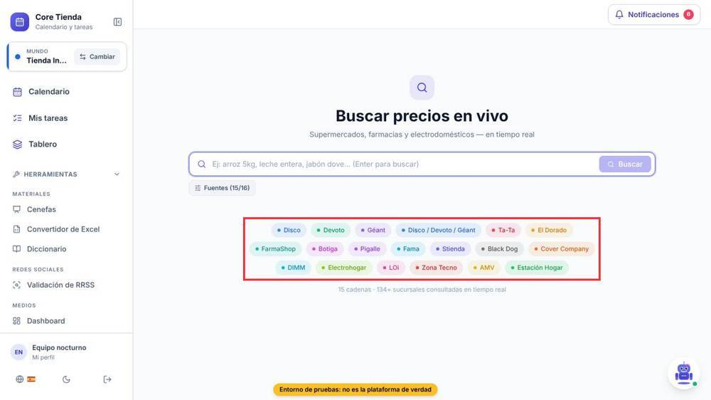
- **Visto:** 25/11

### H-076 · Textos sueltos con errores
- **Gravedad:** ⚪ Detalle · **Quién:** equipo · **Dónde:** varias
- **Qué ve una persona:** «produccion», «Lei 7 filas», «Listo: 2 placas revisadas» cuando no se leyó ninguna, la ventana de error del login que sigue abierta en «Olvidé mi contraseña».
- **Por qué importa:** se ve armado de apuro.
- **Cómo repetirlo:** Cenefas → Pruebas; RRSS con error de IA; login con clave mala → Olvidé.
- **Evidencia:** capturas C/020, C/066, C/005 de la noche.
- **Visto:** 25/11 · 26/11 (sigue)

### H-077 · Al entregar un archivo que no es imagen, el aviso no dice cuál ni qué hacer
- **Gravedad:** ⚪ Detalle · **Quién:** agencia · **Dónde:** formulario de entrega
- **Qué ve una persona:** «No se pudo leer la imagen», sin el nombre ni los formatos que sirven.
- **Por qué importa:** con 4 elegidas no sabe cuál falló.
- **Cómo repetirlo:** elegir un texto renombrado a .png.
- **Evidencia:** captura 012 de Ramiro.
- **Visto:** 25/11 (Ramiro) · 26/11 (sigue)

### H-080 · Solo por la API: mensajes de peso falsos y datos imposibles aceptados
- **Gravedad:** ⚪ Detalle · **Quién:** — (no se llega desde la pantalla) · **Dónde:** API
- **Qué pasa:** «pesa 2 MB: el máximo es 2 MB» para una de 5 MB; meses 13 y 0 dan 200; mensaje vacío al chat gasta una respuesta; campos viejos sin tope de largo.
- **Por qué importa:** robustez; hoy no lo ve nadie.
- **Cómo repetirlo:** ver hallazgos RA-06 y RA-08 de Ramiro (25/11).
- **Evidencia:** respuestas de la API (Ramiro).
- **Visto:** 25/11 (Ramiro)

### H-107 · Inglés suelto: «Feedback» en el celular y colores «blue», «purple» en la Planilla
- **Gravedad:** ⚪ Detalle · **Quién:** equipo, agencia · **Dónde:** pestaña del tablero en el celular; Planilla → Editar planilla de este mes (color del grupo)
- **Qué ve una persona:** en el celular la pestaña dice «Feedback» (en notebook «Esperando feedback»); el color de un grupo de columnas se elige entre «blue», «purple»…
- **Por qué importa:** vocabulario de otra aplicación. Familia de H-062 y H-014.
- **Cómo repetirlo:** agencia celular → tablero; Redexpres → Planilla → Editar planilla.
- **Evidencia:** captura 010 de Lucía; 054 de Sofía.
- **Visto:** 26/11 (Lucía y Sofía) · procesos P27, P39

### H-108 · Esc no cierra «Conectar mi calendario»
- **Gravedad:** ⚪ Detalle · **Quién:** equipo · **Dónde:** `/calendario` → Conectar mi calendario
- **Qué ve una persona:** la ventana con los pasos de Outlook/Google no se cierra con Esc (las demás sí).
- **Por qué importa:** gesto que en el resto anda.
- **Cómo repetirlo:** Calendario → Conectar mi calendario → Esc.
- **Evidencia:** captura 091 de Sofía.
- **Visto:** 26/11 (Sofía) · procesos P11, P54

### H-109 · Alta de agencia: al elegir «Otra agencia (nueva)…» el campo Contraseña se estira al doble
- **Gravedad:** ⚪ Detalle · **Quién:** jefatura · **Dónde:** `/admin` → Nuevo usuario → Externa
- **Qué ve una persona:** el campo de contraseña queda el doble de alto que los demás.
- **Por qué importa:** se ve roto en el alta de una agencia nueva (lo que Ivan quiere que sea fácil).
- **Cómo repetirlo:** /admin → Nuevo usuario → Externa → Otra agencia (nueva)….
- **Evidencia:** captura 149 de Sofía.
- **Visto:** 26/11 (Sofía) · proceso P51

### H-112 · Cenefas: antes de generar dice «Se van a generar 1 cenefas» con un Excel de 5 productos
- **Gravedad:** ⚪ Detalle · **Quién:** equipo · **Dónde:** Cenefas → Rompe Precios `/materiales/cenefas?destino=rompe_precios`, notebook
- **Qué ve una persona:** con el Excel de ejemplo (5 productos) y una plantilla elegida, abajo dice «Se van a generar 1 cenefas a partir de 1 Excel» (cuenta plantillas, no cenefas, y con «1 cenefas» mal escrito). Al lado, el botón «Generar y descargar PPTX» está activo aunque la Vigencia (con asterisco) está vacía, y no descarga nada: lleva a la revisión del lote (H-050).
- **Por qué importa:** quien prepara cenefas para el fin de semana no sabe cuántas va a imprimir y duda de si cargó bien el Excel; el botón promete algo que no hace.
- **Cómo repetirlo:** Cenefas → Rompe Precios → Agregar Excel (el de «Descargar plantilla Excel») → Elegir plantillas → Cargar nueva plantilla (A4, `Base cenefa A4 1.pptx`) → elegirla → mirar el cuadro de abajo a la derecha.
- **Evidencia:** 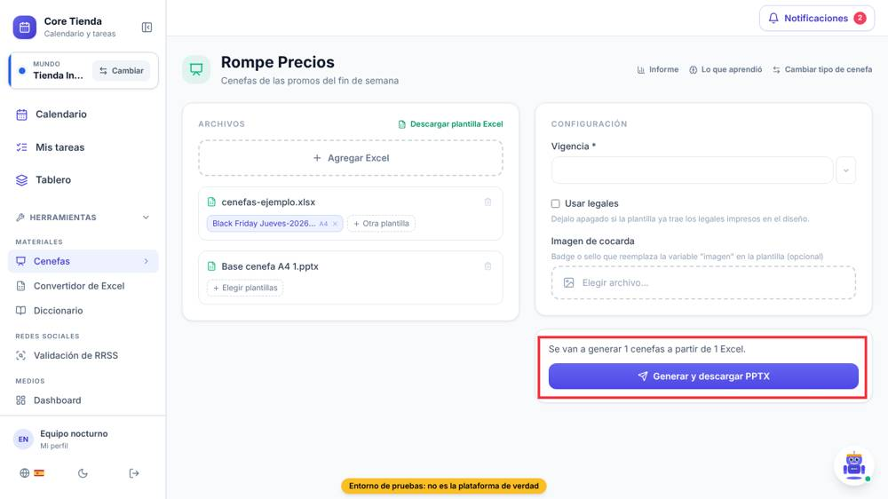
- **Idea de arreglo:** «Se van a generar 5 cenefas (1 plantilla)» y el botón «Revisar y generar», apagado sin vigencia.
- **Visto:** 26/11 noche (Sofía) · 26/11 noche (Martina: tampoco supo si la vigencia cuenta, ver H-115)

### H-071 · Para confirmar: las miniaturas de la entrega recortan la pieza
- **Gravedad:** ⚪ Detalle · **Quién:** agencia y equipo · **Dónde:** formulario de entrega y ficha
- **Qué ve una persona:** cuadradas y verticales cortadas («080×108»), apaisadas como franja.
- **Por qué importa:** antes de mandar no ve la pieza entera.
- **Cómo repetirlo:** entregar una imagen vertical.
- **Evidencia:** capturas C/071 y C/080 de la noche.
- **Ojo (Lucía, 26/11):** las imágenes de prueba (`imagenes_de_prueba.py`) ya traen el texto cortado de borde a borde («080×108»): la evidencia de este hallazgo puede ser eso y no la plataforma. Confirmar con una imagen de prueba con margen antes de trabajarlo.
- **Visto:** 25/11

### H-006 · Para confirmar: errores que se ven como «no hay nada»
- **Gravedad:** 🟠 · **Quién:** equipo, agencia · **Dónde:** campanita, tablero, archivos de una tarea
- **Sospecha (código):** si falla la carga, la campanita dice «Todavía no tenés notificaciones»; el tablero no avisa si se corta la conexión; los archivos de una tarea no muestran nada.
- **Fuente:** `plataforma/calendario-tareas-entregas.md`.

### H-011 · Para confirmar: en Administración uno se puede dejar afuera a sí mismo
- **Gravedad:** 🟠 · **Quién:** admin · **Dónde:** `/admin`
- **Sospecha (código):** el superadmin puede desactivarse a sí mismo; cambiar el rol en la fila borra sin avisar los permisos ajustados a mano. (Probalo con una cuenta descartable, nunca con Equipo nocturno.)
- **Fuente:** `plataforma/entrada-admin-diseno.md`.
- **Auditoría 25/11:** el ícono de desactivar está en la fila propia del admin (no se tocó). Desactivar a otro es un toque sin preguntar: H-049.

### H-016 · Para confirmar: Validación de redes deja borrar lo ajeno
- **Gravedad:** 🟡 · **Quién:** equipo · **Dónde:** `/redes-sociales/validacion`
- **Sospecha (código):** el tacho aparece en validaciones de otras personas; si el borrado falla, toda la lista dice «No se pudo cargar el historial».
- **Fuente:** `plataforma/materiales-precios-locales.md`.

## Hechos

### H-081 · Pedido de Ivan: que la agencia pueda ir y venir con la entrega hasta que se apruebe
- **Gravedad:** 🟠 Traba (pedido de Ivan, 25/11) · **Quién:** agencia y equipo · **Dónde:** ficha de la tarjeta y tablero `/entregas`
- **Qué pasa hoy:** una vez que la agencia envía, la tarjeta queda bloqueada hasta que el equipo la devuelve. Si se olvidaron un archivo o les pidieron un cambio por WhatsApp, no tienen cómo actualizarla (es H-042 visto por Martina).
- **Lo que pide Ivan** ([comentario](https://github.com/IvanCasaviejaTI/marketingTienda/issues/82#issuecomment-7169163795)): mientras la tarjeta no esté aprobada, la agencia puede enviar sin esperar respuesta:
  - **Versiones:** cada envío nuevo sobre la misma tarjeta es v2, v3… con fecha y hora; el equipo ve siempre la última y tiene el historial para comparar.
  - **Agregar archivos:** si solo faltaba algo, se suma a la versión actual sin crear otra.
  - **Comentario por envío:** una nota corta («faltaba el formato historia», «ajuste pedido por WhatsApp») para que lo acordado por fuera quede registrado.
  - **Aviso automático:** cada envío nuevo le avisa al equipo.
  - **Bloqueo solo al aprobar:** la tarjeta se cierra únicamente al aprobarla, y el equipo la puede reabrir si hace falta otro cambio.
- **Cuidado al construirlo:** las imágenes de versiones anteriores no se borran nunca (son el histórico) y la base es de 500 MB: comprimir en el navegador como hoy. Relacionado: H-035, H-036, H-037 (las rondas actuales).
- **Visto:** 25/11 (pedido de Ivan) · 26/11 (ya no pasa)
- **Estado:** ya no pasa (26/11, corrida de procesos): en `main` por el PR #86 (feat/entregas-ida-y-vuelta). La agencia suma archivos a la versión («Sumé 1 archivo a la versión 1…» queda como comentario), manda v2 sin esperar («La versión 1 todavía no la revisaron: esta la reemplaza»), el historial muestra v1 Reemplazada / v2 En revisión, cada envío avisa al equipo y la tarjeta se cierra al aprobar y se puede reabrir. Probado por Sofía, Martina (a ciegas) y Ramiro en notebook y celular. Lo que quedó: H-089 (comparar), H-095 (marca perdida al chocar), H-097 (palabras).

### H-042 · La agencia no puede sumar la pieza que le faltaba una vez que entregó
- **Gravedad:** 🟠 Traba · **Quién:** agencia · **Dónde:** Mi tablero → tarjeta en «Esperando feedback», celular
- **Qué ve una persona:** mandó el header y quiere mandar el carrito: en la ficha no hay botón para subir y en esa columna no hay «Mover».
- **Por qué importa:** queda esperando que revisen algo incompleto (y por H-035 el equipo ve «ya están todas»). Martina abandonó.
- **Cómo repetirlo:** entregar una sola pieza de un pedido de dos → buscar cómo agregar la segunda.
- **Evidencia:** 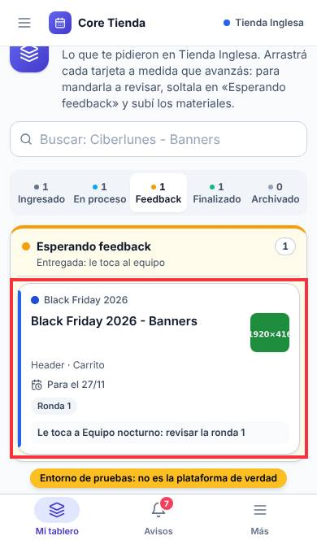
- **Ivan (25/11):** queda dentro de H-081 (la agencia va y viene hasta que se aprueba).
- **Visto:** 25/11 (Martina a ciegas) · 26/11 (ya no pasa)
- **Estado:** ya no pasa (26/11): resuelto dentro de H-081 (PR #86); la agencia «Suma archivos a la versión 1» y manda la pieza que faltaba (Sofía 043, Martina 032).

### H-037 · Al entregar la corrección, el formulario no recuerda qué había que cambiar
- **Gravedad:** 🟠 Traba · **Quién:** agencia · **Dónde:** ficha → «Entregar ronda 2», celular claro
- **Qué ve una persona:** la marca («El fondo tiene que ser rojo, no verde») queda dos pantallas abajo; el formulario solo dice «Subí la pieza…».
- **Por qué importa:** entrega de memoria; si se olvida un punto, otra ronda.
- **Cómo repetirlo:** tarea devuelta con una marca → agencia (celular) → la tarjeta → Entregar ronda 2.
- **Evidencia:** 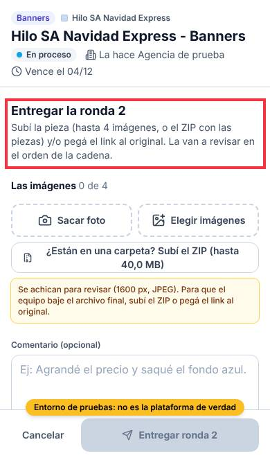
- **Visto:** 25/11 · 26/11 (ya no pasa)
- **Estado:** ya no pasa (26/11): el formulario de la corrección repite «Lo que te pidieron cambiar» en rojo, en notebook y celular (Sofía 058, Martina 058).

### H-038 · La agencia entra desde el celular y no ve lo que volvió con cambios
- **Gravedad:** 🟠 Traba · **Quién:** agencia · **Dónde:** Mi tablero `/entregas`, celular claro
- **Qué ve una persona:** el tablero abre siempre en «Ingresado»; lo que «Volvió con cambios» está en «En proceso», sin ninguna marca en la pestaña.
- **Por qué importa:** lo más urgente es lo que no ve al entrar.
- **Cómo repetirlo:** el equipo pide cambios → la agencia entra a Mi tablero en el celular.
- **Evidencia:** 
- **Visto:** 25/11 · 26/11 (ya no pasa)
- **Estado:** ya no pasa (26/11): en el celular la agencia ve «Volvió con cambios» en rojo en el tablero y en la ficha (Sofía 056 y 057; Ramiro 085).

### H-110 · La Guía no explicaba las versiones de las entregas (lo nuevo)
- **Gravedad:** 🟡 Desprolijo · **Quién:** agencia y equipo · **Dónde:** Guía de uso `/ayuda`, notebook y celular
- **Qué ve una persona:** buscar «versión» trae solo «Medios» (por «inversión»); «sumar archivos» → «No hay nada»; la sección de la agencia dice «entregás la ronda siguiente» y no habla de v1/v2, de sumar archivos a la versión ni de comparar.
- **Por qué importa:** la agencia que se traba con lo nuevo busca en la guía y no encuentra nada.
- **Cómo repetirlo:** /ayuda → buscar «versión» y «sumar archivos».
- **Evidencia:** capturas 008 de Sofía; 018 y 066 de Martina (entorno en 87a949c).
- **Visto:** 26/11 (Sofía y Martina a ciegas) · proceso P32
- **Estado:** resuelto en `main` por el PR #90 (fix/guia-versiones, «versiones en vez de rondas, y lo nuevo de las entregas»), que entró después del commit probado esta noche. **Confirmar en pantalla la próxima noche.**

### H-020 · Después de confirmar el pedido, queda trancado sin decirlo y sin saber cómo corregir
- **Gravedad:** 🟠 Traba · **Quién:** local · **Dónde:** Mi pedido `/redexpres/mi-pedido`, celular claro
- **Qué ve una persona:** toca «Confirmar pedido» y se confirma de una (sin «¿seguro?»). Después los campos se ven exactamente igual que antes, pero al tocarlos no se puede escribir; abajo sigue diciendo «Los cambios se guardan automáticamente al dejar de escribir». Nada dice que ya no se puede cambiar ni a quién pedirle que lo abra.
- **Por qué importa:** el encargado que se equivocó en un número (o confirmó sin querer con el pulgar) queda trabado y no sabe a quién llamar; parece que la pantalla se colgó.
- **Cómo repetirlo:** equipo en Redexpres crea el mes en la Planilla. Local de prueba (celular) → Mi pedido → escribir cantidades → «Confirmar pedido» → tocar un campo e intentar escribir.
- **Evidencia:**  · los campos están bloqueados pero sin cambio visible.
- **Idea de arreglo:** pedir confirmación antes, y después mostrar los campos como bloqueados con un texto «Ya lo confirmaste. Si tenés que cambiar algo, pedile a <quién> que lo vuelva a abrir».
- **Prueba a ciegas (Martina, 25/11):** abandonó. Tocó el 300 y escribió 30: no cambió, «números grisecitos», nada dice que está bloqueado; Notas libres tampoco deja; en «Más» no hay cómo pedir el cambio → «le mando un WhatsApp a marketing». Pidió un cartel «Ya confirmaste; para cambiarlo pedíselo a marketing». 
- **Visto:** 25/11 (Martina a ciegas)
- **Estado:** ya no pasa (25/11, auditoría): en `main` por el PR #68 (c34443e). Confirmar pregunta antes y después muestra «Ya confirmaste el pedido… pedíselo a marketing» con candado.

### H-021 · La Planilla de Redexpres está escondida al fondo de Herramientas, debajo de Medios
- **Gravedad:** 🟠 Traba · **Quién:** equipo de Redexpres · **Dónde:** menú lateral en el mundo Redexpres, notebook claro
- **Qué ve una persona:** en el mundo Redexpres el menú muestra Calendario, Mis tareas, Tablero y Colocación. Para llegar a «Planilla de pedidos» hay que abrir «Herramientas» y bajar pasando Cenefas, Convertidor, Dashboard, Analytics GA4, Campañas, Análisis IA y Conexiones. Además hay dos «Dashboard» (uno en Medios y otro en Finanzas).
- **Por qué importa:** la planilla mensual es lo central de Redexpres y la persona la tiene que buscar cada vez; el doble «Dashboard» confunde.
- **Cómo repetirlo:** equipo → Cambiar → Redexpres → buscar la planilla de pedidos desde el menú.
- **Evidencia:** 
- **Idea de arreglo:** en el mundo Redexpres, «Planilla de pedidos» arriba, junto a Colocación.
- **Prueba a ciegas (Martina, 25/11):** lo logró con dificultad, 11 pasos (~5 dando vueltas): ningún «Pedidos» en el menú, entró a Cenefas creyendo que era el material, el menú corta en «Campañas» y no se nota que sigue; recién al fondo, abajo de Medios, encontró «Planilla de pedidos». La planilla en sí se entendió («1/60 confirmados», fila confirmada distinguible). Detalle: en las celdas vacías de otros locales aparecen cajitas editables y da miedo tocar algo. 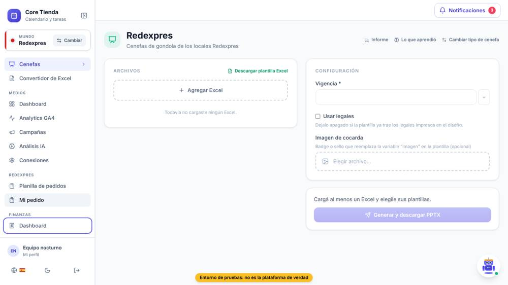
- **Visto:** 25/11 (Martina a ciegas)
- **Estado:** ya no pasa (25/11, auditoría): en `main` por el PR #68; en Redexpres «Colocación» y «Planilla de pedidos» están arriba del menú.

### H-009 · Sin mes abierto, el local y la planilla muestran doce meses apagados y nada más
- **Gravedad:** 🟠 Traba · **Quién:** local, equipo de Redexpres · **Dónde:** Mi pedido `/redexpres/mi-pedido` (celular) y Planilla `/redexpres/planilla` (notebook)
- **Qué ve una persona:** el local entra a Mi pedido y ve su sucursal y doce meses en gris clarito (contraste 1,4:1); tocarlos no hace nada y no hay ningún texto que diga que el mes todavía no se abrió ni a quién avisarle. En la Planilla, lo mismo: meses punteados y la pantalla en blanco; tocar un mes punteado crea el mes de una, sin preguntar.
- **Por qué importa:** el encargado cree que la pantalla está rota; el gestor puede abrir un mes equivocado con un toque.
- **Cómo repetirlo:** base sin meses de Redexpres → local de prueba → Mi pedido; equipo en Redexpres → Herramientas → Planilla de pedidos.
- **Evidencia:**   · contraste medido 1,4:1 en los meses.
- **Pendiente de ver:** el Excel con «Confirmar pedido» en vez de «Confirmado» y el «Guardando…» sin fin cuando falla un guardado (no se probaron hoy). Escribir y salir enseguida de Mi pedido **ya no pierde lo escrito** (25/11).
- **Idea de arreglo:** usar el texto de «todavía no hay meses» que ya existe y pedir confirmación al crear un mes tocándolo.
- **Lucía (25/11):** en notebook los meses no abiertos se ven igual de apagados.
- **Visto:** 24/11 (código) · 25/11 (confirmado en pantalla) (Lucía)
- **Estado:** en `main` por el PR #68 (25/11). En la auditoría no se pudo ver el caso sin meses abiertos (la base ya tenía meses): mirarlo en el próximo recorrido.
- **Confirmado (26/11):** sin mes abierto, Mi pedido dice «Marketing todavía no abrió el pedido de Noviembre 2026. Cuando lo abra, lo vas a poder cargar acá.» (barrido vacío y Martina 007). Lo que queda va en H-099.

### H-024 · Al marcar algo en la imagen, la imagen se va de la vista
- **Gravedad:** 🟡 Desprolijo · **Quién:** equipo · **Dónde:** «Revisar ahora» en la ficha de la tarjeta, notebook 1366×768
- **Qué ve una persona:** toca la imagen para marcar «Precio más grande»; la ventana baja sola hasta el campo de la marca y la mitad izquierda queda en blanco: ya no ve la imagen ni dónde puso la marca mientras escribe.
- **Por qué importa:** revisar es comparar lo que se ve con lo que se escribe; hay que subir y bajar para cada marca.
- **Cómo repetirlo:** equipo → Mis tareas → Para revisar → Revisar ahora → tocar la imagen.
- **Evidencia:** 
- **Idea de arreglo:** que la imagen quede fija a la izquierda mientras se escribe la marca.
- **Visto:** 25/11
- **Estado:** ya no pasa (25/11, auditoría): al marcar, la imagen queda a la vista y baja la columna de la derecha (probablemente PR #74 «imágenes sin saltos»).

### Mis tareas avisa cuando no pudo traer todo
- **Rama:** `nocturno/2026-11-24-mis-tareas-avisa-fallas` («[Nocturno] Mis tareas avisa cuando no pudo traer todo»).
- **Estado:** en `main` por el PR #54 (merge e20b367), 24/11/2026. Mis tareas ya no dice «Estás al día» cuando no pudo traer las tareas o las piezas para revisar. No resolvía ningún H del cuaderno (Mis tareas no estaba en H-006).

## Descartados (no volver a proponer)

### H-041 · Descartado: a una persona nueva del equipo con rol «Usuario» no le aparece el calendario
- **Gravedad:** 🟠 Traba · **Quién:** jefatura y la persona nueva · **Dónde:** `/admin` → Nuevo usuario, notebook
- **Qué ve una persona:** el rol «Usuario» trae cenefas, analytics, precios y asistentes, pero no «Ver el calendario»; la tarjeta dice «Arranca sin permisos» y «15 permiso» a la vez.
- **Por qué importa:** la persona entra sin Calendario, Mis tareas ni Tablero.
- **Cómo repetirlo:** /admin → Nuevo usuario → Del equipo → Crear → rol Usuario → lápiz → Calendario.
- **Evidencia:** 
- **Visto:** 25/11
- **Descartado (25/11, Ivan, [comentario](https://github.com/IvanCasaviejaTI/marketingTienda/issues/82#issuecomment-7169163795)):** no es un problema, es lo esperado: «No todos los usuarios deben tener acceso al calendario: hay gente que no lo va a usar y además es información confidencial. El acceso tiene que asignarse de forma explícita y solo a quien corresponda.» No volver a proponer que el rol «Usuario» traiga el calendario.

