# Auditoría completa de Core Tienda · 25/11/2026

> Pedido de Ivan (25/11): «prueba completa total de toda la plataforma… saber qué anda y qué no… principalmente de
> diseño: diseños que parecen DEMASIADO IA cuando tiene que parecer más tranqui, más chill, más minimal».
> Sin cambios de código: esto es el diagnóstico y la propuesta de orden para los próximos PR del Equipo nocturno.

## 0. Qué se hizo

- **Entorno:** `main` en `7f23df8` (incluye el PR #68 «Redexpres sin trabas» y el #76 «Avanzar»), web y API de pruebas con
  datos sembrados (Black Friday, Navidad, Redexpres con 60 locales). La IA y las conexiones externas están **simuladas**
  (sin internet): lo que dice la IA no se juzgó; sí cómo la pantalla muestra lo que pasa.
- **Cuentas:** Equipo nocturno (superadmin), una cuenta del equipo con rol «Usuario» creada y borrada para la prueba,
  una externa nueva («Estudio Auditoria»), Agencia de prueba y Local de prueba (Nativo Florida).
- **Mundos:** los cinco (Tienda Inglesa, Tienda Express, Redexpres, Tienda Viajes, Tienda Farma).
- **Vistas:** notebook 1366×768 y celular 390×664, claro y oscuro.
- **Números:**
  - Barrido automático: 31 pantallas × 4 vistas × 3 cuentas en Tienda Inglesa (249 capturas) + equipo en Tienda Inglesa
    con datos (124) + equipo en los otros cuatro mundos, notebook y celular claro (4 × 62) = **621 capturas**, todas las
    hojas de contacto miradas.
  - A mano: **439 capturas** (Sofía 339 en dos frentes, Martina 56 a ciegas, Ramiro 22, Lucía 22 + 2 maquetas).
  - Ciclo completo equipo ↔ agencia (agencia en el celular) en 3 rondas, de «pedido» a «Finalizado».
  - Prueba a ciegas (Martina): 6 consignas → 3 logradas, 1 con dificultad, **2 abandonadas**.
  - Pruebas automáticas (Ramiro): **5.911 pasan, 0 fallan** (backend 5.021 con Postgres hasta la migración 0090;
    frontend 890 en 9 suites; lint y type-check sin errores, 64 avisos menores). Velocidad: las 33 pantallas abren
    entre 0,8 y 2,1 s. Consola: 0 errores en 31 pantallas × 3 cuentas (salvo uno del local, H-003).
  - Seguridad por API: 64 consultas con las 3 cuentas y sin sesión; la agencia y el local reciben «no» en todo lo interno.
- **No se pudo recorrer (y por qué):**
  - Bloqueo del login a los 5 intentos y límite por IP (H-012): el cupo lo comparten todos los agentes y los habría
    bloqueado a todos.
  - Sesión que vence en medio de un formulario y uso sin conexión: no hay forma de forzarlo sin cortar la sesión de
    los demás agentes.
  - Doble clic en «Entregar» / «Aprobar»: no se tocaron tarjetas compartidas.
  - Lo que depende de afuera: precios reales de las cadenas, Meta/Google/GA4, mails que llegan de verdad, la IA real.
  - No se volvieron a ver: H-016 (tacho en validaciones ajenas, hace falta un 2.º usuario de RRSS), H-019 (foto
    panorámica del local), H-027 (editor de cenefas en el celular) y H-009 sin meses abiertos (la base ya tenía meses).
  - Tienda Viajes y Tienda Farma: solo notebook y celular claro (se ven igual que Tienda Express).
  - Conector de reuniones: no estaba disponible en esta sesión.

## 1. Qué anda bien

**Calendario y acciones**
- Crear una acción te deja en su ficha con el paso siguiente claro («Crear tarea» o «Usar plantilla»).
- Fechas: si «Arranca» queda después de «Termina», se corrige sola y abajo lo dice en criollo («Va del 15 de junio al
  21 de junio de 2027 · 7 días»). El cruce de año anda. Nombres largos, con tildes, ñ y emoji se guardan enteros.
- Borrar una tarea o una acción pide confirmación adentro de la pantalla. Doble clic en «Crear» crea una sola acción;
  dos pestañas editando la misma acción no se pisan.
- La vista Lista se lee de un vistazo; el mes vacío explica qué va ahí. La vista Equipo ya cuenta la tarea de la agencia
  para su responsable de Tienda (parte de H-007 resuelta).

**El ciclo con la agencia**
- El control previo de la agencia avisa la pieza que falta y pregunta «¿Por qué no va todo?»; el equipo lo ve después.
- Revisar: se marca tocando la imagen y la imagen queda a la vista (H-024 ya no pasa). «Comparar con la ronda 1» se
  entiende enseguida. Los avisos verdes dicen qué pasó y qué sigue.
- La agencia corrige bien desde el celular: ve en rojo «Volvió con cambios», el número sobre la imagen y la marca.
- Una panorámica de 12000×3000 se achica sola y entra; Escape no borra un formulario a medio llenar.
- Mis tareas: «Para revisar · esperan tu decisión» arriba y el «Te toca…» en cada tarjeta (Martina lo encontró solo).

**Permisos**
- La agencia está bien encerrada: /admin, /precios, /calendario, /facturacion… la devuelven a su tablero; no ve
  tarjetas de otras agencias ni por link ni por búsqueda; no puede aprobarse ni arrastrar a Finalizado (lo frena el
  servidor, no solo la pantalla).
- El local no toca lo de otro local, no puede editar un pedido confirmado y la planilla general le dice que no.
- Carteles «no es de este mundo» claros y con salida («Pasar a Tienda Inglesa / Pasar a Redexpres»).

**Redexpres (lo arreglado anoche ya está en `main`)**
- Confirmar el pedido pregunta antes y después muestra «Ya confirmaste el pedido de Diciembre 2026. Si tenés que
  cambiar algo, pedíselo a marketing» con candado (H-020 ya no pasa). La Planilla está arriba en el menú (H-021 ya no
  pasa). Lo que escribe el local no se pierde si sale y vuelve. El equipo ve la fila verde «Confirmado» al instante.
- Pedido de foto de colocación de punta a punta: el equipo lo pide en dos toques, el local lo ve arriba en Fotos, la
  sube y al equipo le llega el aviso.

**Resto**
- Cambio de contraseña (obligatorio del primer ingreso y desde Mi perfil) con mensajes claros.
- Alta de usuarios del equipo y externos anda; al desactivar a alguien se le corta la sesión.
- Generar cenefas por el camino clásico termina bien («Cenefa lista», «Corrida verificada»).
- Validación de RRSS muestra el error de la IA sin romperse; Listas de monitoreo y Colocación tienen vacíos que
  explican y llevan al paso siguiente.
- Modo oscuro parejo en el núcleo (calendario, mis tareas, tablero, menú) y en admin, perfil, ayuda, finanzas.
- Lo que en diseño ya está «tranqui» y sirve de modelo: Mi pedido, Fotos, Colocación, la Planilla de pedidos, Listas de
  monitoreo y la ficha de una entrega.

## 2. Qué no anda

Gravedad: 🔴 bloquea · 🟠 traba · 🟡 desprolijo · ⚪ detalle. «Nuevo» = número desde H-035; los de antes dicen
«sigue pasando». Dentro de cada gravedad, primero lo que más gente sufre más seguido.

### 🔴 Bloquea

#### H-018 · Una persona nueva no logra pedirle trabajo a la agencia: no aparece en «¿Quién la hace?» (sigue pasando, sube a 🔴)
- **Quién:** equipo · **Dónde:** ficha de la acción → Crear tarea, y Tablero → Nueva tarjeta · notebook
- **Qué pasa:** la lista ofrece Publicis, Another Monday y Diseñadores «(todavía sin usuarios)» y «Equipo nocturno
  (vos)». «Agencia de prueba», que tiene cuenta y trabaja todos los días, no está. Martina, a ciegas, **abandonó**:
  «¿Cómo le pido algo a la agencia con la que trabajo todos los días?». Quien sabe el truco crea la tarea para Publicis y
  después la cambia, con una ventanita gris del navegador (H-070).
- **Cómo repetirlo:** equipo → Calendario → una acción → Crear tarea → Banners → abrir «¿Quién la hace?».

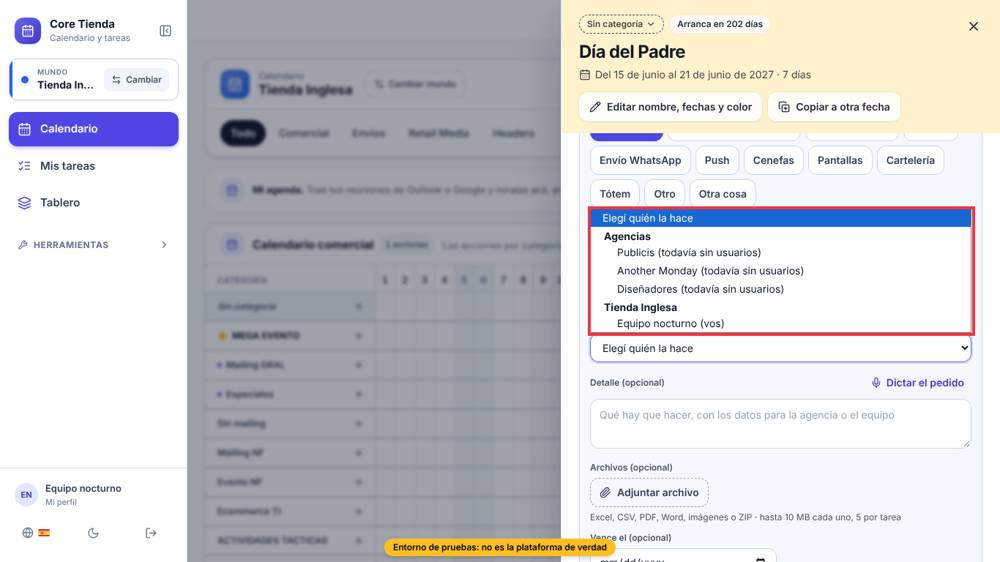

#### H-008 · Generar cenefas (motor v2) termina en «Error desconocido» y la corrida queda colgada (sigue pasando, confirmado)
- **Quién:** equipo · **Dónde:** `/materiales/cenefas/v2/generar` · notebook
- **Qué pasa:** elige la plantilla, sube el Excel («El CSV está listo», aunque subió un Excel), toca «Generar» y a los
  10 s: «Error en la generación — Error desconocido» y solo «Volver al inicio». En el Historial queda «Esperando
  confirmación», sin botón para descargar ni confirmar.
- **Cómo repetirlo:** Generar cenefas → «Cenefa A4» → subir el Excel de «Descargar plantilla Excel» → Validar → Generar →
  esperar → `/materiales/cenefas/v2/jobs`.

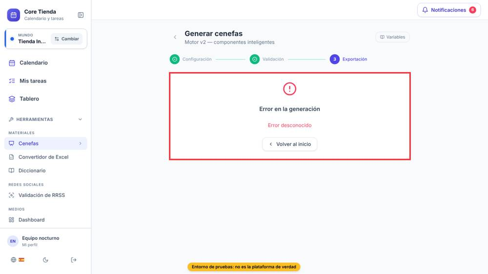

#### H-001 · Borrar una acción o una tarea se lleva las imágenes y los ZIP que entregó la agencia (sigue pasando)
- **Quién:** equipo · **Dónde:** ficha de la acción → Eliminar; tarea → «Borrar con sus entregas»
- **Qué pasa:** el aviso dice «Se va con ella 1 tarea. No se puede deshacer.» y no menciona que con la tarea se van las
  entregas, que son el histórico. Rompe la regla «las imágenes de las entregas no se borran nunca».
- **Cómo repetirlo:** acción con una tarea entregada → Editar → Eliminar.

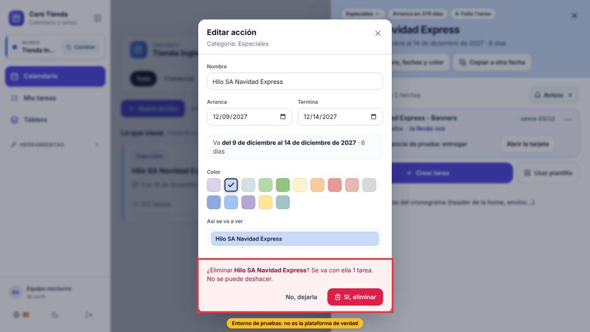

### 🟠 Traba

#### H-035 · Al revisar dice «Ya están todas las piezas del pedido» cuando falta el carrito (nuevo)
- **Quién:** equipo · **Dónde:** Revisar la ronda (Mis tareas → Revisar ahora) · notebook
- **Qué pasa:** el pedido es «Header · Carrito»; la agencia mandó solo el header (y lo dice en el comentario). Abajo
  dice «Ya están todas las piezas del pedido» y el botón grande verde es «Aprobar y terminar». Quien revisa apurado
  aprueba y el carrito no llega nunca. (Con una tarea creada desde la pantalla, el control previo de la agencia sí avisó
  lo que faltaba: hay que ver de qué depende.)
- **Cómo repetirlo:** tarea «Black Friday 2026 - Banners» entregada con una sola imagen 1920×416 → Revisar ahora.

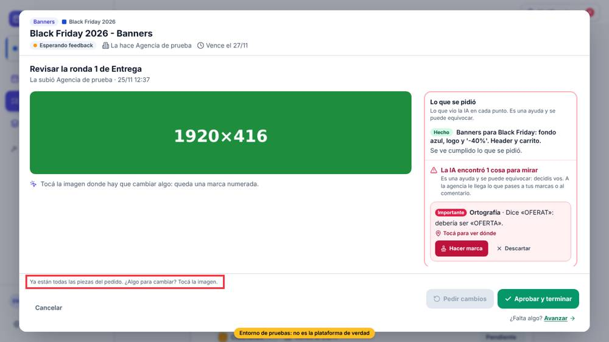

#### H-036 · «Avanzar» con todo entregado le pide a la agencia «lo que falta», y no falta nada (nuevo)
- **Quién:** equipo y agencia · **Dónde:** Revisar la ronda · notebook; la agencia en el celular
- **Qué pasa:** en la ronda 2 están todas las piezas. Si se toca el link «¿Falta algo? Avanzar», la tarjeta vuelve a la
  agencia con «Te dieron el OK: entregá lo que falta (ronda 3)» y la agencia no sabe qué mandar. Además los dos botones
  cambian de lugar de una ronda a otra (en la 1 y la 3 el verde grande es «Avanzar»; en la 2, «Aprobar y terminar»).
- **Cómo repetirlo:** tarea con Header + Carrito → la agencia entrega todo en la ronda 2 → equipo «Revisar ahora» → Avanzar.

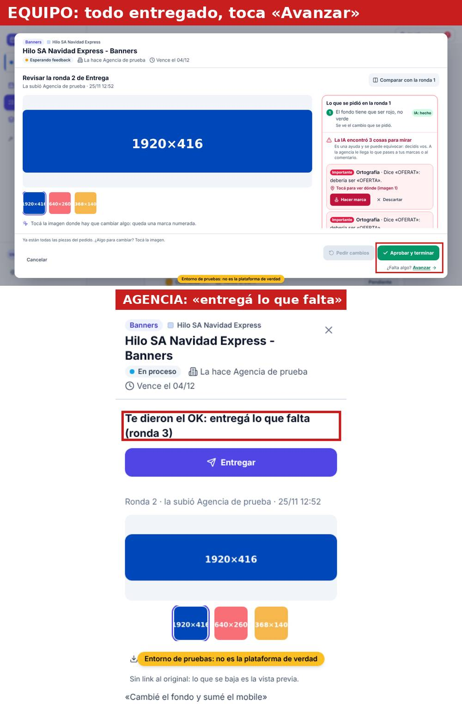

#### H-042 · La agencia no puede sumar la pieza que le faltaba una vez que entregó (nuevo)
- **Quién:** agencia · **Dónde:** Mi tablero → tarjeta en «Esperando feedback» · celular
- **Qué pasa:** mandó el header y quiere mandar el carrito. La tarjeta pasó a «Esperando feedback», en la ficha no hay
  botón para subir y en esa columna no hay «Mover». Queda esperando que revisen algo incompleto (y, por H-035, el equipo
  ve «ya están todas»). Martina **abandonó**.
- **Cómo repetirlo:** agencia → entregar una sola pieza de un pedido de dos → buscar cómo agregar la segunda.

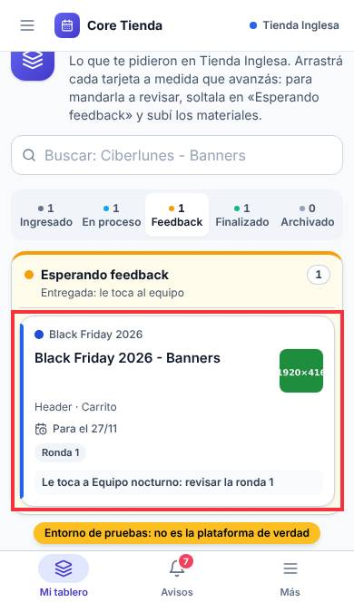

#### H-037 · Al entregar la corrección, el formulario no le recuerda a la agencia qué tenía que cambiar (nuevo)
- **Quién:** agencia · **Dónde:** ficha → «Entregar ronda 2» · celular
- **Qué pasa:** la marca («El fondo tiene que ser rojo, no verde») queda dos pantallas abajo; el formulario de entrega
  solo dice «Subí la pieza…». Para chequear tiene que cancelar y volver. Si se olvida un punto, hay otra ronda.
- **Cómo repetirlo:** tarea devuelta con una marca → agencia (celular) → la tarjeta → Entregar ronda 2.

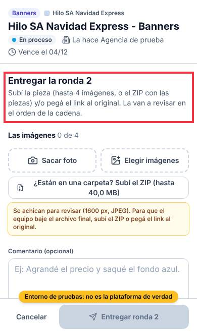

#### H-038 · La agencia entra desde el celular y no ve lo que volvió con cambios (nuevo)
- **Quién:** agencia · **Dónde:** Mi tablero · celular
- **Qué pasa:** el tablero muestra una columna por vez y abre siempre en «Ingresado». Lo urgente («Volvió con cambios»)
  está en «En proceso» y esa pestaña no tiene ninguna marca.
- **Cómo repetirlo:** el equipo pide cambios → la agencia entra a Mi tablero en el celular.

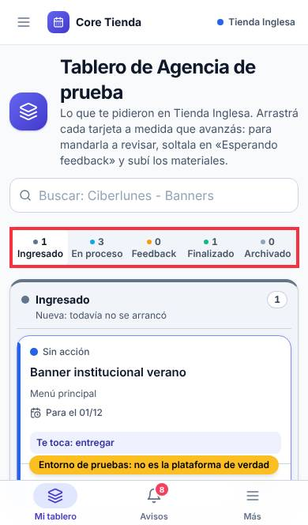

#### H-039 · «Atrás» o recargar en medio de una entrega borra todo lo cargado, sin preguntar (nuevo)
- **Quién:** agencia (y el equipo al entregar algo de Tienda) · **Dónde:** ficha → Entregar · notebook y celular
- **Qué pasa:** subió las imágenes y escribió el comentario; toca «atrás» (como para cerrar en el celular) o recarga:
  vuelve al tablero con todo cerrado y lo cargado se perdió. Con Escape sí está protegido. Al recargar, tampoco vuelve
  a la tarjeta.
- **Cómo repetirlo:** agencia → una tarjeta → Entregar → subir imagen y comentario → atrás o F5 → abrir la tarjeta.

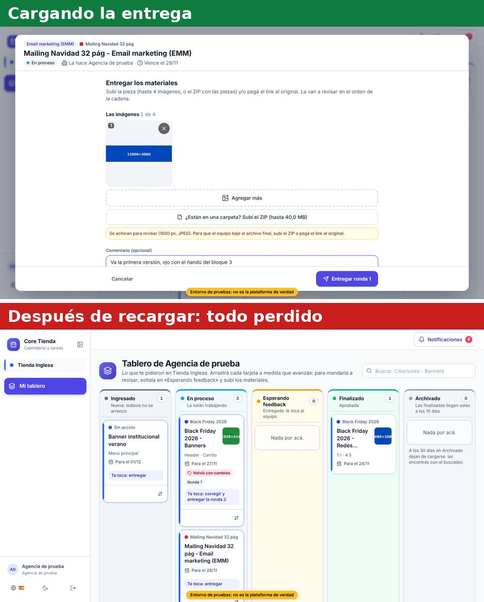

#### H-040 · El link del mail lleva al login y, después de entrar, no abre la tarea (nuevo)
- **Quién:** agencia y equipo · **Dónde:** `/login` desde un aviso por mail
- **Qué pasa:** «te pidieron cambios en Black Friday – Banners» → toca el link → como no tenía sesión, entra → cae en
  el tablero general sin la tarjeta abierta. Lo mismo cuando la sesión vence trabajando.
- **Cómo repetirlo:** sin sesión, abrir `/entregas?tarea=…` → entrar como agencia.

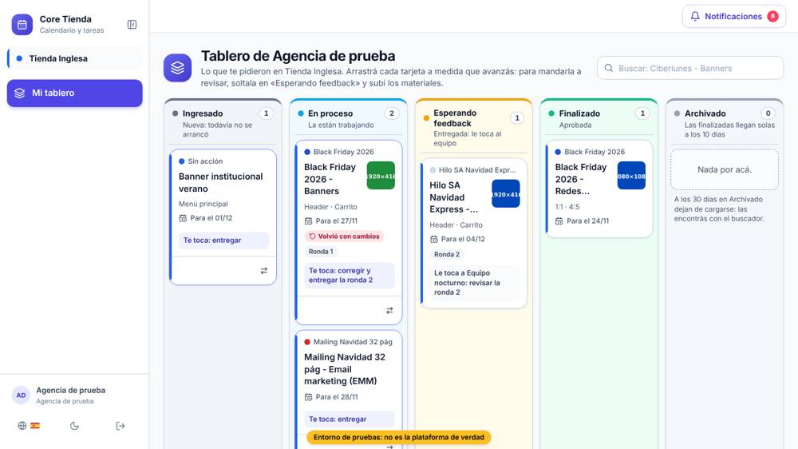

#### H-041 · A una persona nueva del equipo con rol «Usuario» no le aparece el calendario (nuevo)
- **Quién:** Ivan (al dar de alta) y la persona nueva · **Dónde:** `/admin` → Nuevo usuario · notebook
- **Qué pasa:** el rol «Usuario» trae cenefas, analytics, precios y los asistentes, pero **no** «Ver el calendario» ni
  nada de calendario. La persona entra y no tiene Calendario, Mis tareas ni Tablero, que es el corazón de la
  plataforma. La tarjeta del rol dice a la vez «Arranca sin permisos» y «15 permiso».
- **Cómo repetirlo:** /admin → Nuevo usuario → Del equipo → Crear → rol «Usuario» → lápiz → bajar a Calendario.

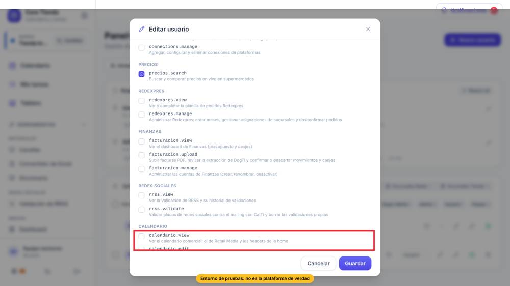

#### H-043 · Una plantilla armada en el editor no aparece al hacer cenefas (nuevo)
- **Quién:** equipo · **Dónde:** Editor de plantillas → Cenefas → Pruebas · notebook
- **Qué pasa:** guarda la plantilla («Template creado»), va a Cenefas → Elegir plantillas: «Todavía no hay plantillas
  guardadas». Solo aparece en el otro generador (el que falla, H-008). Tiene que volver a subirla como PPTX.
- **Cómo repetirlo:** `/materiales/cenefas/v2` → Cenefa A4 → Guardar → `/materiales/cenefas` → Pruebas → Elegir plantillas.

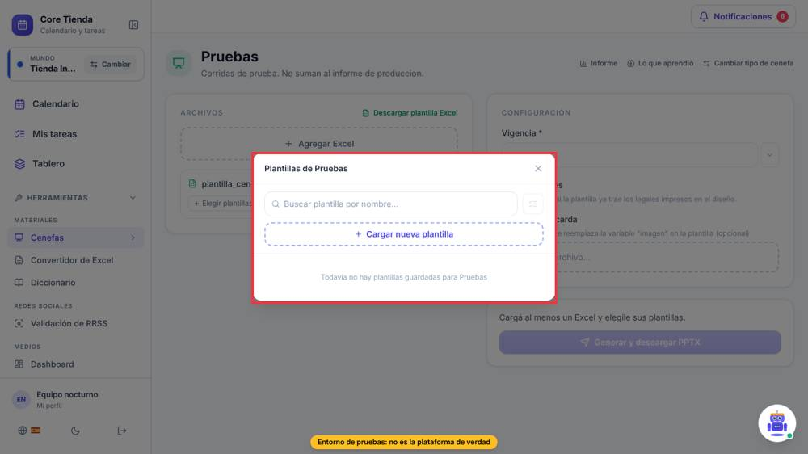

#### H-044 · En la Planilla de pedidos no hay cómo buscar un local entre 60 (nuevo)
- **Quién:** equipo de Redexpres · **Dónde:** `/redexpres/planilla` · notebook
- **Qué pasa:** 60 filas sin orden alfabético ni buscador; el estado queda al final a la derecha (hay que correr la
  tabla) con 59 botones violeta «Confirmar pedido» uno abajo del otro; nombres largos cortados.
- **Cómo repetirlo:** mundo Redexpres → Planilla de pedidos → Diciembre → buscar «Costa Verde».

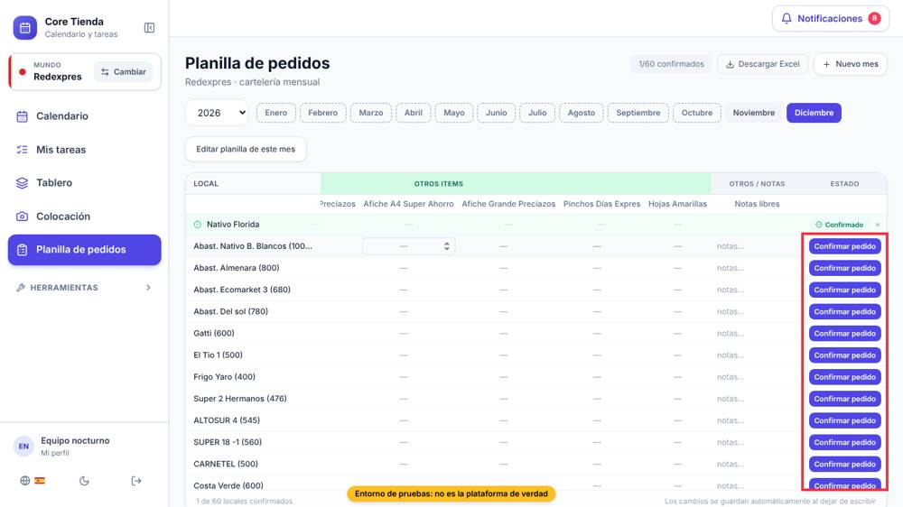

#### H-045 · Buscar precios muestra un error técnico en inglés y no dice «no encontré nada» (nuevo)
- **Quién:** equipo · **Dónde:** `/precios` · notebook
- **Qué pasa:** primero una ventana «Búsqueda lista — Encontramos 0 producto(s) relevantes» con «Continuar»; después
  en naranja «Disco / Devoto / Géant: HTTPSConnectionPool(host=…) Max retries exceeded… ProxyError…». (Sin internet
  es esperable que falle; lo que importa es cómo se muestra.)
- **Cómo repetirlo:** /precios → «arroz saman 1kg» → Enter.

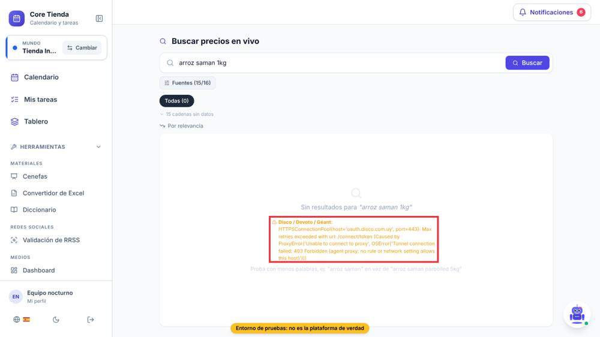

#### H-046 · En Finanzas, «Confirmar» la factura queda gris y no dice qué falta (nuevo)
- **Quién:** equipo · **Dónde:** `/facturacion` → Subir factura · notebook
- **Qué pasa:** completa todo y «Confirmar» sigue gris; ningún campo dice que es obligatorio. Recién al escribir
  «Concepto», abajo de todo, se habilita.
- **Cómo repetirlo:** Subir factura → un PDF → completar todo menos Concepto.

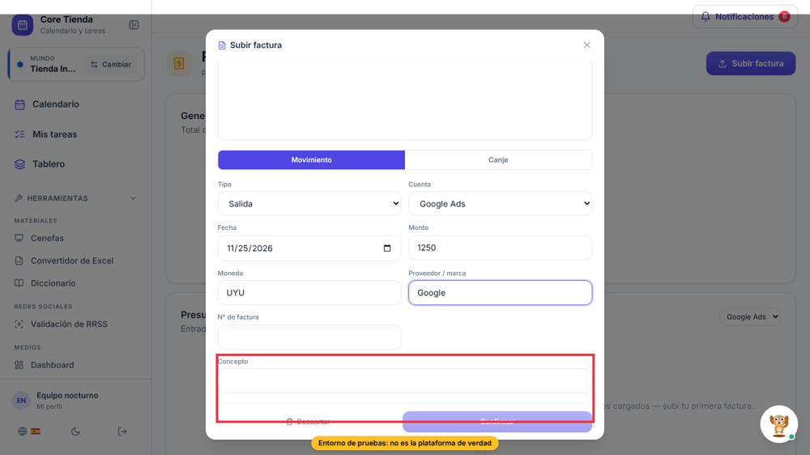

#### H-010 · El local entra a un robot y no a lo suyo (sigue pasando)
- **Quién:** local · **Dónde:** al entrar · celular
- **Qué pasa:** «Hola, Local 👋», robot, «Asistente con IA real · Powered by Claude Sonnet 5». Ni el pedido ni las
  fotos. Si le pregunta a Don Tino «¿qué tengo que hacer hoy?», le contesta que pida permiso del calendario.
  Martina: «yo vengo a pedir cenefas».

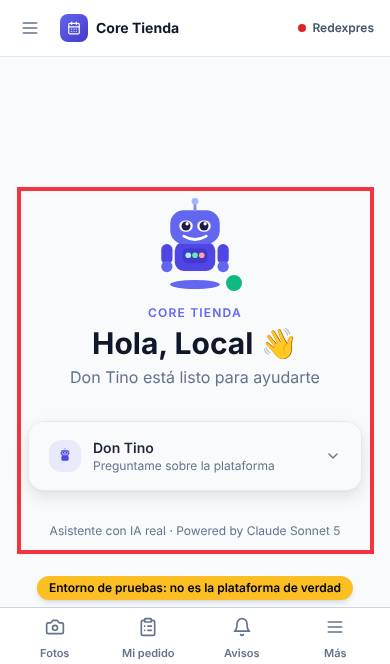

#### H-013 · Conexiones dice «Contraseña incorrecta» aunque la clave está bien (sigue pasando, confirmado)
- **Quién:** equipo con rol Usuario · **Dónde:** `/settings` → Nueva conexión
- **Qué pasa:** le ofrecen «Nueva conexión», escribe su clave correcta y sale «Contraseña incorrecta». Lo que pasa es
  que no tiene permiso.

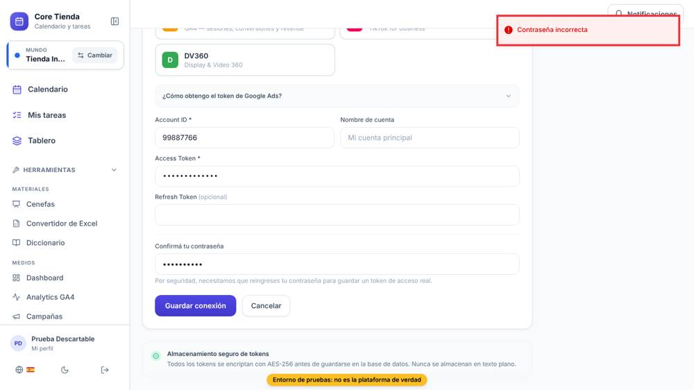

#### H-025 · El muñequito de Don Tino tapa botones: «Más» en el celular y «Enviar» en La Triada (sigue pasando, se amplía)
- **Quién:** equipo · **Dónde:** Convertidor, Precios, Finanzas (otro dibujo), Cenefas, La Triada · celular y notebook
- **Qué pasa:** en el celular tapa «Más», la puerta al resto del menú; en la notebook tapa el botón de enviar del chat
  de La Triada.

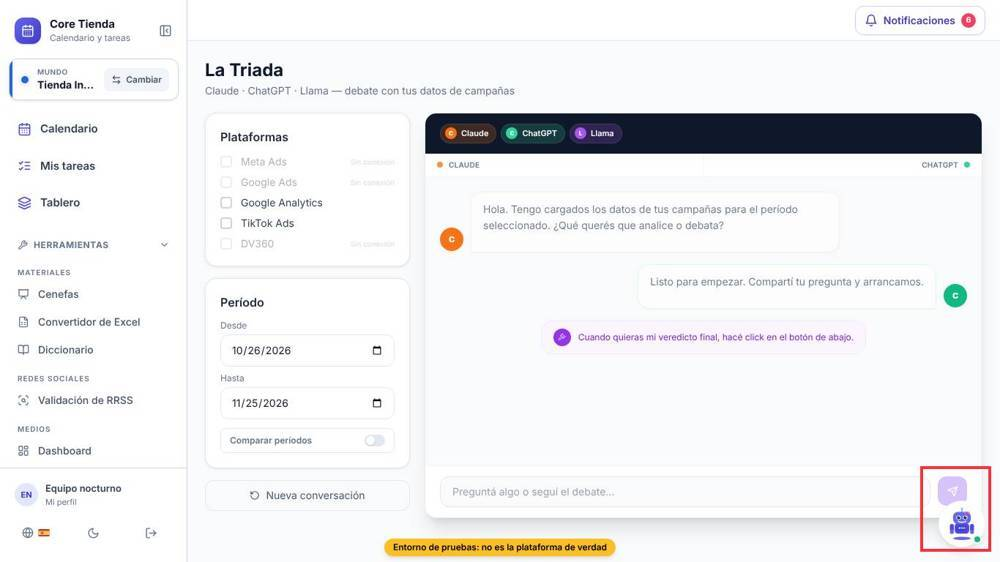

#### H-002 · En Materiales no se leen los nombres de las herramientas (sigue pasando, se amplía)
- **Quién:** equipo · **Dónde:** `/materiales` · claro
- **Qué pasa:** títulos blanco sobre blanco (1,1:1) y, nuevo, el texto pegado al borde de la tarjeta, sin margen.

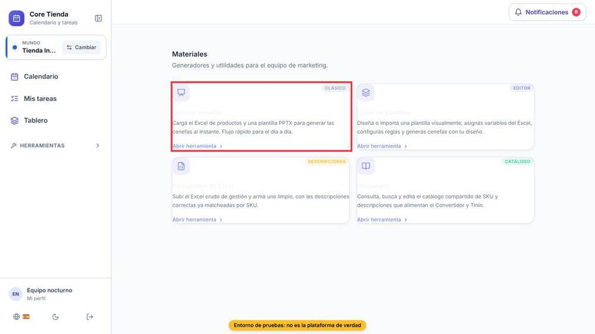

#### Otros 🟠 que siguen pasando
- **H-026** · En Campañas, Analytics, Conexiones y Listas de monitoreo el menú no muestra dónde estás sin bajar.
- **H-027** · Editor de cenefas en el celular: la barra de arriba se encima (no se volvió a ver hoy).
- **H-019** · La foto panorámica de la góndola no se manda (no se volvió a ver hoy).

### 🟡 Desprolijo

#### H-047 · «Otro» y «Otra cosa», uno al lado del otro, al pedir una tarea (nuevo; lo vieron Sofía, Martina y Lucía)
- **Dónde:** ficha → Crear tarea; Tablero → Nueva tarjeta. «Otra cosa» viene marcada. Nadie sabe la diferencia.

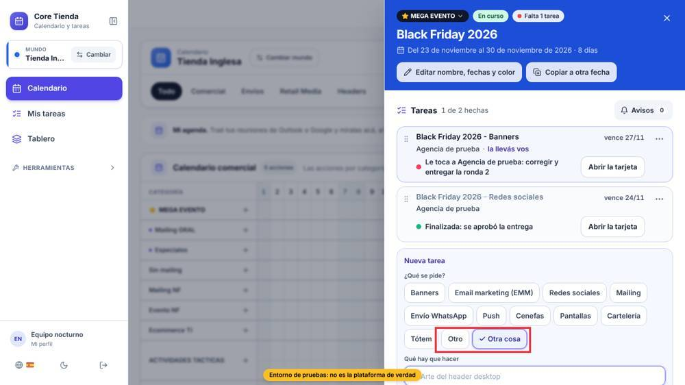

#### H-048 · A la agencia, una tarea que no es suya le dice «la borró otra persona» (nuevo)
- **Dónde:** `/entregas?tarea=<de otra agencia>` · Ventana vacía con «Esta tarea ya no existe: la borró otra
  persona.» y «Probar de nuevo». Ocultarla está bien; el mensaje es falso y el botón no sirve. Le pasa con un aviso viejo
  de una tarea que el equipo pasó a otra agencia.

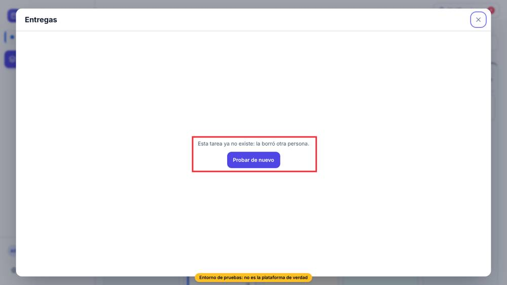

#### H-050 · Revisión del lote de cenefas: «Ver capacidad (XXX)», el precio encimado y genera sin la vigencia obligatoria (nuevo)
- **Dónde:** Cenefas → Pruebas → revisión. Botón con texto de relleno «(XXX)»; «Precio Final» encima del «899»; el
  título del aviso cortado; «Generar las 1»; deja generar con «Vigencia *» vacía.

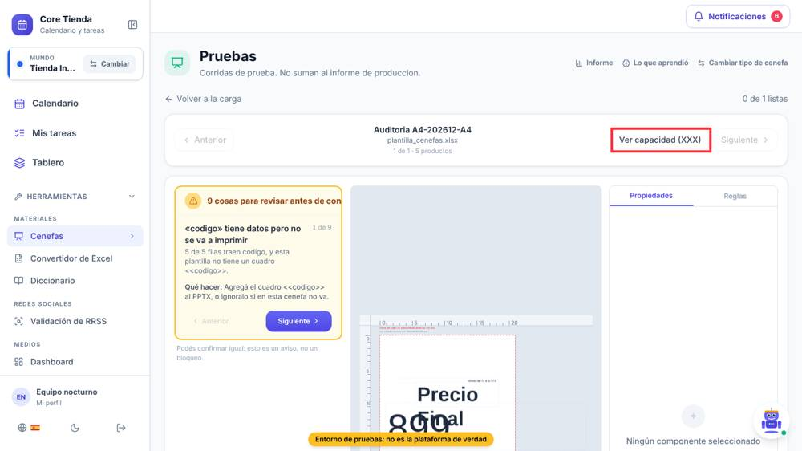

#### H-052 · Tablero del equipo en el celular: el título ocupa 8 renglones y no se ve ninguna tarjeta (nuevo)
- **Dónde:** `/entregas`, celular. El texto queda apretado entre el ícono y «Nueva tarjeta»; después buscador, cuatro
  botones de agencia y cinco pestañas; la primera tarjeta queda tapada por la barra de abajo.

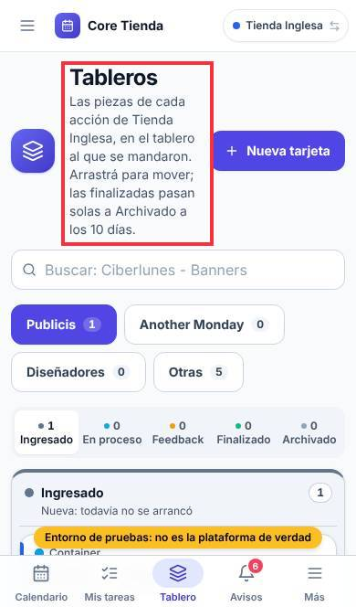

#### H-058 · Una dirección que no existe muestra «404 This page could not be found», en inglés y sin salida (nuevo)
- **Dónde:** cualquier link mal copiado (`/calendario/xyz`). Pantalla blanca, sin menú ni botón para volver.

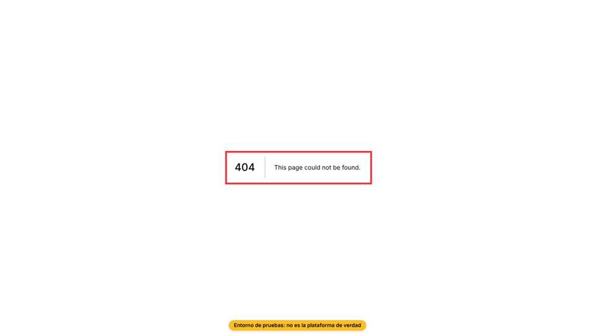

#### H-068 · El calendario de Redexpres encandila: barras amarillo flúo y títulos en mayúscula cortados (nuevo)
- **Dónde:** `/calendario` en Redexpres. Amarillo puro, naranja, magenta y negro uno al lado del otro; «ANIVERSARIO
  MAILING NOVIEMBRE (SORTEO AUTO + SORTEO) 40 PAG + CONTRATAP…». Duda para Ivan en la sección 3.

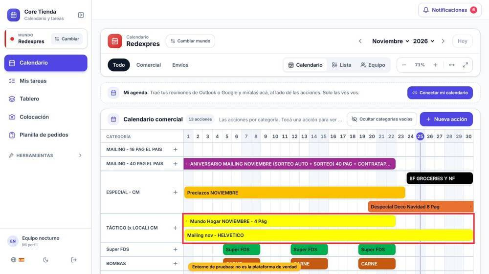

#### El resto de los 🟡 (nuevos)
- **H-049** · A una cuenta desactivada le dice «Email o contraseña incorrectos»; y desactivar es un toque en un ícono,
  sin preguntar (el mismo ícono está en la fila propia del admin, H-011). `/admin` y `/login`.
- **H-051** · Calendario en el celular: abre con dos renglones del mes a la vista, al bajar entran 7 días y la columna
  de categorías ocupa la mitad; los filtros («Retail Med…») y la tabla de Campañas se cortan sin señal de que se
  desliza. La vista Lista, que se lee bien, hay que buscarla.
- **H-053** · En la vista Equipo del calendario, cambiar de mes no cambia nada abajo (sigue «Esta semana»).
- **H-054** · «Cambiar el pedido» abre otro formulario con otras palabras («Banner web», «Medidas» vacías, «Desde/Hasta»
  vacías aunque vence el 04/12).
- **H-055** · El comentario de la agencia está debajo de la imagen, pero el panel «Comentarios» dice «Todavía no hay
  comentarios».
- **H-056** · En el celular, en Mis tareas tocar el título de una tarea no la abre (hay que tocar el chip de la acción)
  y no hay un «Hoy»: solo «Vencidas» y «Para esta semana».
- **H-057** · Mi pedido del local: tres casilleros dicen «cenefa» («Cenefa Oferta x3», «Cenefas 3xA4 Preciazos»,
  «Cenefas A4 Preciazos»); ¿«x3» es que vienen de a tres?
- **H-059** · El logo de Tienda (la margarita) no aparece en ningún lado: cuadrado violeta con gráfico de barras en el
  login, robot en el login del celular, cuadrado con calendario en el menú y en Mundos.
- **H-060** · Análisis IA (La Triada) dice «Tengo cargados los datos de tus campañas» sin ninguna conexión, y
  «hacé click en el botón de abajo» sin tal botón.
- **H-061** · Administración habla en código: `platform.users.view`, «15 permiso», «50 registro», ADMIN en la lista y
  SUPER ADMIN en el perfil, 4-5 íconos sin texto por fila, campos sin título; la Auditoría dice `admin.user.delete`,
  «user #4» y «—» en quién cambió la contraseña.
- **H-062** · En inglés la plataforma sale mezclada (menú «Calendar» y el resto en castellano) y «Cenefas» se traduce
  «Banners», que es otra pieza.
- **H-063** · Convertidor y Editor de plantillas con jerga: «matchear», «Mapeo de columnas», `ofertaUno`, «Template»,
  «placeholders», «canvas», «0 comp. · 0 reglas · 3 vars»; la columna MECÁNICA dice «Precio F» (cortado); la hoja A4
  del editor es un cuadrito de 150 px.
- **H-064** · El Informe de producción dice «entre el 2026-11-25 y el 2026-11-25» y el número grande sale de una
  carga declarada en agosto; la columna del Historial se llama «ISSUES».
- **H-065** · Un link de nueva contraseña vencido dice «Token inválido o expirado» dos veces y no ofrece pedir otro.
- **H-066** · Las ventanas de Finanzas y de Administración dejan una franja blanca de 24 px arriba sin oscurecer.
- **H-067** · Finanzas muestra el total como «$-1.250»: no se entiende si es gasto o saldo negativo.
- **H-069** · Letra gris clarito o de 10 px que no se lee: pasos 2 y 3 de Generar cenefas, «DESDE/HASTA» del Informe,
  «Sin conexión» de La Triada (≈2,6:1), «ACTIVA», «SUPER ADMIN», «OFERTAS/BOMBAS» del pedido.
- **H-070** · Confirmaciones en la ventanita gris del navegador («localhost dice…»): cambiar la agencia de una tarea,
  confirmar el pedido del local y borrar una cuenta. En el resto, la confirmación va adentro de la pantalla.

#### 🟡 que siguen pasando
- **H-007** · «Copiar a otra fecha» no copia el archivo del pedido y no lo avisa (confirmado; la parte de la vista
  Equipo ya no pasa).
- **H-022** · Quién hace la tarea se ve cortado («Agencia de prueba (Ager») y, ahora también, en las tarjetas del tablero
  («Agencia de prue…», «Imprenta Gráfic…»).
- **H-004** · El nombre del mundo se corta («Tienda In…», «Tienda F…») y hay dos botones para cambiarlo.
- **H-003** · Tres carteles distintos para «esto no es para vos» (el del local en /entregas, además, deja un error en
  la consola).
- **H-014** · Lo que explica la plataforma está viejo: la Guía no menciona calendario, tareas ni tablero; el login vende
  «Analytics multiplataforma, Análisis con IA…»; Don Tino muestra «1.380 tokens» y «Powered by…» (confirmado).
- **H-015** · «Informe» en Cenefas no hace nada para quien no es superadmin (confirmado).
- **H-017** · Las pantallas viejas parecen otra aplicación (ver sección 3).
- **H-029** · Dos botones principales iguales en el calendario y «1 acciones».
- **H-028** · Dashboard: «últimos 30D días», «Miércoles 25 De Noviembre», «0.00x», «Auto-sync activo».
- **H-030** · Finanzas vacía ofrece «Subir factura» antes que «Crear la primera cuenta».
- **H-031** · Las pantallas vacías tienen cinco estilos distintos.
- **H-032** · Cenefas en el celular: tarjetas angostas con texto cortado.
- **H-033** · Conexiones en oscuro: un cuadro «+» blanco.
- **H-023** · Entrega aprobada con «Falta 1 pieza» en rojo (no se volvió a ver hoy).

### ⚪ Detalle
- **H-071** · Las miniaturas de la entrega recortan la pieza («080×108»).
- **H-072** · Dos avisos verdes encimados tapan la ✕ de la ficha de la acción.
- **H-073** · Con el celular en modo oscuro, la plataforma se ve en claro (solo se prende con la luna del menú).
- **H-074** · «Nueva tarjeta» no entra en la pantalla de una notebook; al bajar se va el título.
- **H-075** · Buscar precios: «Fuentes (15/16)», 18 pastillas y «15 cadenas» no coinciden.
- **H-076** · Textos sueltos con errores: «produccion», «Lei 7 filas», «Listo: 2 placas revisadas» cuando no se leyó
  ninguna, la ventana de error del login que queda abierta en «Olvidé mi contraseña».
- **H-077** · Al entregar un archivo que no es imagen dice «No se pudo leer la imagen» sin decir cuál ni qué formatos sirven.
- **H-078** · El menú dice «Tablero» y la pantalla «Tableros»; el botón dice «Notificaciones» y la barra del celular «Avisos».
- **H-079** · Buscador de la agencia en el celular: dos cruces juntas; el texto dice «Arrastrá» donde se usa «Mover».
- **H-080** · Solo por la API (no se llega desde la pantalla): «pesa 2 MB: el máximo es 2 MB» para una de 5 MB; meses
  13 y 0 aceptados; mensaje vacío al chat aceptado; campos viejos sin tope de largo.
- **H-034** · El local y la agencia ven «Calendario y tareas» bajo el logo (sigue pasando).

### Para confirmar (siguen sin verse en pantalla)
- **H-005** · Aprobar arrastrando sin aviso: hoy, arrastrar de Ingresado a Finalizado no hizo nada y nadie dijo por qué;
  no había una tarjeta en «Esperando feedback» para probar lo de aprobar.
- **H-006** · Errores que se ven como «no hay nada» · **H-011** · Dejarse afuera a uno mismo (el ícono de desactivar
  está en la fila propia; no se tocó) · **H-012** · Bloqueo del login · **H-016** · Borrar validaciones ajenas.

### Lo que no se cuenta (y por qué)
- La IA que «encuentra» «OFERAT» en una imagen que no lo dice, o que da por «hecho» un cambio que no está: la IA es
  simulada en este entorno.
- Fechas en formato mes/día, la ruedita que no baja el panel, el desplegable que cierra el panel y «Confirmar pedido
  no da señal» (Martina): vienen del navegador automático (idioma en inglés; la ventanita de confirmación se cancela
  sola). Con el navegador de Sofía, confirmar el pedido sí mostró el cartel.
- El cartel amarillo «Entorno de pruebas» que tapa botones: solo existe en este entorno.

### Ya no pasan
- **H-020** (el local queda trancado al confirmar) y **H-021** (Planilla escondida): en `main` por el PR #68, vistos hoy.
- **H-009** (doce meses apagados sin mes abierto): en `main` por el PR #68; hoy no se pudo ver el caso sin meses.
- **H-024** (la imagen se iba de la vista al marcar): hoy la imagen quedó a la vista.
- La parte de **H-007** de la vista Equipo (la tarea de la agencia ya cuenta para su responsable).

## 3. Diseño: de «hecho por IA» a tranqui y minimal

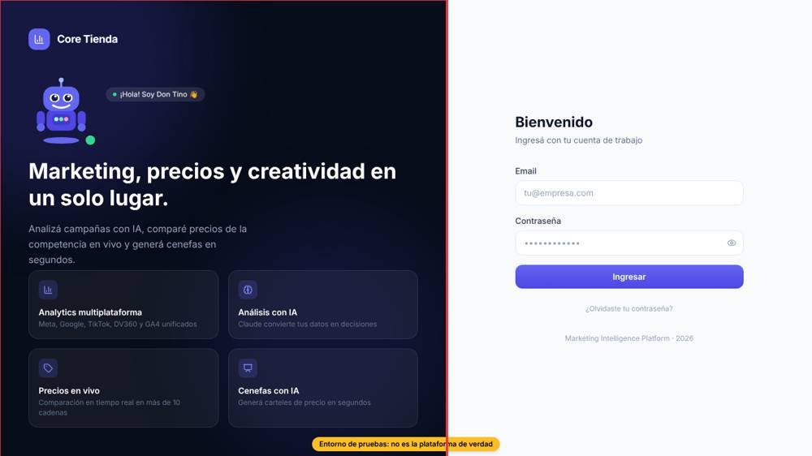

**Diagnóstico (Lucía):** no es una cosa sola, es la suma: un **índigo de Tailwind de fábrica** (`#4f46e5`, 1.252 usos)
que no es el azul de Tienda Inglesa; **cinco mascotas** (Don Tino robot, Tinín, CatTi gato, DogTi perro, Doña Tina;
99 usos); **cuadraditos de ícono con degradé** al lado de cada título; **pastillas de colores** para todo; **textos que
explican de más** («Motor v2 — componentes inteligentes», «Powered by Claude Sonnet 5»); y **bordes muy redondeados con
sombra** en cada caja. El núcleo (calendario, mis tareas, tablero, ficha de entrega) está cerca; lo que más grita
«IA» es el login, Inicio, Mundos, Precios, Materiales, Cenefas, La Triada y la Guía.

### 3.1 La dirección: 12 reglas

**1. Paleta: un azul, un rojo, grises neutros.**

| Uso | Claro | Oscuro |
|---|---|---|
| Fondo de página | `#FAFAFA` | `#111113` |
| Superficie (tarjetas, menú, ventanas) | `#FFFFFF` | `#1A1A1D` |
| Borde de cajas y separadores | `#E4E4E7` | `#2E2E33` |
| Borde de campos y botones secundarios | `#8A8A93` | `#71717A` |
| Texto principal | `#18181B` | `#F4F4F5` |
| Texto secundario | `#52525B` | `#A1A1AA` |
| **Azul marca** (botón principal, link, activo, foco) | `#0047BA` (hover `#003A99`) | botón `#2563EB`, link `#7AA2F7` |
| Azul suave (ítem elegido) | `#E8EEF9` | `#1E2A44` |
| **Rojo** (error, vencido, borrar, número de avisos) | `#C81E2B` | `#FF6B73` |
| Verde (aprobado) | `#15803D` | `#4ADE80` |
| Ámbar (esperando) | `#B45309` | `#FBBF24` |

Todos pasan 4,5:1 (texto) o 3:1 (bordes de controles). El rojo del logo `#F6323E` queda solo en el logo. Se van el
índigo/violeta/fucsia, el azul noche del login y los grises «slate» (pasan a grises neutros). El color de cada mundo, solo
como un puntito al lado del nombre.

**2. Tipografía:** Inter (una sola carga). Cuatro tamaños: 22 px título de pantalla · 16 px sección · 14 px texto
(16 px en campos del celular) · 12 px etiquetas. Nada debajo de 12 px (hoy hay 419 usos de 9–11 px). Dos pesos: 400 y
600. **Sin MAYÚSCULAS CON ESPACIADO** («HERRAMIENTAS», «MUNDO», «CATEGORÍA», «SUPER ADMIN»: 108 usos).

**3. Espaciado:** escala 4 · 8 · 12 · 16 · 24 · 32; margen de página 32 px en notebook y 16 px en el celular. Separar
con aire y una línea fina; **nunca una tarjeta dentro de otra**.

**4. Radios:** 6 px en botones, campos y tarjetas; 8 px en ventanas. Pastilla redonda solo para el número de avisos.

**5. Sombras:** lo apoyado en la página, sin sombra (solo borde). Sombra solo para lo que flota (menú, ventana). Sin
sombras de color ni desenfoque detrás de las ventanas: velo gris liso.

**6. Botones:** uno principal por pantalla, azul liso (sin degradé), 40 px de alto (44 en celular). Secundario blanco
con borde. Borrar, en rojo. Si hay dos acciones fuertes, la segunda pasa a secundaria.

**7. Íconos:** de línea, 16–18 px, del color del texto. **Sin cuadradito de color ni degradé detrás.** Fuera los
destellos ✨/✦ (26 usos).

**8. El color se gana:** azul = «tocá acá / estás acá»; rojo = vencido/error; verde = aprobado; ámbar = esperando.
Todo lo demás (categorías, cadenas, etiquetas, tipos de pieza) en gris. Estados: puntito de color + palabra, no fondos
pastel por columna.

**9. Textos:** título de 1–3 palabras; subtítulo de una línea o nada. Fuera el marketing adentro de la herramienta
(«Marketing Intelligence Platform», «Powered by…», «en tiempo real», «componentes inteligentes»). Sin emojis en la
interfaz (👋, ⭐, 🎉). Castellano de la gente: «Avisos», «Plantilla», «Historial», «Clics».

**10. Mascotas:** afuera de la interfaz de trabajo. Don Tino queda como **función**, sin cara: «Preguntarle a Don
Tino» en la barra de arriba, abre un panel lateral sobrio. **Un solo asistente.** El logo es **la margarita de 7
pétalos** en el menú, el login y la carga.

**11. Movimiento:** solo transiciones de 150 ms al abrir/cerrar. Fuera los latidos, rebotes, el puntito verde «en
línea» y los brillos (153 usos).

**12. Celular y oscuro, con la misma regla:** el botón principal abajo, a mano del pulgar; nada flotante encima de la
barra de abajo; 44 px para tocar. En oscuro, los mismos tokens invertidos y nada de cajas blancas.

**Así podría quedar el calendario** (maqueta de Lucía: margarita, mundo como texto + «Cambiar», menú sin íconos, una
sola fila de encabezado con **un** botón azul, filtros como pestañas subrayadas, acciones como barras blancas con una
rayita de color, sin «Mi agenda», sin zoom, sin mayúsculas ni estrella):

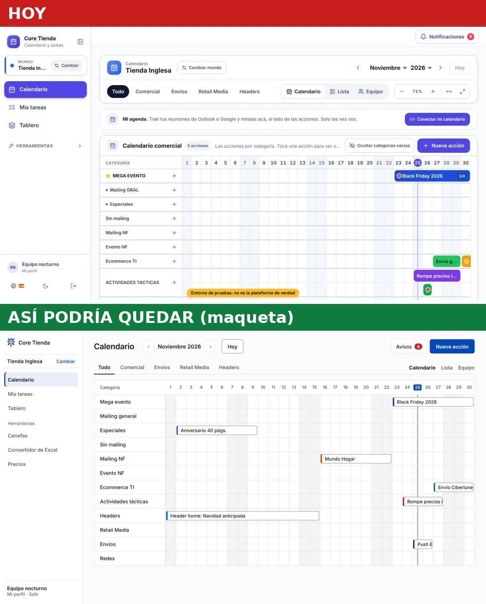

En oscuro:

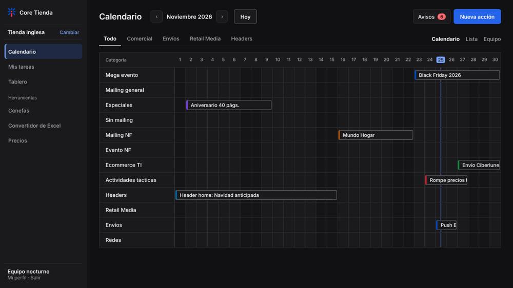

### 3.2 Pantalla por pantalla

Formato: **Hoy** → **Hacer**.

**Estructura común (menú, barra de arriba, barra de abajo)**
- Hoy: logo = cuadrado índigo con degradé y calendario; «Calendario y tareas» debajo; caja del mundo con «MUNDO» en
  mayúscula y «Tienda In…» cortado; ítem activo índigo lleno con sombra violeta; «HERRAMIENTAS / MATERIALES / MEDIOS» en
  mayúscula; botón «Notificaciones» con borde índigo; robot flotante en 6 pantallas.
- Hacer: margarita + «Core Tienda»; sin subtítulo; mundo en texto completo + link «Cambiar»; activo en azul suave sin
  sombra; grupos en minúscula 12 px gris; «Avisos 6» sin borde de color; sin robot flotante.

**Login** — la pantalla más «IA» de todas.
- Hoy: mitad izquierda azul noche con resplandor violeta, robot con «¡Hola! Soy Don Tino 👋», titular de folleto,
  cuatro tarjetas translúcidas vendiendo IA, logo de gráfico de barras, «Bienvenido», botón en degradé, «Marketing
  Intelligence Platform · 2026». En el celular el logo es el robot.
- Hacer: una columna centrada sobre `#FAFAFA`: margarita (48 px), «Core Tienda», dos campos, un botón azul «Entrar»,
  «¿Te olvidaste la contraseña?». Nada más.

**Mundos** — 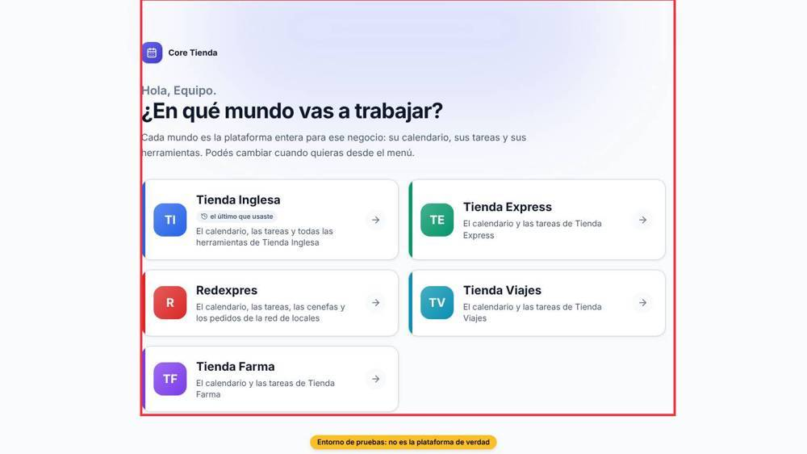
- Hoy: resplandor índigo arriba, cuadrados con degradé y siglas (TI, TE, R…), rayita de color, flechita en círculo,
  párrafo explicativo.
- Hacer: lista de 5 filas con borde fino: puntito del color del mundo + nombre + una línea gris; «Último» en gris en la
  última usada; sin párrafo.

**Inicio / Don Tino** — 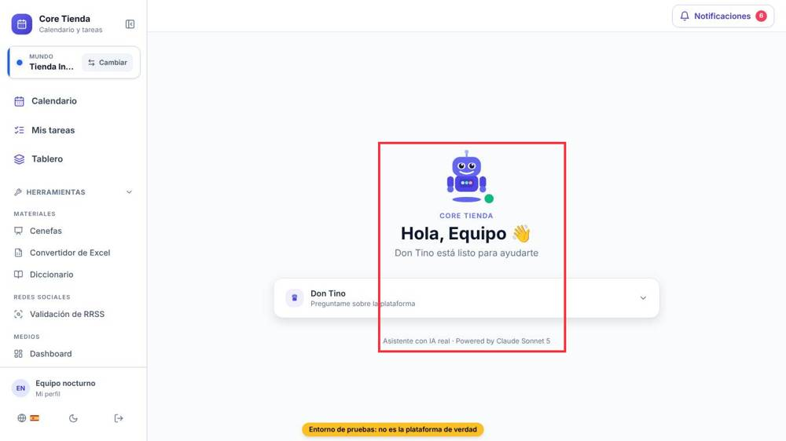
- Hoy: robot grande con punto verde, «CORE TIENDA» en mayúscula índigo, «Hola, Equipo 👋», acordeón con sombra,
  «Powered by Claude Sonnet 5», «tokens» debajo de cada respuesta, sugerencias sobre Google Ads y ROAS.
- Hacer: que Inicio no sea un chat (el equipo entra a su calendario o Mis tareas; el local a Fotos o Mi pedido, H-010).
  Don Tino como panel lateral sin dibujo; saludo de una línea; sin «Powered by» ni «tokens».

**Calendario** — 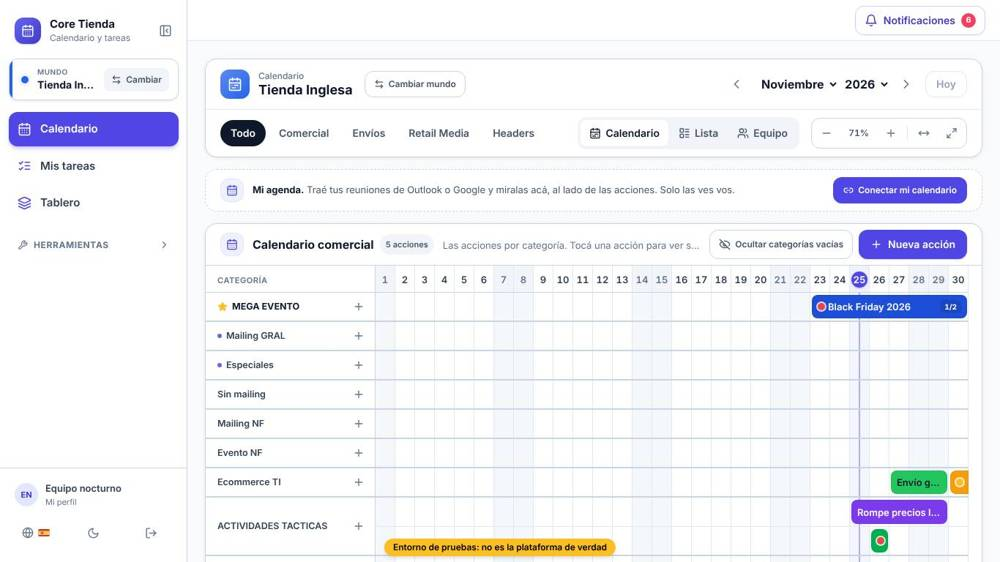
- Hoy: tres cajas redondeadas apiladas (encabezado, «Mi agenda» punteada, «Calendario comercial») con su cuadradito de
  ícono; dos botones índigo llenos; pastilla negra «Todo»; «5 acciones» en pastilla; texto explicativo cortado;
  ⭐ «MEGA EVENTO»; «ACTIVIDADES TACTICAS» en mayúscula; barras llenas de colores fuertes; zoom «71 %».
- Hacer: ver la maqueta. En el celular, abrir en Lista (que se lee bien) y no en el mes.

**Ficha de una acción** — 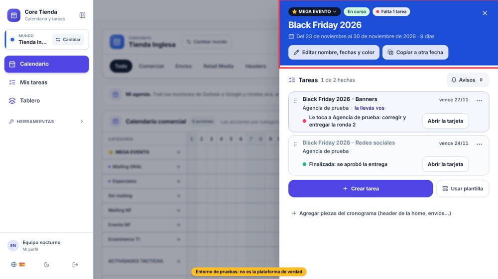
- Hoy: cabecera entera pintada del color de la acción, pastillas «⭐ MEGA EVENTO» / «En curso» / «Falta 1 tarea», fondo
  desenfocado, tareas como tarjetas celestes con borde índigo.
- Hacer: cabecera blanca con una rayita del color al lado del título; estados como texto gris con puntito; velo liso;
  tareas como filas separadas por línea.

**Nueva tarea**
- Hoy: 13 pastillas redondas para «¿Qué se pide?» dentro de una caja celeste dentro de la ficha; «Otro» y «Otra cosa».
- Hacer: lista de opciones en una columna o un desplegable; sin caja de fondo; una sola «Otra».

**Mis tareas** — 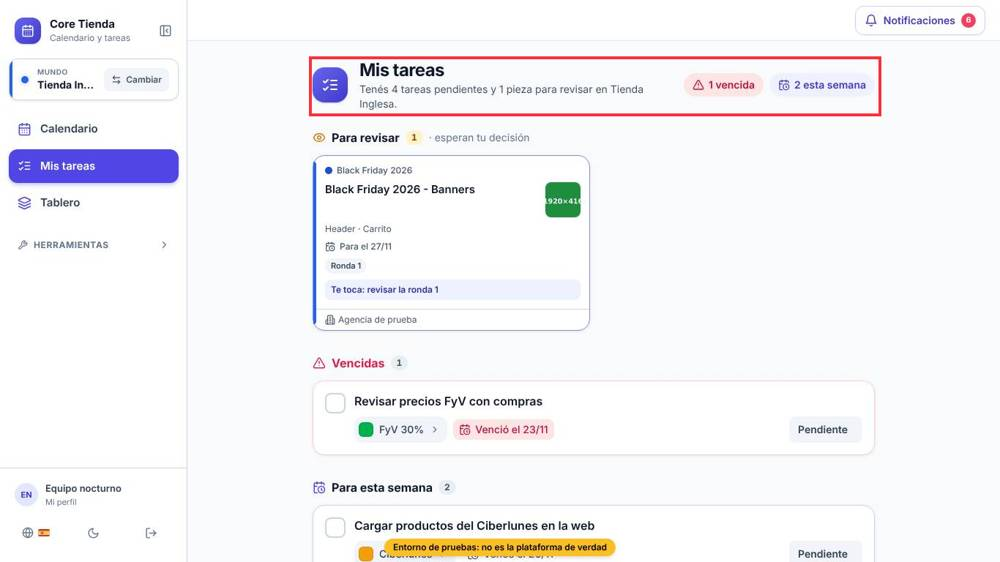
- Hoy: cuadrado índigo con degradé al lado del título; pastillas «1 vencida» rosa y «2 esta semana» lila; tarjeta de
  revisión con borde índigo + rayita + caja celeste; chip de color de la acción.
- Hacer: título solo; el resumen como una línea («1 vencida · 2 esta semana», vencida en rojo); tareas como filas.

**Tablero (equipo y agencia)** — 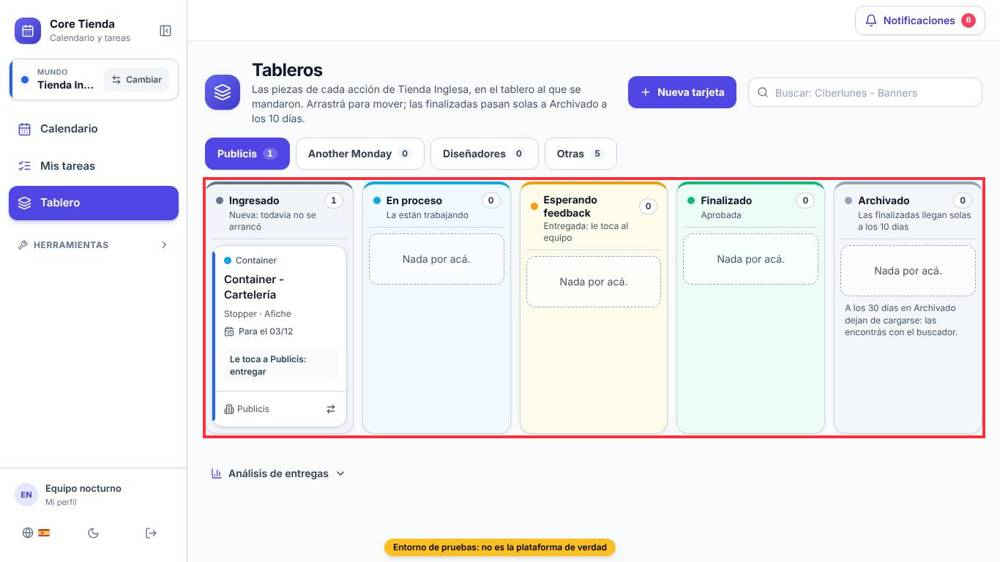
- Hoy: cuadrado de ícono con degradé; párrafo de 3 renglones sobre cómo arrastrar; agencias como pastillas grandes;
  **cada columna con fondo pastel distinto y borde de color arriba** (un arcoíris); «Nada por acá.» en cajas punteadas.
  En el celular de la agencia, «Arrastrá…» donde se usa «Mover».
- Hacer: todas las columnas sobre el mismo gris claro, título con puntito de estado; tarjetas blancas con borde fino;
  subtítulo de una línea o ninguno; agencias como pestañas subrayadas.

**Ficha de una entrega y Revisar**
- Hoy: de lo más sobrio (buen modelo). Detalles: «RONDA 1 · VOLVIÓ CON CAMBIOS» en mayúscula; caja rosa con borde rojo
  «La IA encontró 6 cosas para mirar» con pastillas «Importante»; tres colores de botón en la misma barra; 🎉 al
  finalizar; en el control previo de la agencia, cuatro tarjetas rosas con el mismo aviso.
- Hacer: mayúsculas a normal; lo de la IA como una lista gris plegada («La IA marcó 6 cosas · ver»), sin rojo salvo lo
  que de verdad bloquea; un botón principal; sin 🎉.

**Colocación, Fotos, Mi pedido, Planilla** — ya tranquilas.
- Sobra: ícono en círculo verde en Fotos, pastilla índigo del local, etiquetas de grupo en pastilla de color y mayúscula
  de 10 px («OFERTAS», «BOMBAS»), franjas pastel en la planilla.
- Hacer: dejar casi igual; grupos con título de sección en texto (14 px 600); meses como pestañas o selector.

**Materiales** — ver la captura de H-002 arriba.
- Hoy: cuatro tarjetas con cajita lila, etiqueta de color en la esquina («CLÁSICO», «EDITOR»…), títulos invisibles,
  sin margen.
- Hacer: lista de 4 filas: nombre + una línea; toda la fila es el link.

**Cenefas** — 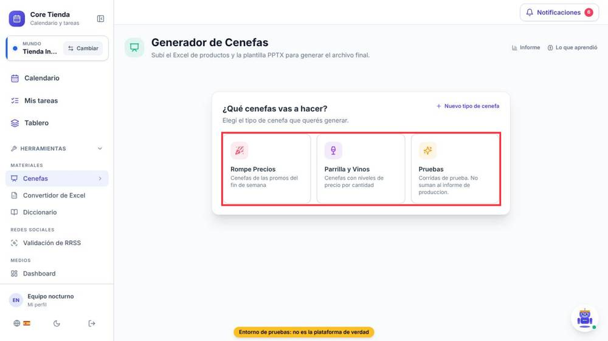
- Hoy: tarjeta flotante con sombra con tres tarjetas adentro; cada opción con cajita de color (confeti 🎉, copa,
  destellos ✨); robot flotante «Tinín, tu asistente» (otro asistente más).
- Hacer: título + tres opciones planas sin ícono de color; sin Tinín; «Informe» y «Lo que aprendió» como links.

**Editor de plantillas · Generar v2 · Lo aprendido · Historial · Informe**
- Hoy: «Template», «Motor v2 — componentes inteligentes», «Template del editor ✦», «PLANTILLAS PREDETERMINADAS» en
  mayúscula 10 px, pasos 2 y 3 casi invisibles, «Lo que aprendió Tinín», KPI en tarjetas con números verdes.
- Hacer: «Plantilla», «Lo aprendido», «Historial», «Informe»; sin subtítulos de marketing ni ✦; etiquetas normales de
  12 px; «Paso 1 de 3» en texto; números en negro.

**Convertidor de Excel · Diccionario**
- Hoy: cuadradito ámbar/verde; caja dentro de caja; botones desactivados violeta lavado; robot flotante; «alimentado por
  el Convertidor y por Tinín».
- Hacer: sin cuadradito; un solo nivel de caja; botón desactivado gris; sin mención a Tinín; palabras de la gente
  (H-063).

**Validación de RRSS** — 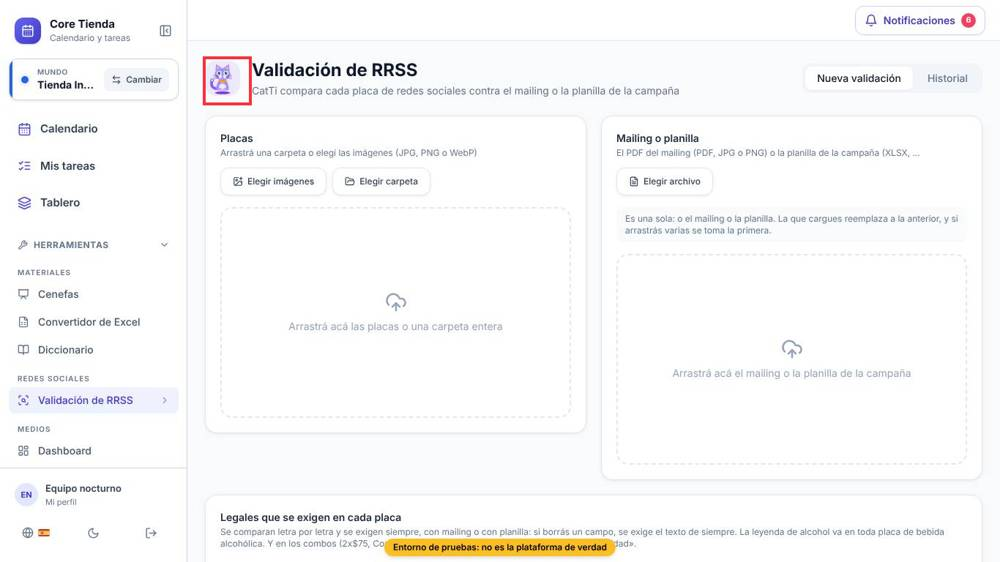
- Hoy: el gato CatTi como ícono del título («CatTi compara…»), dos zonas punteadas enormes, cuatro párrafos explicativos.
- Hacer: sin gato; «Compara cada placa con el mailing o la planilla»; zonas de soltar de 120 px; legales plegados.

**Buscar precios · Listas** — 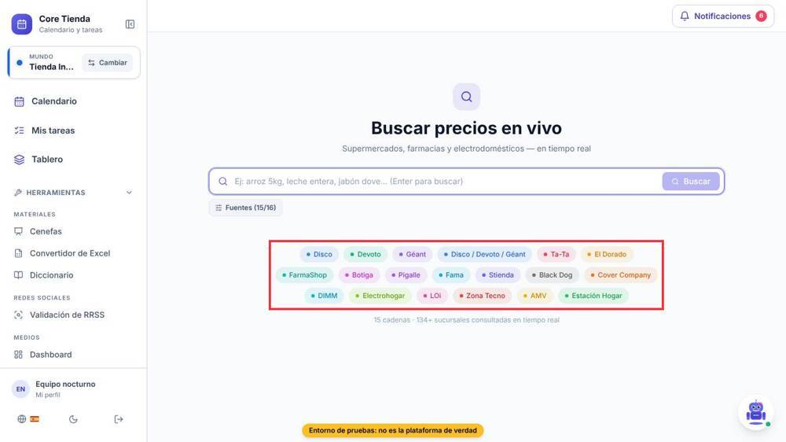
- Hoy: landing de buscador centrada, «en vivo — en tiempo real», **18 pastillas arcoíris** de cadenas, «134+
  sucursales», robot flotante; en Listas, estrella en cajita lila.
- Hacer: título a la izquierda («Precios»); buscador normal; las cadenas dentro de «Fuentes (15)» plegado; sin «en
  vivo/en tiempo real».

**Guía de uso** — 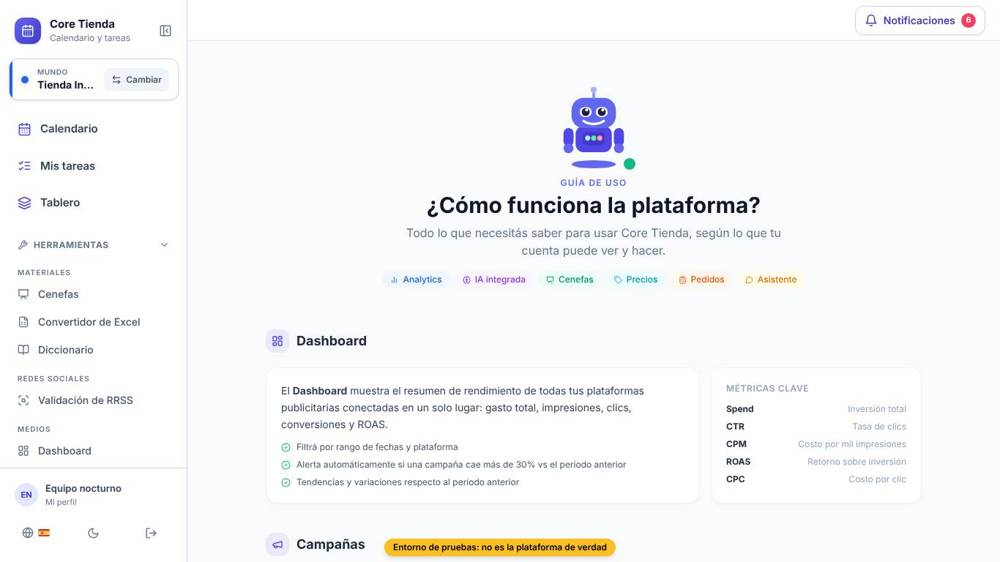
- Hoy: robot grande, «GUÍA DE USO» en mayúscula, 6 pastillas de colores, tablas «MÉTRICAS CLAVE» en inglés.
- Hacer: página de texto con índice a la izquierda; sin robot ni pastillas; contenido al día (H-014).

**Dashboard** — 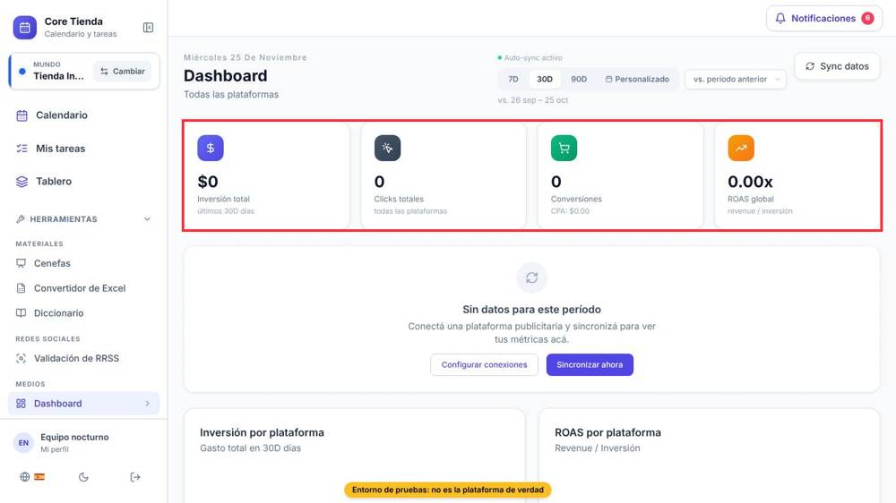
- Hoy: «Miércoles 25 De Noviembre» en mayúscula espaciada; «● Auto-sync activo»; 4 KPI con cuadrados de color lleno
  (índigo, gris, verde, naranja); vacío punteado con dos botones; «0.00x», «Clicks».
- Hacer: 4 números con etiqueta gris debajo, sin ícono ni color; una línea de estado gris; vacío con un botón.

**La Triada · Campañas · Analytics GA4** — ver la captura de H-025 arriba.
- Hoy: cabecera negra con pastillas de colores por modelo, burbujas violetas, robot tapando el enviar; Campañas con 5
  grupos de pastillas de filtro apilados.
- Hacer: el mismo chat sobrio que Don Tino (nombre del modelo en gris arriba de cada mensaje); filtros en una fila con
  desplegables.

**Finanzas · Cuentas** — 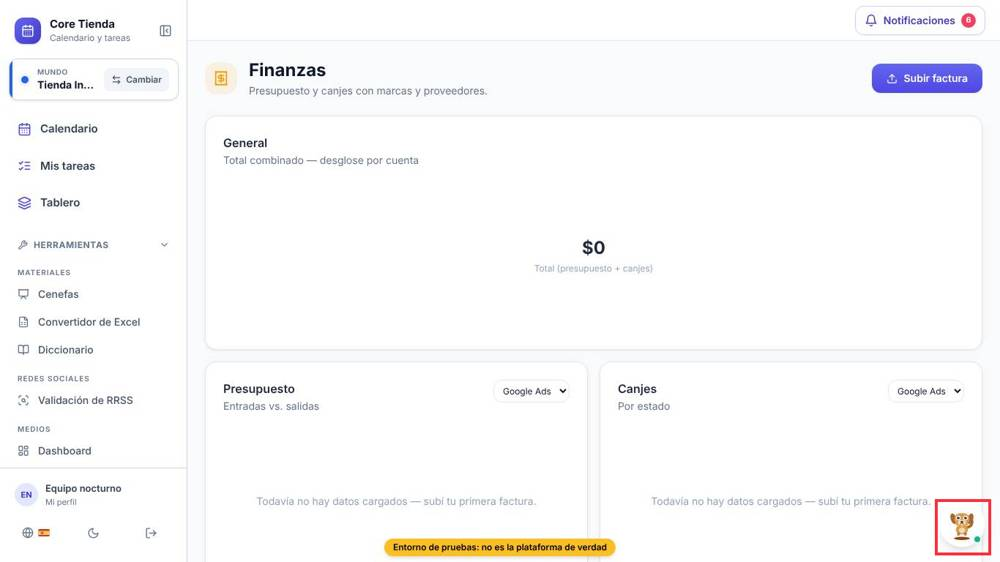
- Hoy: cuadradito ámbar con «$»; **perro DogTi** flotante; botón en degradé; tarjetas enormes casi vacías; «ACTIVA» en
  pastilla verde de 10 px.
- Hacer: sin perro; tarjetas a la altura de lo que tienen; «Activa» en texto verde 12 px; botón liso.

**Conexiones**
- Hoy: botón en degradé, cuadro «+» (blanco en oscuro), caja «Almacenamiento seguro de tokens · AES-256» con puntito verde.
- Hacer: sin la caja de AES-256; vacío de una línea con el botón.

**Administración** — 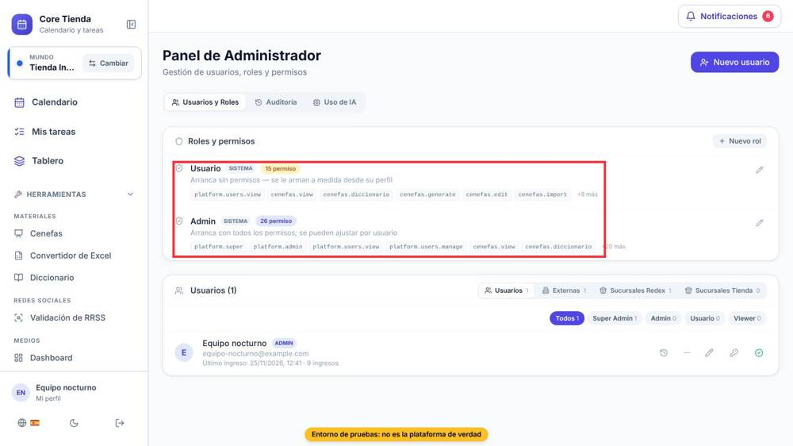
- Hoy: cocardas «SISTEMA», «15 permiso» de colores, permisos en letra de código, filtros en pastilla, «SUPER ADMIN»
  rosa de 9–10 px, cinco íconos por fila.
- Hacer: rol y cantidad en texto gris; las claves técnicas detrás de «Ver permisos»; acciones de la fila con texto.

**Mi perfil**
- Hoy: tres tarjetas apiladas con sombra, «SUPER ADMIN» rosa, avatar lila, botón en degradé.
- Hacer: una columna con secciones separadas por línea; rol en texto.

**Carteles de «sin acceso» y página que no existe**
- Hoy: tres estilos (candado + botón; escudo rojo y una línea; globo con punto rojo) y el 404 en inglés.
- Hacer: uno solo: ícono gris de línea, una frase, «Volver al inicio».

### 3.3 Dudas de Lucía para Ivan
1. **Colores de las acciones del calendario:** hoy son barras llenas del color que elige cada uno (de ahí el amarillo
   flúo de Redexpres). Propuesta: barra blanca con rayita de color. ¿La gente usa el color de fondo para reconocer las
   acciones de un vistazo? Si sí, alternativa: barra llena con una paleta acotada a 8 tonos apagados.
2. **Don Tino y las mascotas:** sacar los cinco dibujos y dejar a Don Tino como función, sin cara. ¿Se conserva el
   nombre «Don Tino»? (La propuesta lo deja; lo que sale es el robot.)
3. **Azul de la interfaz:** pasar del índigo al azul de Tienda Inglesa `#0047BA` cambia todos los botones y el ítem
   activo. Es el cambio que más se va a notar; conviene hacerlo de una vez y en todas las pantallas.

## 4. Prioridades sugeridas (en PRs medianos del Equipo nocturno)

**Tanda 1 · Que pedir y entregar no se trabe (lo de todos los días, equipo ↔ agencia)**
- PR «Pedirle a la agencia de verdad»: H-018 (la agencia con usuarios aparece en «¿Quién la hace?»), H-047 (una sola
  «Otra»), H-070 en el cambio de agencia (confirmación adentro de la pantalla), H-022 (nombres sin cortar).
- PR «Revisar sin confusiones»: H-035 (no decir «ya están todas» si faltan), H-036 («Avanzar» solo si falta algo y
  botones siempre en el mismo lugar), H-042 (la agencia puede sumar lo que faltaba), H-037 (la corrección a la vista al
  entregar).
- PR «La agencia en el celular»: H-038 (abrir donde le toca), H-039 (no perder lo cargado), H-040 (el link del mail
  abre la tarea), H-079.
- Por qué primero: es el flujo central, lo usan todos los días el equipo y las agencias, y Martina abandonó dos veces.

**Tanda 2 · El cambio visual de base (la parte «tranqui y minimal»)**
- PR «Base visual»: paleta (índigo → azul `#0047BA`, grises neutros), un solo botón principal liso, radios 6 px, sin
  sombras de color ni desenfoque, sin mayúsculas espaciadas, nada debajo de 12 px. Se hace en los tokens, así que
  cambia todo de una vez (H-017, H-069, H-029, H-033).
- PR «Sin mascotas y con la margarita»: logo margarita (H-059), login de una columna, Inicio que no es un chat (H-010),
  Don Tino como panel sin dibujo y un solo asistente (sale Tinín, CatTi, DogTi, Doña Tina; resuelve H-025), sin
  «Powered by» ni «tokens» (H-014).
- PR «Menú y encabezados»: mundo sin cortar y un solo «Cambiar» (H-004), menú que marca dónde estás (H-026), un solo
  estilo de encabezado (título + una línea, sin cuadradito), un solo cartel de «sin acceso» y una página de «no existe»
  (H-003, H-058), vacíos parejos (H-031).
- Antes de arrancar: las tres dudas de la sección 3.3.

**Tanda 3 · Las pantallas del núcleo, una por una (con la base ya puesta)**
- Calendario según la maqueta (incluye H-068 si Ivan elige la rayita; H-051 abriendo en Lista en el celular; H-053),
  Tablero (columnas sin arcoíris, H-052), Mis tareas (H-056), ficha de la acción y Revisar (la IA como lista sobria).

**Tanda 4 · Herramientas que hoy fallan o confunden**
- Cenefas: H-008 (el motor v2 termina o se esconde), H-043 (la plantilla del editor aparece donde se hacen cenefas),
  H-050, H-063, H-064, H-015, H-002.
- Administración y altas: H-041 (el rol Usuario trae el calendario), H-013, H-049, H-061, H-065.
- Finanzas, Precios y Medios: H-046, H-067, H-030, H-045, H-060, H-028.
- Redexpres: H-044 (buscar un local en la planilla), H-057.

**Aparte, cuando Ivan diga · la regla de las entregas**
- H-001: que no se pueda borrar una acción o tarea con entregas (ofrecer archivarla). Chico, pero toca una regla que
  no se discute; conviene hacerlo antes de que alguien pierda un histórico.

---
*Equipo nocturno · Sofía (consolidado), Martina (a ciegas), Lucía (diseño), Ramiro (pruebas). Capturas originales en
el entorno de la noche; las de este informe, en `img/`.*
