# Cada proceso, de punta a punta · 26/11/2026

> Pedido de Ivan (25/11): «lanzá nuestro grupo de agentes… para que hagan cada proceso de toda la plataforma».
> Corrida especial del Escuadrón Lechuza, sin cambios de código: 57 procesos probados como los hace la gente,
> con lo último de `main` de ese momento (`87a949c`: entregas con versiones #86, agencias sin mundos #85, una sola
> burbuja #87, mails del equipo #88, Clientes VIP #89). Los #90 (la guía explica las versiones) y #91 (informe de
> Clientes VIP) entraron a `main` durante la corrida y **no** se probaron.

## 0. Cómo se hizo

- **Entorno:** plataforma entera levantada en la nube (base Postgres vacía, migraciones hasta 0091, API con la IA
  simulada, web armada como en producción). Nada tocó producción. Los mails no salen en este entorno.
- **Cuentas:** Equipo nocturno (superadmin, 5 mundos), Agencia de prueba (externa), Local de prueba (Nativo Florida,
  Redexpres) y 7 descartables creadas desde `/admin` para la prueba (2 del equipo con rol Usuario, 1 sin Clientes VIP,
  2 agencias nuevas, etc.).
- **Quién hizo qué:**
  - **Sofía** (en dos frentes a la vez): los procesos del equipo de Tienda, del calendario a la aprobación, y
    materiales, Redexpres, finanzas, medios y Clientes VIP. Después pasó todo al cuaderno.
  - **Martina**, a ciegas (solo capturas y toques): el encargado del local y la agencia en su primer día, en notebook
    y celular. Hizo el ciclo completo con Sofía: pedido → v1 → sumar archivo → v2 → cambios pedidos → v3 desde el
    celular → aprobado, en 20 minutos.
  - **Ramiro** intentó romper cada proceso: permisos cruzados (67 consultas internas, todo lo que va por id, las
    escrituras), doble clic, carreras, datos raros y celular. Corrió además las pruebas automáticas.
  - **Lucía** miró cada pantalla: barrido vacío (384 capturas: 3 cuentas × notebook y celular × claro y oscuro), barrido
    con datos (96 capturas en 8 pantallas) y lo nuevo de hoy a mano.
- **Números:** unas 600 capturas a mano y 480 de barrido. Pruebas automáticas: backend **5.111 pasan, 0 fallan**
  (con Postgres; una falla aislada de «Event loop is closed» en la primera corrida, no se repitió en otras dos);
  frontend: lint sin errores (63 avisos), type-check bien, calendario 616, chat 30, cenefas 12, colocación 12;
  **`test:externos` falla en `test:acceso` (35 bien, 1 mal: `/clientes-vip`)**. Es lo mismo que hoy tiene en rojo el
  CI de `main` en GitHub desde #90 y #91 (ver H-083).
- **Seguridad:** ningún agujero. La agencia (dos distintas), el local y una cuenta del equipo sin el permiso reciben
  «no» en todo lo que no les toca, en la pantalla y en la API. Una agencia no ve nada de otra.

## 1. Todos los procesos

✅ anda · ⚠️ anda con trabas · ❌ no anda · ⏸ no se pudo probar. Las imágenes están en [`img/`](img/); las demás
capturas están citadas en el cuaderno, en cada hallazgo.

**Resultado: 27 ✅ · 27 ⚠️ · 2 ❌ · 1 ⏸.**

| # | Proceso | Quién · dónde empieza → dónde termina | Estado | Qué pasó | Hallazgos |
|---|---|---|---|---|---|
| P01 | Entrar | Todos · `/login` → mundos / tablero / lo suyo | ⚠️ | Anda con las 3 cuentas; la agencia cae directo en su tablero. Pasado el bloqueo por 5 errores, **un solo error vuelve a bloquear 15 min**. El local cae en Don Tino. | H-012, H-010, H-059 |
| P02 | Olvidé mi contraseña / link vencido | Todos · `/login` → `/reset-password` | ⚠️ | El link inválido dice «Token inválido o expirado» sin salida. En pruebas, la recuperación por mail no está activada. | H-065 |
| P03 | Cambiar la contraseña | Todos · `/perfil` → entrar con la nueva | ⚠️ | Equipo: anda (también la obligatoria del primer ingreso). **Local: llena los 3 campos y recién al final le dicen que no puede.** | H-084 |
| P04 | Elegir y cambiar de mundo | Equipo · `/mundos` → calendario del mundo | ✅ | Anda. Sigue el nombre cortado y dos botones para lo mismo. | H-004 |
| P05 | La agencia no elige mundos | Agencia · `/login` → su tablero | ✅ | Entra directo, ve solo lo suyo, de cualquier mundo. | — |
| P06 | Crear una acción | Equipo · «Nueva acción» → barra en el mes | ✅ | Anda; doble clic crea una sola; fechas al revés las frena. | H-076 |
| P07 | Editar una acción | Equipo · ficha → mes | ✅ | Anda, también renombra la tarea con nombre automático. | — |
| P08 | Copiar a otra fecha | Equipo · ficha → acción nueva | ⚠️ | Copia, pero **no trae el Excel del pedido** y no lo avisa. | H-007 |
| P09 | Borrar una acción | Equipo · ficha → desaparece | ✅ | Pregunta dentro de la ventana; la otra pestaña se entera sola. | H-001 |
| P10 | Vistas Lista y Equipo | Equipo · `/calendario` | ⚠️ | En Equipo, cambiar de mes no cambia nada. | H-053 |
| P11 | Mi agenda | Equipo · `/calendario` | ✅ | Explica bien cómo conectar Outlook/Google; Esc no cierra el cuadro. | H-108 |
| P12 | Nueva tarea desde una acción | Equipo · ficha → tarjeta en el tablero | ⚠️ | Se crea con medidas, fecha y adjunto, pero **la agencia de prueba (y cualquier agencia nueva) no está en «¿Quién la hace?»**. Si el adjunto se rechaza, la tarea sale igual sin él. | H-018, H-096, H-047 |
| P13 | Nueva tarjeta sin acción | Equipo · `/entregas` → tarjeta | ❌ | **Solo para Publicis, Another Monday o Diseñadores, y después no hay dónde cambiar la agencia**: a otra agencia nunca le llega. Además «Crear tarjeta» queda fuera de la pantalla. | H-018, H-074 |
| P14 | Tarea interna | Equipo · ficha → Mis tareas | ✅ | Anda. | — |
| P15 | Adjuntar al pedido | Equipo → agencia | ✅ | La agencia ve el Excel con «Bajar». | — |
| P16 | Plantillas de tareas | Equipo · ficha → tareas creadas | ⚠️ | En una acción que ya arrancó crea **tareas ya vencidas** sin avisar. | H-091 |
| P17 | Cambiar la agencia de una tarea | Equipo · ficha de la acción | ⚠️ | Solo desde la ficha de la acción, con la ventanita gris del navegador y el nombre cortado. | H-018, H-070, H-022 |
| P18 | La agencia encuentra el pedido y lo arranca | Agencia · tablero → En proceso | ✅ | A ciegas, en 2 pasos: «Te toca: entregar», medidas y fecha. | — |
| P19 | La agencia entrega y deja nota | Agencia · ficha → v1 | ✅ | Anda; triple clic crea una sola versión; una imagen de 90 MB se achica bien. El control previo no avisa la medida que falta. | H-094, H-035, H-077 |
| P20 | Sumar archivos y mandar otra versión | Agencia · ficha → v2 | ✅ | **Lo nuevo anda muy claro**: «Sumar archivos a la versión 1» y «esta la reemplaza». | — (ya no pasan H-042, H-081) |
| P21 | Revisar: Avanzar | Equipo · ficha | ⚠️ | Con todo entregado le dice a la agencia «entregá lo que falta (versión 4)». | H-036 |
| P22 | Pedir cambios | Equipo → agencia | ✅ | La agencia lo ve en rojo en notebook y celular, y el formulario lo repite. Si choca con una versión nueva, «recargá» borra la marca escrita. | H-095, H-055, H-098 (ya no pasan H-037, H-038) |
| P23 | Comparar versiones | Equipo · ficha | ⚠️ | Pone lado a lado dos piezas distintas, sin elegir cuál. | H-089 |
| P24 | Aprobar y terminar | Equipo · ficha → Finalizado | ⚠️ | Aprueba **con piezas faltantes sin preguntar**, y la aprobada sigue en rojo «Faltan 4 piezas». | H-023 |
| P25 | Reabrir | Equipo → agencia | ✅ | Abre «Entrega 2» y le llega a la agencia con el motivo. | H-097 |
| P26 | Revisión con IA (simulada) | Equipo · ficha | ⚠️ | Dice «encontró 2 cosas» y muestra una. La agencia no la ve (bien). | H-094 |
| P27 | Tablero del equipo | Equipo · `/entregas` | ⚠️ | Las tarjetas de la agencia caen en «Otras»; menú «Mover» cortado; en el celular no se ve ninguna tarjeta. Por la API se puede pasar a Finalizado sin nada entregado. | H-090, H-092, H-093, H-052, H-005 |
| P28 | Mis tareas | Equipo · `/mis-tareas` | ✅ | Anda; tocar el nombre de la tarea no la abre. | H-056 |
| P29 | Avisos y campanita | Equipo, agencia y local | ✅ | Cada paso llega a quien corresponde y abre la tarjeta. | — |
| P30 | Mails de avisos | Sistema | ✅ | Se generan para quien corresponde (los del tablero, solo campanita, por diseño). En pruebas no salen. | — |
| P31 | Don Tino: una burbuja e Inicio | Todos | ⚠️ | Una sola burbuja por pantalla. **Pero tapa botones**: «Confirmar pedido» del local, «Validar placas», «Enviar» de La Triada. Al local le sugiere Google Ads. | H-025, H-010, H-014 |
| P32 | Guía de uso | Todos · `/ayuda` | ⚠️ | Buscador y temas andan; no explicaba las versiones (resuelto en `main` por #90, a confirmar). | H-110 |
| P33 | Cenefas: listado, lote, generar | Equipo · `/materiales/cenefas` → PDF | ✅ | Anda de punta a punta. Detalles de textos. | H-105, H-050 |
| P34 | Cenefas motor v2: editor y Generar | Equipo · `/v2` → `/v2/generar` | ❌ | **«Error en la generación — Error desconocido».** | H-008 |
| P35 | Convertidor | Equipo · Excel → Excel convertido | ✅ | Anda; sigue la jerga. | H-063 |
| P36 | Diccionario | Equipo | ⚠️ | Se corrige, pero no se puede agregar desde ahí. | H-103 |
| P37 | Buscar precios | Equipo · `/precios` | ⚠️ | Sin internet: error técnico en inglés y una ventana de «0 productos». | H-045 |
| P38 | Listas de monitoreo | Equipo · `/precios/listas` | ⏸ | Se arman desde un producto buscado y sin internet no hay productos. | — |
| P39 | Planilla de Redexpres | Equipo · `/redexpres/planilla` | ✅ | Mes nuevo, 60 locales, columna nueva: anda. Sin buscador. | H-044, H-107 |
| P40 | Mi pedido del local | Local · `/redexpres/mi-pedido` | ⚠️ | A ciegas cargó 30 cenefas y quedó. **Un -5 da «Error al guardar» y queda escrito**; no le avisan cuando abren el mes. | H-085, H-099, H-057 |
| P41 | Confirmar y desconfirmar | Local ↔ equipo | ⚠️ | Confirma, pero con la ventanita gris del navegador y la burbuja tapa el botón. **Desconfirmar: solo el superadmin, con una ✕ de 10 px sin preguntar.** | H-086, H-070, H-025 |
| P42 | Pedir foto de colocación | Equipo · ficha, pestaña Fotos | ✅ | Le llega al local. | — |
| P43 | El local sube la foto | Local · `/fotos` | ✅ | Desde el celular, también la panorámica 4000×1200. | (nota en H-019) |
| P44 | Validación de redes | Equipo | ⚠️ | Anda el camino de error (IA con clave falsa); la burbuja tapa «Validar placas». | H-025 |
| P45 | Medios | Equipo | ⚠️ | Vacíos claros; La Triada: Enter no manda y muestra «OPENAI_API_KEY». | H-102, H-060 |
| P46 | Finanzas | Equipo · cuenta → factura | ⚠️ | «Confirmar» gris sin decir qué falta; «$-1.220». | H-046, H-067 |
| P47 | Clientes VIP: cargar (CSV inventado) | Equipo | ⚠️ | Carga 12 filas inventadas bien. **Un mes 13 muestra «undefined» y rebota el archivo entero sin decir la fila.** | H-088 |
| P48 | Clientes VIP: tablero, segmentos, ficha | Equipo | ⚠️ | **Eje «0 M»**, el informe del mes es un mensaje de error (IA simulada; #91 lo toca) y con poca historia todos «Creciendo». | H-087, H-100, H-101 |
| P49 | Sin permiso no se ve Clientes VIP | Equipo sin permiso, agencia, local | ✅ | Ni menú, ni pantalla, ni API. (El chequeo automático del front falta: H-083.) | H-083 |
| P50 | Alta de usuario del equipo | Admin → la persona entra | ✅ | Anda. Sigue la jerga de permisos. | H-061 |
| P51 | Alta de agencia | Admin → la agencia entra | ✅ | Entra a su tablero, **pero no aparece para pedirle trabajo**. | H-018, H-109 |
| P52 | Permisos y roles | Admin | ✅ | Dar y quitar se nota al instante. | H-061, H-003 |
| P53 | Perfil | Todos · `/perfil` | ⚠️ | No hay dónde cambiar el nombre; en English queda mezclado. | H-104, H-062 |
| P54 | Conexiones | Equipo · `/settings` | ⚠️ | Es de publicidad, no del calendario; sin internet no se termina. | H-026 |
| P55 | Permisos cruzados | Agencia y local | ✅ | Todo cerrado. | — |
| P56 | Doble clic, carreras, datos raros | Todos | ✅ | Nada se duplica; `<script>` y emojis salen como texto. | H-095, H-085 |
| P57 | Cada pantalla, notebook/celular, claro/oscuro | Todas | ⚠️ | Nada tarda más de 6 s y el oscuro anda parejo; cuatro carteles distintos para «sin acceso», la app no sigue el oscuro del celular. | H-003, H-073, H-106 |

## 2. Lo que no anda, en detalle

### H-018 · No se le puede pedir trabajo a una agencia que no sea de las tres de siempre (🔴)
- **Quién:** equipo de Tienda, con cualquier agencia nueva (la de prueba o una dada de alta hoy en `/admin`).
- **Dónde:** «¿Quién la hace?» al crear una tarea (P12) y «Nueva tarjeta» del tablero (P13).
- **Cómo repetirlo:** `/admin` → alta de una agencia nueva → en una acción, «Nueva tarea»: no está en la lista. En
  `/entregas` → «Nueva tarjeta»: tampoco, y la tarjeta creada para Publicis no tiene dónde cambiarse.
- **Por qué importa:** Ivan: «la van a usar varias agencias a la vez». Hoy una agencia nueva entra a su tablero, pero
  nunca le llega nada.
- 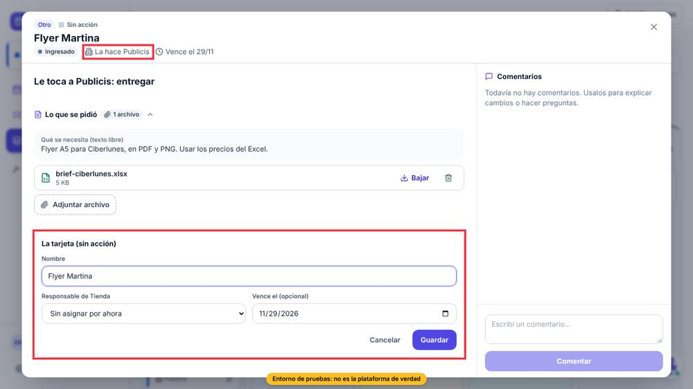

### H-083 · Las pruebas automáticas de `main` están en rojo (🟠)
- **Dónde:** CI de GitHub, desde el merge de #90 y #91: `test:externos` → `test:acceso`, «cada herramienta de un mundo
  tiene su permiso — /clientes-vip». Falta `/clientes-vip` en `REQUISITOS` de `frontend/lib/acceso.ts`.
- **Por qué importa:** todo PR nuevo nace en rojo. No es un agujero: la pantalla y la API sí bloquean (P49).

### H-008 · Generar cenefas con el motor nuevo termina en «Error desconocido» (🔴)
- **Quién:** equipo. **Dónde:** `/materiales/cenefas/v2` → «Guardar y Generar» → `/v2/generar`.
- **Cómo repetirlo:** cargar la plantilla «Base cenefa A4», sumar un cuadro, generar con el Excel de ejemplo.
- El camino viejo de Cenefas (P33) anda.

### H-025 · La burbuja de Don Tino tapa botones (🟠)
- **Quién:** el local (más que nadie), y el equipo. **Dónde:** «Confirmar pedido» y el sello «Confirmado» en Mi pedido,
  «Sacar foto» en el celular, «Validar placas», «Enviar» de La Triada, el último «Confirmar pedido» de la Planilla.
- Ya no tapa «Más» en el celular (#87).
- 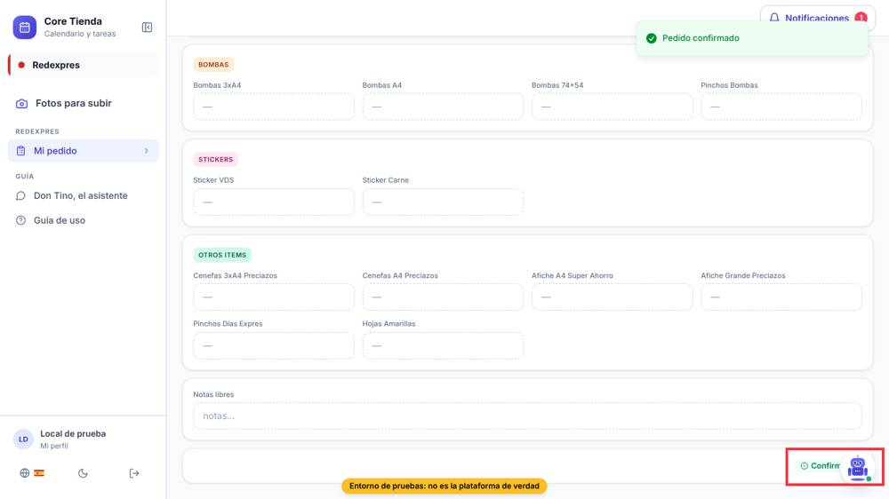

### H-023 · «Aprobar y terminar» aprueba con piezas faltantes sin preguntar (🟠)
- **Dónde:** ficha de la tarjeta, notebook y celular. La aprobada sigue diciendo en rojo «Faltan 4 piezas del pedido».

### H-036 · «Avanzar» con todo entregado pide «lo que falta» (🟠)
- **Dónde:** ficha de la tarjeta. La agencia lee «Te dieron el OK: entregá lo que falta (versión 4)» y no falta nada.
- 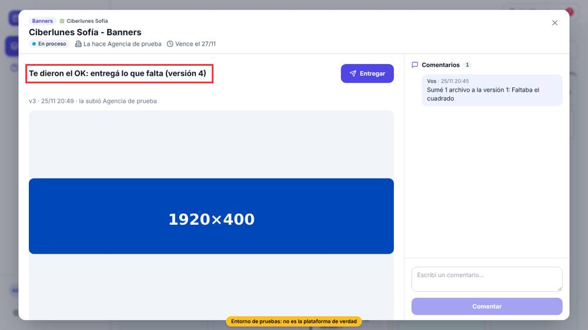

### H-089 · Comparar versiones pone dos piezas distintas (🟠)
- **Dónde:** ficha con v1 y v2, «Comparar con la versión 1»: el cuadrado de la v1 al lado del banner de la v2.
- 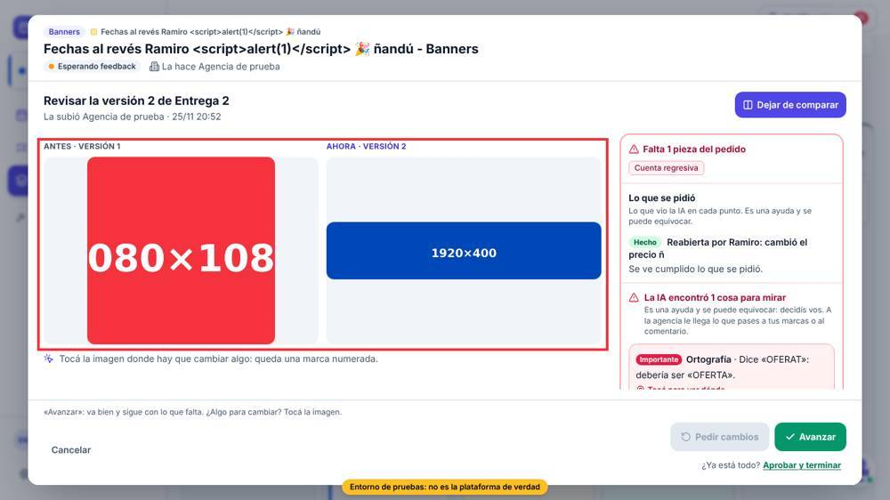

### H-090 · En el tablero del equipo, la agencia nueva no tiene su pestaña: cae en «Otras» (🟠)
- 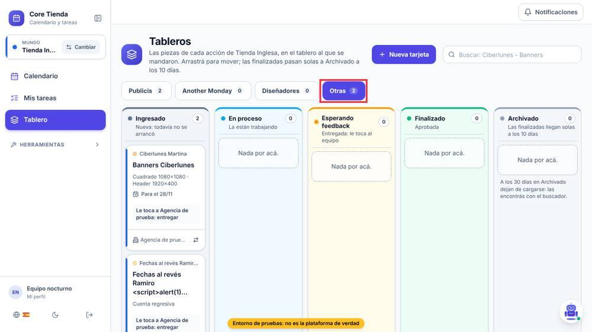

### H-086 · Desconfirmar un pedido del local: solo el superadmin, con una ✕ de 10 px (🟠)
- **Quién:** el gestor de Redexpres que no es superadmin no ve cómo destrabarle el pedido a un local (el servidor sí lo
  deja con `redexpres.manage`). Es la salida que pedía H-020.
- 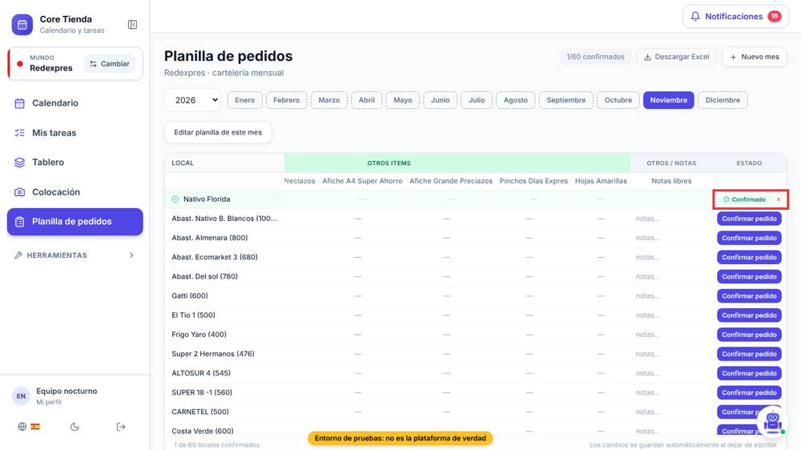

### H-085 · Mi pedido: una cantidad negativa queda escrita con «Error al guardar» (🟠)
- **Cómo repetirlo:** local → Mi pedido → escribir -5. El servidor no lo guarda pero la casilla lo sigue mostrando.
  2.5 se guarda como 2 sin avisar.
- 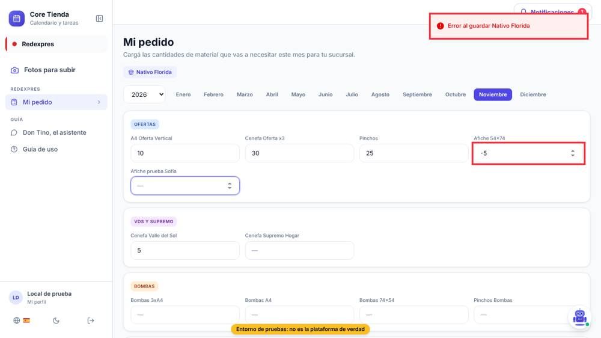

### H-084 · Al local le dejan llenar «Cambiar contraseña» y al final le dicen que no puede (🟠)
- 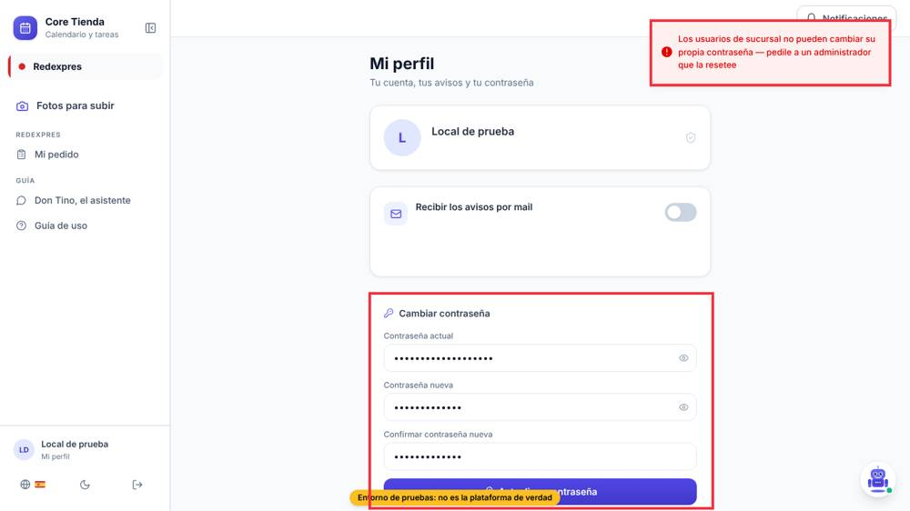

### H-087 · H-088 · H-100 · Clientes VIP (🟠 · 🟠 · 🟡)
- Con datos inventados: el eje del gráfico dice «0 M» en todas las rayas; el informe del mes es un mensaje de error
  (IA simulada; #91 lo toca: confirmar). Un mes imposible en el archivo dice «enero 2019 a undefined 2019» y rebota
  todo sin decir la fila. Con poca historia, todos salen «Creciendo, riesgo 0», aunque hayan bajado.
- 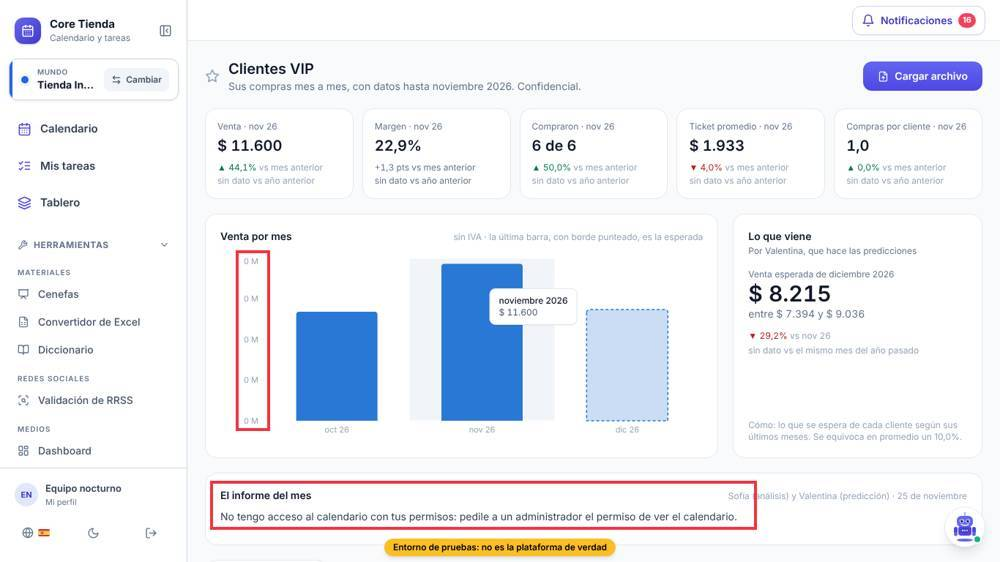
- 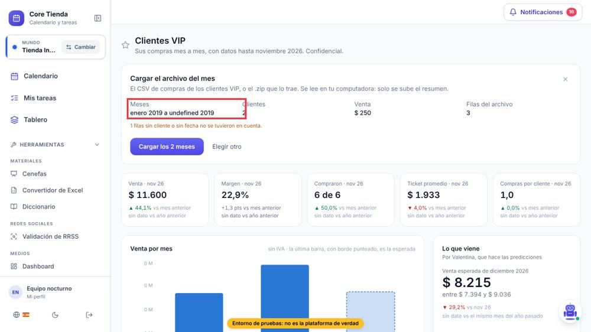
- 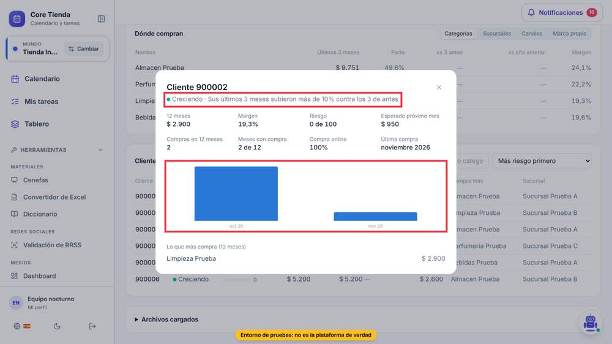

### H-012 · Pasado el bloqueo del login, un solo error vuelve a bloquear 15 minutos (🟠, confirmado)
- Probado con una cuenta descartable: 5 claves malas → bloqueo; al vencer, 1 mala → otros 15 min.

### H-091 · Una plantilla en una acción ya arrancada crea tareas vencidas (🟡)
- 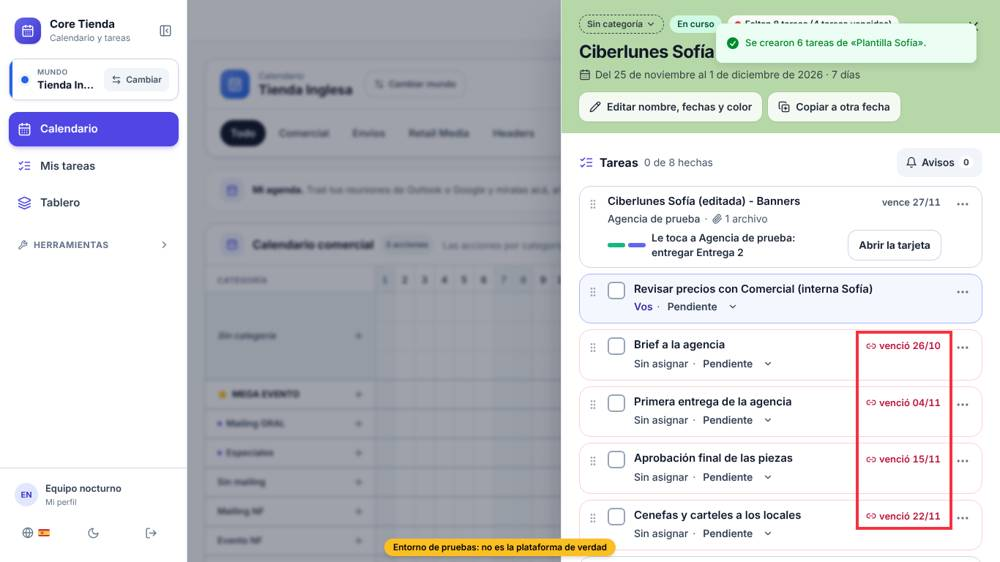

El resto (🟡 y ⚪) está en el [cuaderno](../CUADERNO.md), con capturas y cómo repetirlo: H-092 a H-109.

## 3. Lo que anda bien (y es nuevo)

- **Las entregas que van y vienen** (#86): la agencia suma archivos a la versión, manda v2 sin esperar, ve en rojo lo
  que le cambiaron, re-entrega desde el celular; el equipo compara, reabre y aprueba. A ciegas, en 20 minutos.
- **La agencia sin mundos** (#85): entra y ve su trabajo, nada más.
- **Una sola burbuja** (#87): una por pantalla (en Cenefas, Tinín; en Precios, Doña Tina).
- **Permisos:** cerrados en todo lo probado, también Clientes VIP.
- **Redexpres:** Planilla, Mi pedido y fotos de colocación andan de punta a punta.

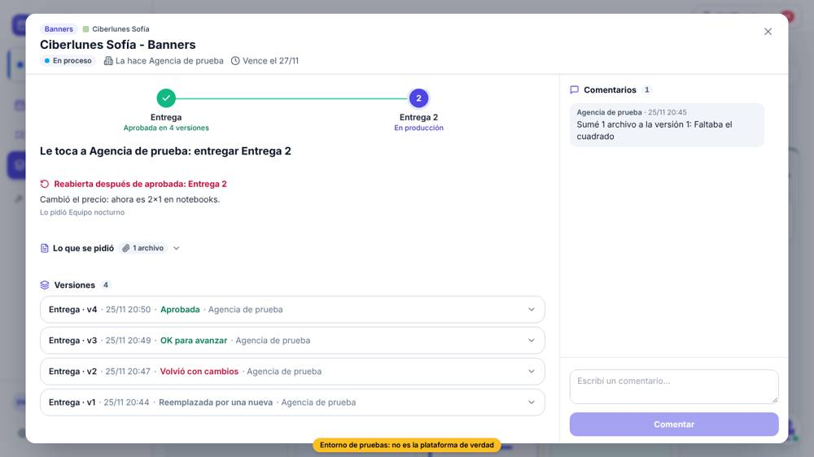

## 4. Lo que no se pudo probar

- Lo de afuera: precios reales, Meta/Google/GA4, Outlook/Google de verdad, mails que llegan, la IA real (Tinín, CatTi,
  DogTi y el informe de Clientes VIP fallan por la clave falsa: no es hallazgo).
- P38 (listas de monitoreo), por no haber productos sin internet.
- Arrastrar a Finalizado en la pantalla (H-005 solo por la API).
- #90 y #91, que entraron a `main` durante la corrida.

## 5. Prioridades para las próximas noches

1. **H-018 + H-090 · Pedirle trabajo a cualquier agencia.** Bloquea el ciclo entero con una agencia nueva, y es el
   principio de Ivan (varias agencias a la vez).
2. **H-083 · El CI de `main` en verde.** Es chico, y sin eso todo PR nuevo nace en rojo.
3. **H-025 · Que la burbuja no tape botones.** Pasa todos los días y en muchos lugares, y se arregla de una vez.
4. **H-023 + H-036 + H-035 · Revisar sin sorpresas.** Es lo que el equipo hace todos los días.
5. **H-089 + H-095 + H-097 · Pulir las versiones nuevas** mientras la gente las adopta.
6. **H-082 · Sugerencias de las agencias**, el pedido de Ivan, después del flujo de la agencia.
7. **H-085 + H-086 + H-084 + H-099 · Local y Redexpres sin trabas** (60 locales, todos los meses).
8. **H-087 + H-088 + H-100 · Clientes VIP confiable** (primero ver qué resolvió #91).
9. **H-001 · No borrar las entregas** (espera que Ivan diga cuándo).
10. **H-008 + H-043 · Cenefas del motor nuevo** (grande: primero entender por qué falla).
